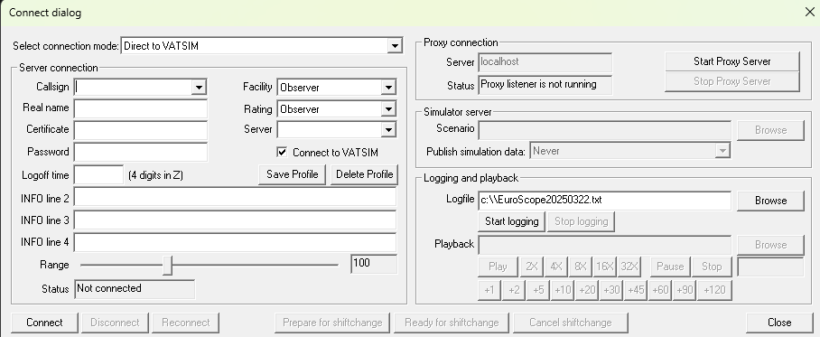
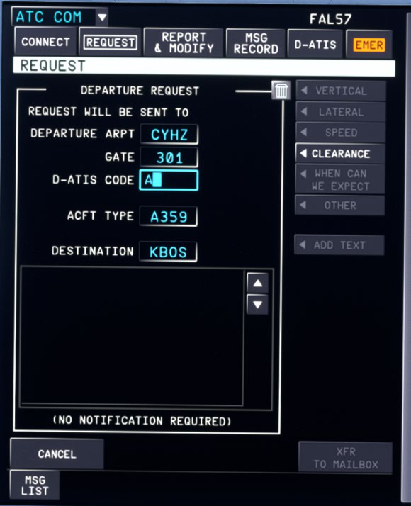
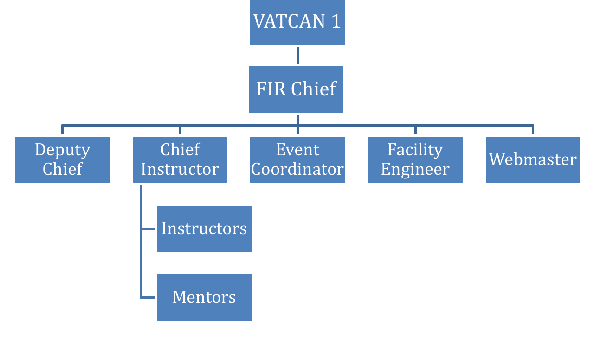

[1] # Control Pages

[1.1] # Document Identification

| Item           | Value                   |
| -------------- | ----------------------- |
| Name           | CZQM FIR General Policy |
| Identification | CZQM-FGP                |
| Type           | Policy                  |
| Revision       | 1.0                     |
| Effective Date | XXXXXX                  |

[1.2] # Revision Records

| Revision ID | Effective Date   | Description of Change                                     |
| ----------- | ---------------- | --------------------------------------------------------- |
| 1.0         | 2025-05-24 0300Z | Initial Release of this format. Replaces SOP Amendment 4. |

[2] # Introduction

[2.1] # Scope

[2.1(a)] This General Policy document is for use only in the CZQM / CZQX VATSIM Flight Information Region (FIR). It is meant for use in the sole context of virtual flight simulation and control. At no time shall it be used or referred to in a real-world context.

[2.1(b)] This document will serve as the policy document for this FIR. It replaces the previous Standard Operating Procedures (SOPs) format which has been divided into several documents. In addition to this policy document, there are now several procedural documents designed to guide internal operations and training processes and practices. Those subordinate documents do not contain FIR policy statements.

[2.1(c)] The Moncton / Gander FIR functions under the auspices of VATSIM and VATCAN. In case of disagreement between the contents of this document and guidance material published by either of the above, their policies and procedures will have precedence.

[2.1(d)] At any time, an update to this document is published, the FIR Chief or their delegate will notify the CZQM membership accordingly.

[2.1(e)] This document may be referred to as the FIR General Policy or FGP.

[2.1(e)(i)] References within this document will appear as follows: [[2.1(e)(i)]]

[2.1(e)(ii)] References from other documents will appear as follows: _CZQM-FGP§2.1(e)(i)_

[2.2] # Applicability

[2.2(a)] This document applies to all members of the FIR including home controllers, students, staff members, and visitors.

[2.2(b)] All member actions must comply with this policy when connected to the network or in other VATSIM related spaces (e.g. CZQM Discord Server, VATCAN TeamSpeak, VATSIM Discord Server, etc.)

[2.3] # Amendments

[2.3(a)] Amendments to this policy and all other policies published by the CZQM / QX FIR shall be tracked and versioned using the CZQM-FIR/policies GitHub repository

[2.3(b)] Amendments shall be tracked in a "Revision Records" table as found in

[2.4] # FIR Document Organization

[2.4(a)] This FIR General Policy covers all matters related to unit policy, as directed by VATSIM and VATCAN.

[2.4(b)] Several specific operating practices documents will provide easy to use guidance related to techniques, best practices, technical tool setups, etc. They will not contain policy statements. They will include:

- Tower Operating Practices, applicable to positions located within virtual air traffic control towers.
- Terminal Operating Practices, applicable to positions providing \_APP services.
- Centre Operating Practices, applicable to positions providing \_CTR services.
- Training Guidelines provides guidance on processes and mechanisms to facilitate training activities.

[2.4(c)] In addition to the above-mentioned documents, several short-term documents, inspired by actual practices, will be used to inform or guide FIR members. They are:

- Operations Letters. These documents introduce changes to procedures or operating practices. They remain valid until canceled or until their content is incorporated into the appropriate higher-level document.
- Operations Bulletins. These documents are temporary by nature and provide short-term guidance. They are valuable for such activities as events, operational tests, etc.
- Staff Memos. These documents are administrative in nature and are designed to provide information to FIR members.

[2.5] # Code of Conduct

[2.5(a)] All controllers shall maintain awareness of and comply with the VATSIM Code of Conduct, the VATSIM Global Controller Administration Policy, the VATCAN Division general Policy, as periodically amended. Controllers are also encouraged to be familiar with the VATSIM Code of Conduct Companion Document.

[2.5(b)] CZQM controllers are advised that they consistently represent this FIR and their fellow controllers when connected to VATSIM or affiliated services such as TeamSpeak and Discord.

[2.5(c)] The motto of VATSIM is to Aviate, Educate, Communicate. A large part of the Educate term is to exercise patience with new or errant pilots and provide them with constructive criticism, typically to avoid embarrassment. This FIR has a reputation as a safe and welcoming space which is important to us to retain.

[2.5(d)] Controllers are expected to be fully engaged in providing control services when logged in as controllers. It is not appropriate to be engaged in activities that result in distraction from the tasks at hand (e.g. playing video games). When traffic presents itself, controllers shall concentrate on delivering service to the traffic rather than engaging in other unrelated activities.

[2.5(e)] We expect the appropriate level of decorum and respect. EuroScope controller INFO lines are not the place to express individualism. They are meant to inform your customer pilots (see [[fig:euroscope-connect]]).

{#fig:euroscope-connect width=90% align=center}

Examples of appropriate controller information include:

- Aerodromes covered by the control position.
- Expected Logoff Time.
- Hyperlink to ATC Sector Split and Frequency Map.
- Hyperlink to local facility websites for pilot information or controller feedback.
- Availability of datalink services such as PDC, DCL or CPDLC.
- Hyperlink to ATC's personal live stream.[^1]

[^1]: Note: Inclusion of such a hyperlink makes the entire stream/recorded session including informal mediums such as a stream chat subject to the VATSIM Code of Conduct.

[2.5(f)] If a member violates VATSIM, VATCAN or FIR policy, they may be subject to disciplinary actions at the discretion of the CZQM FIR Chief and/or VATCAN1.

[2.5(g)] At the discretion of the CZQM FIR Chief and Chief Instructor, a student's training may be halted temporarily while a possible policy violation is investigated.

[2.5(h)] Potential disciplinary actions include:

- Counseling
- VATSIM Supervisory DCRM Referral
- Removal from CZQM

[3] # Training Policy and Standards

[3.1] # General

[3.1(a)] VATSIM air traffic controllers operate in a virtual environment alongside other virtual air traffic controllers and pilot "customers" to whom the provide services.

[3.1(b)] Although this is a hobby, we strive to provide services in as realistic a manner as is possible given the limitations within which we operate.

[3.1(c)] If someone has an issue or observation to make regarding a student being monitored by a mentor or instructor, that observation should be made privately to that mentor or instructor. This does not preclude adjacent controllers from coordinating directly with the student.

[3.2] # Expectations of Instructors and Mentors

[3.2(a)] Mentors and instructors guide and teach junior members. They are expected to lead by example. They are expected to have an increased knowledge of the documents mentioned in paragraph [[2.5(a)]] above as they apply to the instruction of new students, solo permissions and student promotions.

[3.2(b)] Instructor roles and responsibilities are detailed in paragraph [[7.7]] below this is a test.

[3.2(c)] Mentor roles and responsibilities are detailed in paragraph [[7.8]] below.

[3.3] # Student Progress and Expectations

[3.3(a)] Controlling in the VATSIM environment is not a race to the top. We aim to replicate the real-world air traffic control environment, as it exists in Canada, to the degree possible given the virtual environment we operate in. This requires dedication, practice, and a significant amount of effort to learn the rules, regulations, procedures, phraseologies, tools, and methods.

[3.3(b)] Volunteers develop and provide training. Students shall be respectful of instructors and mentors by presenting themselves to training sessions well prepared and ready to learn. Harassing behaviour by pressuring training staff for more time and sessions or not complying with administrative processes outlined in the FIR Training Document are unlikely to yield the desired effect.

[3.3(c)] The training process at each level includes Computer Based Training modules, orientation sessions, Sweatbox simulator sessions, and supervised live sessions before the student graduates to a solo certification to polish the learned skills. Except for ground training, there will be an Over the Shoulder (OTS) evaluation to confirm that the student has attained the required proficiency and is ready to be promoted.

[3.4] # Student Behaviour

[3.4(a)] Students are expected to:

[3.4(a)(i)] Exercise patience and understanding with their instructional staff, colleagues, and pilots.

[3.4(a)(ii)] Study the assigned training and reference material as required to be prepared to properly receive each training module.

[3.4(a)(iii)] Arrive on time and prepared for each scheduled training session.

[3.4(a)(iv)] Inform their Mentor or Instructor as soon as possible if they will not be able to attend a scheduled training or monitoring session.

[3.4(a)(v)] Not press for the provision of training sessions in a manner which may be considered harassment[^2].

[^2]: Harassment in this context is defined as unwelcome conduct that a reasonable person would consider humiliating, intimidating, or abusive.

[3.4(a)(vi)] Utilize opportunities such as logging in as Observer (\_OBS) to learn through examples of others.

[3.5] # Promotions

[3.5(a)] Ratings and promotions are to be actioned by the Chief Instructor, FIR Chief, or FIR Deputy Chief, following recommendations and assurances that all required competencies are met.

[4] # Controlling Policy

[4.1] # Control Authorization

[4.1(a)] Controllers must be authorized by the FIR chief, or their delegate, to connect to a non-observer position within the CZQM/CZQX FIR.

[4.1(b)] A student with a solo endorsement may only exercise the privileges of that endorsement to control the position to which their solo pertains. Soloing students may control other positions if being monitored or supervised by a mentor or instructor.

[4.1(c)] Moncton Centre (CZQM_CTR) and Gander Centre (CZQX_CTR) are enroute sectors and as such require the appropriate Tier 2 controller endorsement. All other positions in this FIR are "unrestricted."

[4.2] # Currency

[4.2(a)] Home and visitor controllers are encouraged to connect and control routinely to maintain proficiency. Although an area or airport may not be seeing traffic when you consider connecting, the adage "connect and they shall come..." does seem to apply...

[4.2(b)] All controllers, whether home or visitors, must control at least three (3) hours per standard calendar quarter within the CZQM FIR to maintain currency.

[4.2(c)] CZQM controllers who are visitors in other Divisions or Subdivisions must control at least 50% of their controlling hours at their home FIR in each quarter.

[4.2(d)] A controller may request a Leave of Absence from the FIR Chief should they not be able to maintain the minimum controlling hours. The leave period will end either on the expiry date or when a controlling session is logged.

[4.2(e)] A controller may be marked as inactive if they fail to meet the activity requirements for any given calendar quarter unless a Leave of Absence has been obtained.

[4.2(f)] An inactive controller will be notified by email and would need to recertify with an instructor prior to connecting to the VATSIM network as a controller. This recertification will be done without disruption to training and may not be prioritized.

[4.2(g)] A controller may be removed from the roster without prior notice at the discretion of the FIR Chief, or their delegate, following two (2) consecutive quarters of inactivity, unless the controller has justified their absence by email to chief@czqm.ca

[4.2(h)] C1+ visiting controllers who fail to maintain CZQM currency within a quarter may be marked as Inactive at the Centre level and may require recertification at the discretion of the Chief Instructor.

[4.2(i)] A visiting controller may be removed from the visitor roster without prior notice at the discretion of the FIR Chief, or their delegate, following two (2) consecutive quarters of inactivity without communication with FIR staff.

[4.3] # Leaves of Absence

[4.3(a)] Members & visitors may request a Leave of Absence should external factors prohibit them from fulfilling the quarterly requirements as a home member/visitor or when absence is expected to be greater than six (6) months. The purpose of a Leave of Absence is not to enable a member to focus on controlling for an outside division.

[4.3(b)] All Leaves of Absence are subject to approval by the FIR Chief or their delegate.

[4.3(c)] Conditions of Leaves of Absence

[4.3(c)(i)] Only one (1) leave period may be granted per 18 months.

[4.3(c)(ii)] A Leave of Absence period shall not exceed 6 months.

[4.3(c)(iii)] A Leave of Absence will only be granted if the controller has maintained currency in the previous quarter.

[4.3(c)(iv)] Once a controller connects to the network for the purpose of controlling, the leave of absence terminates and currency requirements resume as outlined in [[4.2]] above.

[4.3(c)(v)] Upon returning to active status, a controller may be subject to a refresher course to obtain currency, at the discretion of the Chief Instructor.

[4.4] # Visiting / Transferring Controllers

[4.4(a)] Although permissible under certain conditions, S3 Student controllers are asked not to visit any other FIRs or Divisions until they have reached a rating of C1.

[4.4(b)] Student controllers have not yet achieved the required proficiency at home. The introduction of different procedures and processes from elsewhere is likely to negatively affect home learning.

[4.5] # Return from Inactivity

[4.5(a)] Controllers removed from the FIR due to inactivity and wishing to return must use the VATCAN transfer system to reapply to the FIR. Currency training might be necessary upon the decision of the Chief Instructor.

[4.6] # Letters of Agreement

[4.6(a)] Controllers shall comply with the current Letters of Agreement (LoAs) with adjacent FIRs as published in the CZQM website.

[4.7] # Phraseology

[4.7(a)] The use of consistent and approved phraseology is critical in Air Traffic Management.

[4.7(b)] Local and visiting controllers are reminded that non-Canadian phraseology and unofficial pet phrases can easily creep in to communications. Their use is strongly discouraged.

[4.7(c)] Controllers shall make use of official phraseology, as made available by official Canadian sources. A partial list of these sources will be maintained in the CZQM.CA controller resources area.

[4.7(d)] A Moncton / Gander phraseology guide will be available in that same area. It should not be considered authoritative. In case of disagreement between it and official sources, the official document shall prevail.

[4.8] # Pre Departure Clearances (PDC) / Departure Clearance (DCL)

[4.8(a)] PDCs and DCLs are a means of transmitting an initial IFR Clearance to a departing aircraft by means of messaging.

[4.8(b)] PDC / DCL:

[4.8(b)(i)] PDC is transmitted to the aircraft via its company.

[4.8(b)(ii)] DCL is transmitted to the aircraft directly, following a request for it.

[4.8(b)(iii)] Some modern flight simulator aircraft have implemented requests for departure clearance into their avionics (see [[fig:departure-request]]).

{#fig:departure-request width=40% align=center}

[4.8(c)] Under certain circumstances, transmitting PDC / DCL may result in reduced ATC workload and a reduction of readback / hear-back errors.

[4.8(d)] From the S2 level onwards, the use of PDC / DCL is supported but not compulsory. It will be the individual controller's decision to do so or not.

[4.8(e)] Should the controller decide to offer PDC / DCL, the following shall apply:

[4.8(e)(i)] A PDC may be transmitted via a frequency chat alias message, using the standard format as provided by the FIR.

[4.8(e)(ii)] A DCL may be transmitted in response to a clearance request message by a suitably equipped aircraft via the Hoppie ACARS Network. This will require the use of a suitable plug-in: vSMR or TopSky.

[4.9] # Controller Pilot Datalink Communications (CPDLC)

[4.9(a)] CPDLC is a modern means of communicating between pilots and controllers which has been in operational use in Canada for many years. It enables pilots to make requests and for controllers to issue clearances and instructions.

[4.9(b)] Within VATSIM, CPDLC is currently operated courtesy of Hoppie's ACARS which is acting as a Communications Service Provider.

[4.9(c)] CPDLC is not suitable for high intensity interactions with pilots, such as terminal services. CPDLC is available for communicating with enroute aircraft operating at and above FL290.

[4.9(d)] CPDLC has been shown to reduce communications workload and mitigate some voice communications issues.

[4.9(e)] Several modern flight simulator aircraft have implemented CPDLC into their aircraft and this trend is expected to increase.

[4.9(f)] Controllers are encouraged, but not obligated, to provide CPDLC service.

[4.9(g)] Currently, EuroScope Plug-ins VATCANSitu and TopSky have integrated CPDLC functionality into their products.

[4.9(h)] In accordance with AIP Canada GEN 3.4.4.2, the following CPDLC addresses shall be used, as applicable:

| Facility Name                         | Facility Identifier for AFN logon |
| ------------------------------------- | --------------------------------- |
| Gander Area Control Centre (Domestic) | CDQX                              |
| Gander Area Control Centre (Oceanic)  | CZQX (for info)                   |
| Moncton Area Control Centre           | CZQM                              |

[5] # Software Use Policy

[5.1] # Controller Client and Plug-Ins

[5.1(a)] Controllers are limited to using approved software as listed in the VATSIM Approved Software document.

[5.1(b)] Controllers should use the current CZQM officially distributed sector files.

[5.1(c)] Student controllers shall limit themselves to the use of plug-ins that are fit for purpose and supported by the FIR.

[5.1(d)] Controllers with a C1 rating or higher may use additional plug-ins to supplement their controlling sessions. Their use of this software shall not adversely affect their control service or that of others.

[5.2] # Automated Terminal Information Service (ATIS)

[5.2(a)] ATIS broadcasts may only be published by a controller who has attained solo certification at that airport or S2 rating and above.

[5.2(b)] The VATSIM policy regarding ATIS is contained in the Air Traffic Control Frequency and Information Management document. Controllers are asked to refrain from including operational information that is not applicable or cannot be implemented effectively in the VATSIM environment. This includes such items as closed runways / taxiways; disabled aircraft; bird or construction activity; etc. Should Runway Surface Conditions be published, controllers are reminded of the risk of retaining obsolete information. As such, publishing RSCs in an ATIS is discouraged.

[5.2(c)] ATIS broadcasts shall be transmitted using EuroScope or vATIS, the latter being preferred. When using vATIS, the CZQM/CZQX supplied weather profiles shall be not be modified. C1+ controllers are allowed to modify the ARPT COND section to insert airport conditions such as Runway Surface Condition reports, SIGMETs, or the availability of PDC/DCL services, as mentioned in [[5.2(b)]] above.

[5.3] # TeamSpeak

[5.3(a)] Controllers must be connected to the VATCAN TeamSpeak server in a CZQM channel while controlling within the FIR, unless coordinating operations with an adjacent unit. The connection should be made prior to logging into a position.

[5.3(b)] The purpose of the TeamSpeak channels is to facilitate coordination between controllers. As such, a controller TeamSpeak nickname should reflect the individual's name. As these channels are by invitation only, we believe that the appropriate degree of privacy protection from the public is provided.

[5.3(c)] Controllers shall not be deafened for an extended period while connected. Should they need quiet, they should move to an appropriate channel under the "ACC" sections. These channels are reserved for coordination purposes only.

[5.3(d)] Instructors or mentors should use training channels while working with students unless it is operational advantageous to join an operational coordination channel. It is not permitted to use the training channels for non training related purposes.

[5.4] # Streaming and Recording

[5.4(a)] Controllers who wish to stream or record their controlling sessions may do so in accordance with VATSIM COC A18.

[5.4(b)] Students who are controlling under a solo endorsement shall not record or stream their controlling sessions.

[5.4(c)] Students working with mentors or instructors for training purposes, either sweatbox or on the network, shall not record or stream their controlling sessions.

[5.4(d)] Controllers shall not stream any audio from the VATCAN TeamSpeak or CZQM Discord server.

[6] # Administration

[6.1] # Policy Change Communication

All updates to policy and procedures documents shall be communicated to members of the FIR.

[6.2] # Policy Review

[6.2(a)] All policies must be reviewed annually to ensure accuracy.

[6.2(b)] Any guidance material issued pursuant to paragraphs [[2.4(b)]] and [[2.4(c)]] above shall be reviewed at least quarterly.

[6.3] # Contact

[6.3(a)] For questions regarding this document, or any other policy, please contact the FIR Chief: chief@czqm.ca

[6.3(b)] For questions regarding our training program or training related policies, please contact the Chief Instructor: instructor@czqm.ca

[7] # FIR Organizational Structure

The FIR organizational structure is shown in [[fig:org-chart]].

{#fig:org-chart width=85% align=center}

[7.1] # FIR Chief Duties / Roles

[7.1(a)] These Duties / Roles are enhanced from the VATCAN Policy as provided by the Director of VATCAN (VATCAN1)

[7.1(a)(i)] The FIR Chief shall, on a regular basis, keep the VATCAN Division Director informed of any issues within the FIR that may affect VATCAN itself.

[7.1(a)(ii)] Respond to communications on a timely basis from VATCAN when requested to do so.

[7.1(a)(iii)] Appoint, on a case-by-case basis, individuals for FIR positions, subject to this FIR General Policy, the VATCAN Policy and VATSIM Policy.

[7.1(a)(iv)] Maintain a website for the purpose of VATSIM/VATCAN policy with minimum requirements or delegate this responsibility to a webmaster (see [[7.6]] below).

[7.1(a)(v)] Participate in VATCAN Meetings and host meetings in the Moncton/Gander FIR.

[7.1(a)(vi)] Shall be selected by VATCAN1 in accordance with VATCAN policy.

[7.1(b)] A nominee for this position shall:

[7.1(b)(i)] Be a C1/C3 (or higher) Controller

[7.1(b)(ii)] Be a home controller of the Moncton/Gander FIR

[7.1(b)(iii)] Be well versed in MANOPS/MATs, FIR Policy, and VATCAN and VATSIM Policy Documents

[7.1(b)(iv)] Demonstrate commitment to spending time on the network.

[7.1(b)(v)] Demonstrate considerable skill and knowledge for their certified positions.

[7.1(b)(vi)] Have excellent oral and written communication skills.

[7.1(b)(vii)] Be well respected by their peers.

[7.1(b)(viii)] Be eager to learn new information, and willing to accept criticism in the interest of personal growth.

[7.1(b)(ix)] Show great patience through difficult situations.

[7.1(b)(x)] Be willing to follow the direction and duties as set out by the Director of VATCAN

[7.1(b)(xi)] Other requirements as set out by the VATCAN Divisional Director

[7.2] # Deputy FIR Chief Duties and Roles

[7.2(a)] These Duties / Roles expand upon those stated in the VATCAN Policy as provided by the Director of VATCAN (VATCAN1):

[7.2(a)(i)] Assist the FIR Chief with day-to-day operations of the FIR.

[7.2(a)(ii)] Assist the FIR Chief in maintaining Letters of Agreement and FIR Policy.

[7.2(a)(iii)] Assist the FIR Chief and Events Coordinator for larger events/operations.

[7.2(a)(iv)] Participate and host regular meetings where required.

[7.2(a)(v)] Act in the absence of the FIR Chief in accordance with CZQM-FGP§5.1.

[7.2(a)(vi)] Appointment to this position requires the approval of the VATCAN Division Director.

[7.2(b)] A nominee for this position shall:

[7.2(b)(i)] Be a C1/C3 (or higher) Controller

[7.2(b)(ii)] Be a home controller of the Moncton/Gander FIR

[7.2(b)(iii)] Have logged 50 hours online with a C1 (or higher) rating in their home FIR.

[7.2(b)(iv)] Be well versed in MANOPS/MATs, FIR policies, and VATCAN/VATSIM Policy Documents

[7.2(b)(v)] Demonstrate commitment to spending time on the network.

[7.2(b)(vi)] Demonstrate considerable skill and knowledge for their certified positions.

[7.2(b)(vii)] Have excellent oral and written communication skills.

[7.2(b)(viii)] Be well respected by their peers.

[7.2(b)(ix)] Be eager to learn new information, and willing to accept criticism in the interest of personal growth.

[7.2(b)(x)] Show great patience through difficult situations.

[7.2(b)(xi)] Be willing to follow the direction and duties as set out by the FIR Chief and the Director of VATCAN.

[7.2(b)(xii)] Other requirements as set out by the VATCAN Divisional Director

[7.3] # Chief Instructor Duties and Roles

[7.3(a)] These Duties / Roles expand upon those stated in the VATCAN Policy as provided by the Director of VATCAN (VATCAN1):

[7.3(a)(i)] Maintain a list of all current Instructors and Mentors within the Moncton/Gander FIR.

[7.3(a)(ii)] Maintain a list of all current students.

[7.3(a)(iii)] Maintain a waiting list of students on a first come, first serve basis.

[7.3(a)(iv)] Maintain an open communication with all FIR Students.

[7.3(a)(v)] Report on a regular basis any issues affecting the Moncton/Gander FIR to the FIR Chief and the VATCAN Director of Training (VATCAN3)

[7.3(a)(vi)] All other duties as set out for Instructors under this Policy.

[7.3(a)(vii)] Provide guidance to all instructors on current policies and training standards.

[7.3(a)(viii)] Recommend potential instructors/mentors for divisional training/orientation where required.

[7.3(a)(ix)] Appointment to this position requires the approval of the VATCAN Chief Instructor.

[7.3(b)] A nominee for this position shall:

[7.3(b)(i)] Be a C1/C3 (or higher) Controller

[7.3(b)(ii)] Have logged 50 hours online with a C1 (or higher) rating in their home FIR.

[7.3(b)(iii)] Be well versed in MANOPS/MATS, FIR policies, and VATCAN/VATSIM Policy Documents

[7.3(b)(iv)] All other nominee requirements as laid out for instructors under this policy.

[7.3(b)(v)] Be a home controller with the Moncton/Gander FIR

[7.3(b)(vi)] Other requirements as set out by the VATCAN Divisional Director

[7.4] # Events Coordinator Duties and Roles

[7.4(a)] These Duties / Roles expand upon those stated in the VATCAN Policy as provided by the Director of VATCAN (VATCAN1):

[7.4(a)(i)] Report to the FIR Chief with new and report all requests for events involving the Moncton/Gander FIR.

[7.4(a)(ii)] Acquire approvals from the FIR Chief for new events and public postings.

[7.4(a)(iii)] Liaise with the VATCAN Events Coordinator (VATCAN5) for the publication of new events such as Over the Shoulder Examinations (OTS's)

[7.4(a)(iv)] On a regular basis, maintain a presence on social media platforms used by the FIR. This includes posting of regular and special events.

[7.4(a)(v)] Responsible for coordinating events between adjacent FIRs.

[7.4(a)(vi)] Responsible for the coordination of the controllers for the events.

[7.4(a)(vii)] To receive and respond in a timely fashion to requests from Virtual Airlines or other community groups for events.

[7.4(a)(viii)] Participate in regular meetings where required.

[7.4(b)] A nominee for this position shall:

[7.4(b)(i)] Be capable of producing graphics related to OTS and Events.

[7.4(b)(ii)] Be well versed in FIR Policies, and VATCAN/VATSIM Policy Documents

[7.4(b)(iii)] Demonstrate commitment to spending time on the network.

[7.4(b)(iv)] Have excellent oral and written communication skills.

[7.4(b)(v)] Be well respected by their peers.

[7.4(b)(vi)] Be eager to learn new information, and willing to accept criticism in the interest of personal growth.

[7.4(b)(vii)] Show great patience through difficult situations.

[7.4(b)(viii)] Be willing to follow the direction and duties as set out by the FIR Chief.

[7.4(b)(ix)] Be a home controller with the Moncton/Gander FIR

[7.4(b)(x)] Other requirements as set out by the VATCAN Divisional Director

[7.5] # Facility Engineer Duties and Roles

[7.5(a)] These Duties / Roles expand upon those stated in the VATCAN Policy as provided by the Director of VATCAN (VATCAN1):

[7.5(a)(i)] Report to the FIR Chief on a regular basis.

[7.5(a)(ii)] Is responsible for the regular maintenance of the FIRs sector file.

[7.5(a)(iii)] Provide regular updates of the FIRs sector file(s) to the VATCAN's executive team.

[7.5(a)(iv)] Provide regular updates of the FIRs sector file(s) to the FIR membership that include AIRAC updates.

[7.5(a)(v)] Assist the Moncton/Gander FIR membership with issues surrounding EuroScope and the sector files.

[7.5(a)(vi)] Implementation of evolving technologies as developed by VATSIM and VATCAN

[7.5(a)(vii)] Assist the Moncton/Gander FIR staff for the planning and implementation of large events such as Cross the Pond (CTP).

[7.5(a)(viii)] Must be a home controller with the Moncton/Gander FIR

[7.5(b)] A nominee for this position shall:

[7.5(b)(i)] Be capable of using the software and tools required to produce and edit sector files and other configuration files.

[7.5(b)(ii)] Be capable of learning, adapting, configuring, and using new software and tools (plug-ins) to benefit the FIR.

[7.5(b)(iii)] Be well versed in FIR Policies, and VATCAN/VATSIM Policy Documents

[7.5(b)(iv)] Demonstrate commitment to spending time on the network.

[7.5(b)(v)] Have excellent oral and written communication skills.

[7.5(b)(vi)] Be well respected by their peers.

[7.5(b)(vii)] Be eager to learn new information, and willing to accept criticism in the interest of personal growth.

[7.5(b)(viii)] Show great patience through difficult situations.

[7.5(b)(ix)] Willing to follow the direction and duties as set out by the FIR Chief.

[7.5(b)(x)] Be a home controller with the Moncton/Gander FIR

[7.5(b)(xi)] Other requirements as set out by the VATCAN Divisional Director

[7.6] # Webmaster Duties and Roles

[7.6(a)] These Duties / Roles expand upon those stated in the VATCAN Policy as provided by the Director of VATCAN (VATCAN1):

[7.6(a)(i)] Develop and maintain the FIR's Official Website including a roster, events system, news system, resources section, and more.

[7.6(a)(ii)] Manage email services for all FIR Staff

[7.6(b)] A nominee for this position shall:

[7.6(b)(i)] Be an active member of the network, in good standing.

[7.6(b)(ii)] Hold an S1 Rating or higher.

[7.6(b)(iii)] Demonstrate previous experience in web development.

[7.6(b)(iv)] Be a home controller with the Moncton/Gander FIR

[7.6(b)(v)] Other requirements as set out by the VATCAN Divisional Director

[7.7] # Instructor Roles and Responsibilities

[7.7(a)] These Duties / Roles are enhanced from the VATCAN Policy as provided by the Director of Training (VATCAN3)

[7.7(a)(i)] Act as role models and lead the controlling team by example.

[7.7(a)(ii)] Support student controllers in their learning process.

[7.7(a)(iii)] Abide by all VATSIM, VATCAN, and local FIR Training Procedures (including, but not limited to the Global Controller Administration Policy (GCAP), VATCAN Division General Policy, etc.)

[7.7(a)(iv)] Provide initial and continuing instruction to students aspiring to higher controller ratings.

[7.7(a)(v)] Provide initial and continuing instruction to controllers seeking authorization for special positions that require separate authorization from a basic controller rating.

[7.7(a)(vi)] Supervise students online who have not yet achieved sufficient competency for solo operation in each position.

[7.7(a)(vii)] Operate Sweatbox training sessions as needed for initial/continuing instruction.

[7.7(a)(viii)] Maintain written training records in a central repository accessible to other trainers, FIR Staff, and VATCAN Staff

[7.7(a)(ix)] Monitor and report on the progress of students that may be assigned to them.

[7.7(a)(x)] Perform duties as directed by the Chief Instructor. These may include:

[7.7(a)(x)(I)] Assign written exams.

[7.7(a)(x)(II)] Recommend students for solo endorsements.

[7.7(a)(x)(III)] Recommend students for an OTS Evaluation.

[7.7(a)(x)(IV)] Conduct OTS Evaluations.

[7.7(b)] Nominee Requirements

[7.7(b)(i)] Be a C1/C3 (or higher) Controller

[7.7(b)(ii)] Must have logged a minimum of 50 hours online with a C1 (or higher) rating in their home FIR.

[7.7(b)(iii)] Well versed in MANOPS/MAPs, FIR policies, and VATCAN/VATSIM Policy Documents.

[7.7(b)(iv)] Demonstrated Commitment to spending time on the network.

[7.7(b)(v)] Considerable skill and knowledge for their certified positions.

[7.7(b)(vi)] Excellent Oral and Written Communications Skills.

[7.7(b)(vii)] Well respected by their peers.

[7.7(b)(viii)] Eager to learn new information, and willing to accept criticism in the interest of personal growth.

[7.7(b)(ix)] Shows great patience through difficult situations.

[7.7(b)(x)] Willing to follow the training curriculum as specified by the Director of Training and their FIR Chief Instructor.

[7.7(b)(xi)] Provide at least the minimum amount of instruction as directed by the Chief Instructor.

[7.7(c)] Instructors who cease to be involved in training, will revert to their previous rating.

[7.7(d)] Instructor candidates will be recommended by their FIR Chief or FIR Chief Instructor and approved by the VATCAN Director of Training.

[7.8] # Mentors Roles and Responsibilities

[7.8(a)] These Duties / Roles are enhanced from the VATCAN Policy as provided by the Director of Training (VATCAN3)

[7.8(a)(i)] Abide by all VATSIM, VATCAN, and Local FIR Training Policies.

[7.8(a)(ii)] Act as role models and influence others by example.

[7.8(a)(iii)] Provide monitoring and guidance to students aspiring to higher controller ratings or additional position authorizations.

[7.8(a)(iv)] Supervise students online as required.

[7.8(a)(v)] May be permitted to run sweatbox sessions to allow students extra opportunities to practice their skills.

[7.8(a)(vi)] Make written training notes, in a central repository accessible to other trainers, FIR Staff, and VATCAN Staff.

[7.8(a)(vii)] Generally, provide support to students in their learning process.

[7.8(b)] Mentors shall not:

[7.8(b)(i)] Provide a student their first lesson in any given position (online or in sweatbox)

[7.8(b)(ii)] Provide guidance to other students at their same level.

[7.8(c)] Nominee Requirements

[7.8(c)(i)] Must be an S3 (or higher) Controller.

[7.8(c)(ii)] Must have logged a minimum of 25 hours online in their home FIR at their current rating.

[7.8(c)(iii)] Be well versed in MANOPS/MAPs, FIR policies, and VATCAN/VATSIM Policy Documents

[7.8(c)(iv)] Demonstrated Commitment to spending time on the network.

[7.8(c)(v)] Considerable skill and knowledge for their certified positions.

[7.8(c)(vi)] Demonstrate excellent Oral and Written Communications Skills.

[7.8(c)(vii)] Be well respected by their peers.

[7.8(c)(viii)] Be eager to learn new information, and willing to accept criticism in the interest of personal growth.

[7.8(c)(ix)] Demonstrate great patience through difficult situations.

[7.8(d)] Mentors must receive approval from their Chief Instructor or FIR Chief to be permitted to conduct sweatbox sessions. Chiefs/CIs will forward the name of any mentor approved for sweatbox sessions to the Director of Training (VATCAN3), who will maintain a list of sweatbox-authorized mentors. Not all mentors will be permitted to run sweatbox sessions.

[7.8(e)] Mentors will normally be selected by their FIR Chief or FIR Chief Instructor as needed and is normally a purely internal FIR assignment, unless the S3 requirement needs to be waived.
