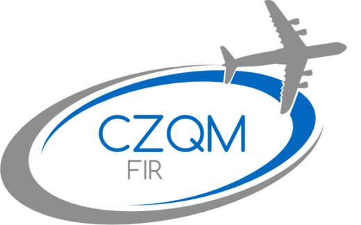

[100] CYHZ Airport

This authority is issued by the CZQM FIR ([[fig:czqm-fir-logo]]).

{#fig:czqm-fir-logo width=30% align=center}

[100.1] Tower release (TR) is automatically granted once confirmation of the active runway is communicated.

[100.2] Should YHZ_TWR utilize a non-active runway for departure, they must obtain a TR from the position covering YHZ_APP.

[100.3] A TR request may be verbally processed or through the use of the VATCANSitu release request function. If the Tower prefers VATCANSitu, inform the departure controller so they can be vigilant of requests.

[200] All other CZQM/CZQX Airports

[200.1] All other airports in the CZQM/CZQX FIR require prior coordination of a TR.

[200.2] The radar position covering terminal or departure services may authorize blanket TR authority depending on their circumstances.

[200.3] TR requests are processed as described in [[100.3]].