[1] # Control Pages

[1.1] # Document Identification

| Item           | Value                           |
| -------------- | ------------------------------- |
| Name           | CZQM FIR Centre Airspace Manual |
| Identification | CZQM-AM                         |
| Type           | Airspace Manual                 |
| Revision       | 2.1                             |
| Effective Date | To be confirmed                 |

[1.2] # Revision Records

| Revision ID | Effective Date   | Description of Change |
| ----------- | ---------------- | --------------------- |
| 2.0         | 2025-11-29 0400Z | Initial release |
| 2.1         | To be confirmed  | High volume sectorization added ([[5.1(c)]]). Frequencies aligned with the FIR frequency file (Liveatc.txt): Digby CZQM_DG_CTR 123.8, CZQM_L_APP 119.2, LFVP_APP 119.1 / LFVP_TWR 118.5, CTP CZQM_4_CTR 123.7. Reformat document to use CZQM docengine. [[2.3]] reflects new git based tracking. |

[2] # Introduction

[2.1] # Scope and Applicability

[2.1(a)] This document is intended to provide operational guidance to CZQM controllers providing services to virtual pilots. This document only reflects the virtual airspace limitations of the CZQM FIR a division of VATCAN on the VATSIM network. At no time shall this document be used for real-world navigation.

[2.1(b)] Our FIR’s sectorization is inspired by the actual NAV CANADA airspace allocations. It has been adapted to suit our particular operational requirements. The airspace allocated to the Moncton and Gander FIRs is treated as one and is subdivided based on our needs and preferences.

[2.1(c)] This document reflects our day-to-day operation. During high volume events, such as Cross-the-Pond (CTP) the airspace will be further subdivided, and the details will be provided in a timely manner, as required.

[2.1(d)] Position versus Sector. A position is what is operated by an individual controller. A controller logs into a position. A sector is a volume of airspace for which a position is responsible. Such volumes vary based on which other positions are active.

[2.2] # Copyright and Fair Dealing Notice

[2.2(a)] This material contains images, navigation data, and screen captures from Navigraph™ (data licensed from Jeppesen®, a Boeing company), NAV CANADA®, and the AeroNav Association (GNG system © AeroNav Association 2013–2025), as well as works of His Majesty the King in Right of Canada. These materials are used under fair dealing for educational and illustrative purposes in accordance with the Canadian Copyright Act. All rights in the original works are retained by their respective copyright and trademark holders.

[2.3] # Amendments

[2.3(a)] Amendments to this document are tracked and versioned using the CZQM-FIR/policies GitHub repository.

[3] # Master Position and Frequency Table
The following table covers the normal CZQM / CZQX working positions and their parameters

| Position Class | Login Profile | ID code | Frequency | Comment                        |
| -------------- | ------------- | ------- | --------- | ------------------------------ |
| Centre         | CZQM_CTR      | QM      | 132.2     |                                |
| ^              | CZQX_CTR      | QX      | 132.1     |                                |
| ^              | CZQM_DG_CTR   | DG      | 123.8     | Digby                          |
| ^              | CZQM_CB_CTR   | CB      | 118.6     | Cape Breton                    |
| Terminal       | CYHZ_APP      | HZA     | 119.2     |                                |
| ^              | CYHZ_FI_APP   | HA2     | 128.55    | Halifax arrival                |
| ^              | CYQM_APP      | QMA     | 124.4     |                                |
| ^              | CYSJ_APP      | SJA     | 124.3     |                                |
| ^              | CYZX_APP      | ZXA     | 120.6     |                                |
| ^              | CZQM_L_APP    | QML     | 119.2     | Consolidated ‘mega’ terminals  |
| ^              | CYQX_APP      | QXA     | 128.5     |                                |
| ^              | CYYR_APP      | YRA     | 119.5     |                                |
| ^              | CYYT_APP      | YTA     | 133.15    |                                |
| ^              | LFVP_APP      | VA      | 119.1     |                                |
| Tower          | CYFC_TWR      | FCT     | 119.0     |                                |
| ^              | CYHZ_TWR      | HZT     | 118.4     |                                |
| ^              | CYQM_TWR      | QMT     | 120.8     |                                |
| ^              | CYZX_TWR      | ZXT     | 119.5     |                                |
| ^              | CYQX_TWR      | QXT     | 118.1     |                                |
| ^              | CYYR_TWR      | YRT     | 119.1     |                                |
| ^              | CYYT_TWR      | YTT     | 120.6     |                                |
| ^              | LFVP_TWR      | VT      | 118.5     |                                |
| Ground         | CYFC_GND      | FCG     | 121.7     |                                |
| ^              | CYHZ_GND      | HZG     | 121.9     |                                |
| ^              | CYQM_GND      | QMG     | 121.8     |                                |
| ^              | CYZX_GND      | ZXG     | 133.75    |                                |
| ^              | CYQX_GND      | QXG     | 121.9     |                                |
| ^              | CYYR_GND      | YRG     | 121.9     |                                |
| ^              | CYYT_GND      | YTG     | 121.9     |                                |
| DELIVERY       | CYHZ_DEL      | HZD     | 123.95    |                                |
| ^              | CYZX_DEL      | ZXD     | 128.025   |                                |
| ^              | CYYR_DEL      | YRD     | 118.1     |                                |

ATIS frequencies are as per the vATIS profiles.

[4] # Airspace Management

[4.1] # General
We provide services within both the CZQM and CZQX FIRs, plus the airspace delegated to us by Gander Oceanic, New York Oceanic and Montreal.

In the Gulf of St-Lawrence / Lower Labrador area, the Montreal FIR has delegated its High-Level Airspace to us.

Controlled airspace within the Moncton and Gander FIRs begins at 2200 feet Above Sea Level (ASL), except in the vicinity of certain airports where it extends to the ground.

There is a significant volume of uncontrolled (Class G) airspace in Northern New Brunswick.

Control services only apply within controlled airspace.

We also have some Special Use Airspace (Class F) that require special treatment, including prohibited access.

[4.2] # Classes of Airspace

| Class | General Applicability | Requirements | Services |
| ----- | --------------------- | ------------ | -------- |
| A | FL180 and above | 2-way comms; Transponder; ATC Clearance; No VFR | Separation provided between all aircraft |
| B | Above 12500 ASL – Below FL180 | 2-way comms; Transponder; ATC Clearance | Separation provided between all aircraft |
| C | Not applicable in our airspace | 2-way comms; Transponder; ATC Clearance | IFR-VFR Conflict Resolution; Traffic Information; IFR – IFR Separation; VFR-VFR conflict resolution upon request |
| D | Control zones, 7 NM radius unless otherwise indicated: CYZX, CYHZ, CYQM, CYQX, CYYR (10NM); CYYT, LFVP (5NM). | 2-way comms; Transponder; VFR radio contact | IFR-VFR Conflict Resolution, workload permitting; Traffic Information; IFR – IFR Separation; VFR-VFR conflict resolution upon request, workload permitting |
| E | Control zones, 5 NM radius unless otherwise indicated: CYYG, CYSJ, CYQY, CYQI, CYDF, CYAY, CYJT. Otherwise generally 2200’ – Below FL180 | VFR No radio; VFR No clearance | No IFR-VFR or VFR-VFR Conflict Resolution; Traffic Information, workload permitting; IFR – IFR Separation |
| F | As per DAH | As per DAH | CYR: No one shall operate within; CYD: No one should operate within; CYA: As per Designated Airspace Handbook |
| G | As per DAH | Nil | Nil |

[5] # Centre Positions (_CTR)
Moncton Centre is the top-level position, as it is the Centre that is normally opened solo. It operates on a co-equal basis with CZQX Centre. When only one centre position is open, that centre is responsible for both FIRs.

Gander Centre is the co-equal Centre position. When only one centre position is open, that centre is responsible for both FIRs.

The sectors for which the positions are normally responsible are explained below.

[5.1] # High Level Airspace (FL290 - 600)

[5.1(a)] # CZQM
This green area represents the Moncton Centre Area between FL290 and FL600. Note the Moncton-Gander boundary line that runs through western Newfoundland. This is different from the low-level FIR boundary that runs further west, between the land masses. See [[fig:czqm-high-level]].

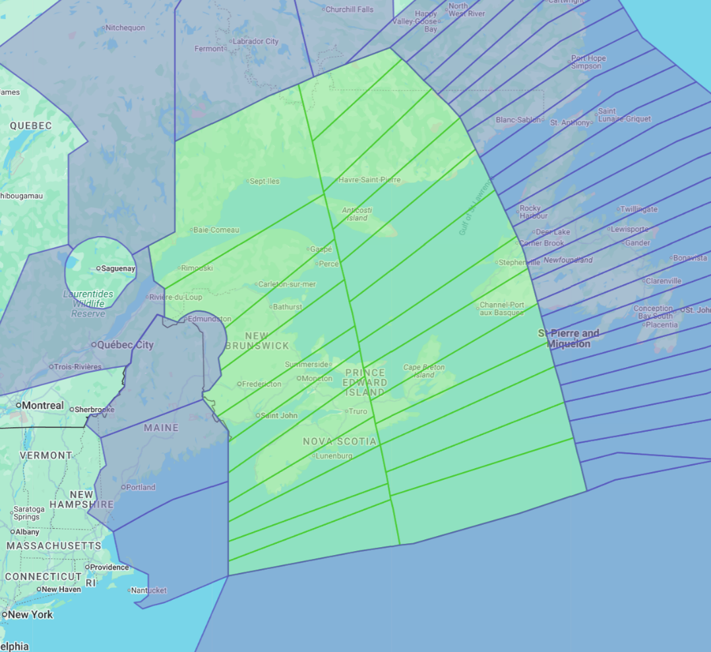{#fig:czqm-high-level width=85%}

[5.1(b)] # CZQX
This green area represents the Gander Centre Area between FL290 and FL600. Note that CZEG owns the airspace to our North, Iceland (BIRD) is to our Northeast. Gander Oceanic to our East. New York Oceanic to our South. See [[fig:czqx-high-level]].

Note that the CZQM-CZQX boundary FL290 and above is located further East than the Low-Level boundary.

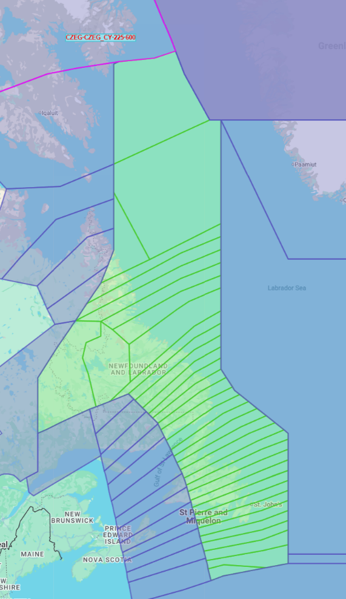{#fig:czqx-high-level width=55%}

[5.1(c)] # High Volume Sectorizations

[5.1(c)(i)] # General
Large events, such as Cross the Pond, introduce large volumes of traffic that require airspace sectorizations that differ from consolidated airspace routine operations. This section describes the current high volume sectorization.

Positions are named based on their FIR and numbered increasing from South to North. Each position shares an east-west boundary with its correspondingly numbered counterpart (CZQM1 is adjacent to CZQX1). Position boundaries are also aligned with adjacent domestic FIR (Montreal, Boston) sector boundaries to simplify coordination. Oceanic sector boundaries may vary depending on the event.

These are High Level Airspace positions (FL290+).

[5.1(c)(ii)] # Consolidations
ATC connections to their control positions are known to fail. In order to minimize disruptions, the 1-4 positions in each FIR will back up its corresponding position. e.g. should QM1 connection fail, QX1 would take over both sectors. Should both QM1 and QX1 fail, the sectors revert to CZQM_CTR.

[5.1(c)(iii)] # Moncton

| Position   | Symbol (SI) | Frequency |
| ---------- | ----------- | --------- |
| CZQM_1_CTR | QM1         | 123.9     |
| CZQM_2_CTR | QM2         | 132.7     |
| CZQM_3_CTR | QM3         | 135.65    |
| CZQM_4_CTR | QM4         | 123.7     |

See [[fig:ctp-czqm]].

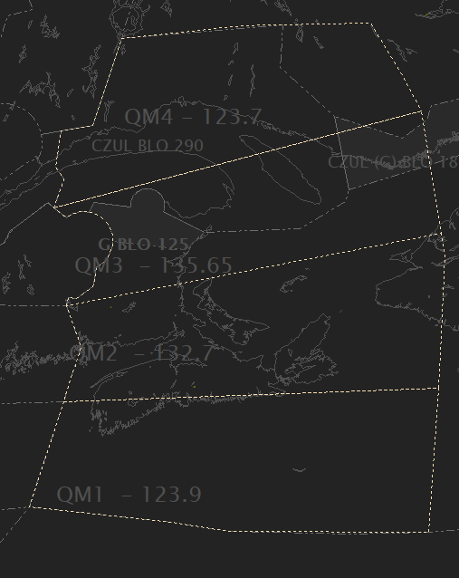{#fig:ctp-czqm width=65%}

[5.1(c)(iv)] # Gander

| Position   | Symbol (SI) | Frequency |
| ---------- | ----------- | --------- |
| CZQX_1_CTR | QX1         | 132.34    |
| CZQX_2_CTR | QX2         | 133.0     |
| CZQX_3_CTR | QX3         | 125.075   |
| CZQX_4_CTR | QX4         | 128.175   |
| CZQX_5_CTR | QX5         | 132.05    |
| CZQX_6_CTR | QX6         | 119.85    |
| CZQX_7_CTR | QX7         | 135.2     |

See [[fig:ctp-czqx]] and [[fig:ctp-consolidated]].

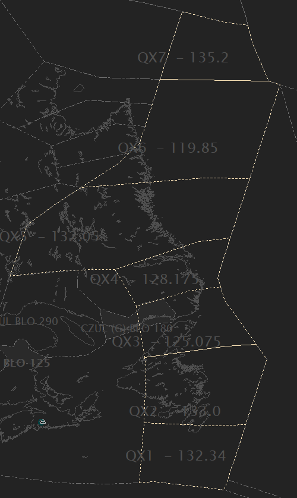{#fig:ctp-czqx width=50%}

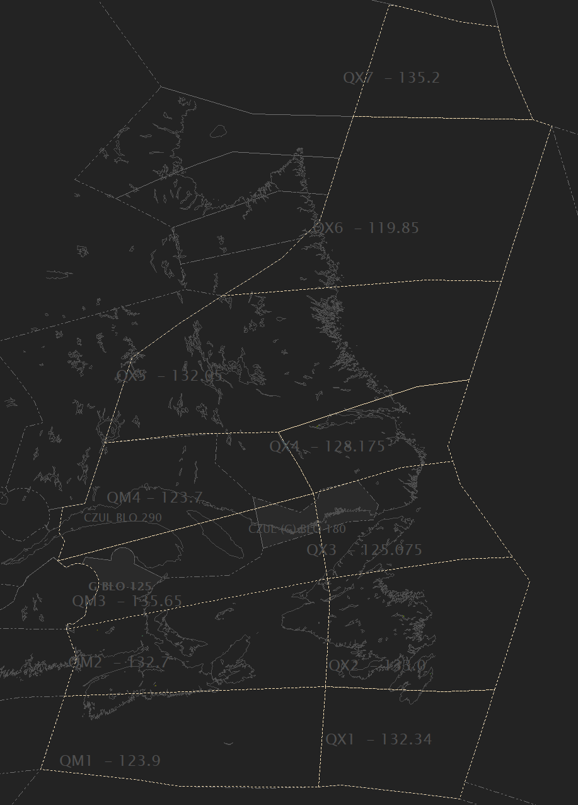{#fig:ctp-consolidated width=75%}

[5.2] # Low Level Airspace (Surface to below FL290)

[5.2(a)] # Centre Sectors

[5.2(a)(i)] # Moncton
This figure represents the Moncton area from the Surface to below FL290. It is further subdivided as shown in the following sections. See [[fig:czqm-low-level]].

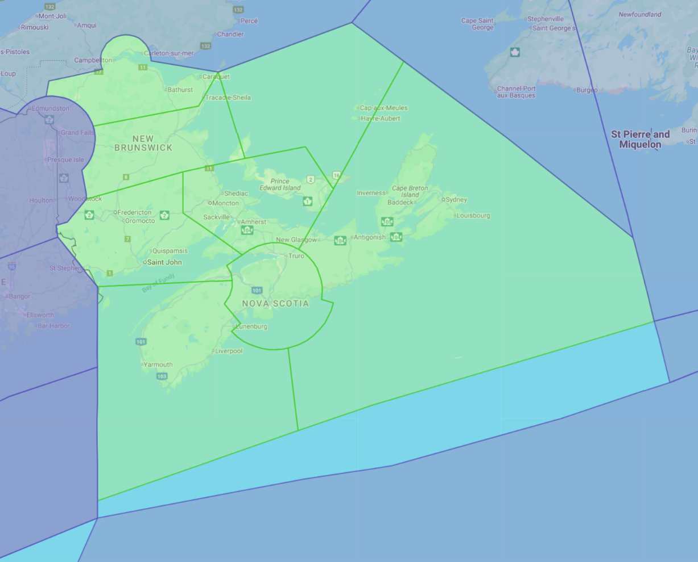{#fig:czqm-low-level width=90%}

[5.2(a)(i)(I)] # Digby Sector
The Digby sector’s purpose is to sequence flights into Halifax from the West when required. See [[fig:digby-sector]].

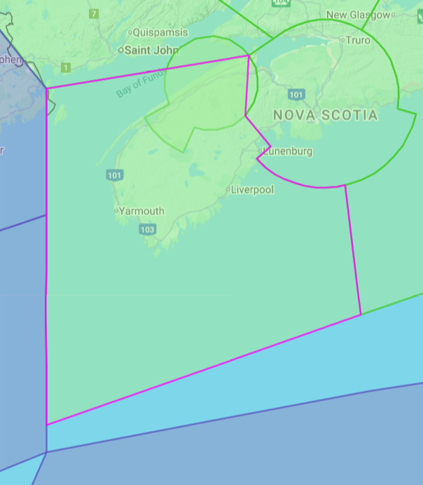{#fig:digby-sector width=60%}

[5.2(a)(i)(II)] # Cape Breton Sector
The Cape Breton sector’s purpose is to sequence flights into Halifax from the East when required. See [[fig:cape-breton-sector]].

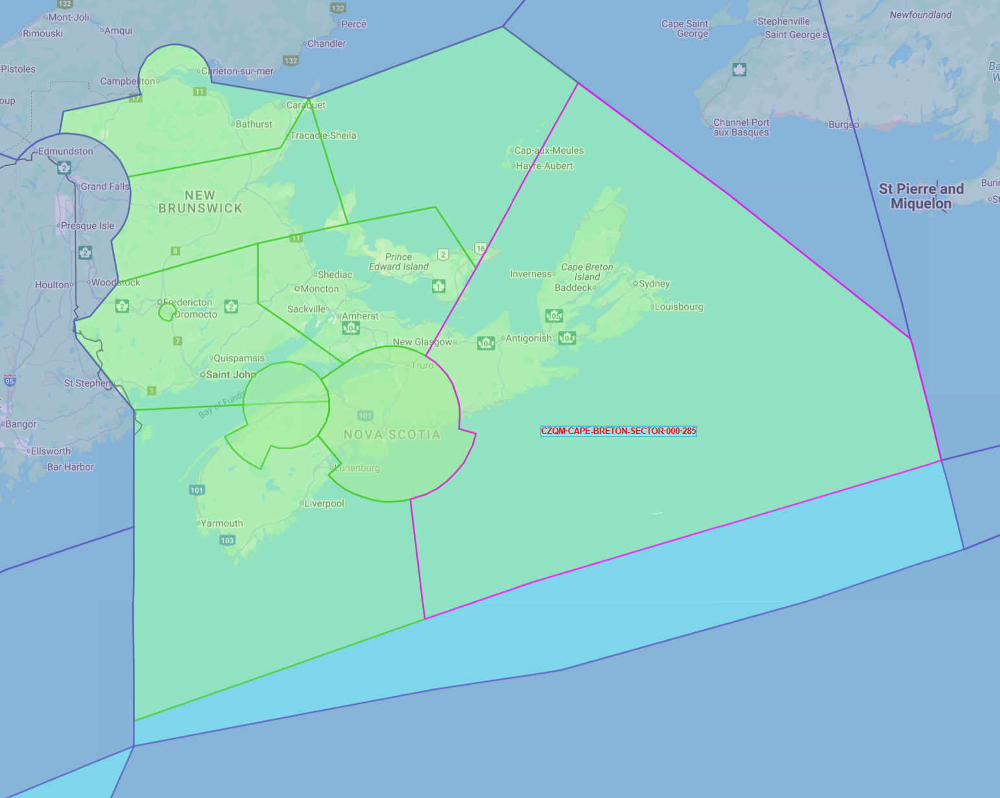{#fig:cape-breton-sector width=90%}

[5.2(a)(i)(III)] # Charlo area uncontrolled (Class G) airspace SFC-12500
The depicted area represents uncontrolled (Class G) airspace in Northern NB. As the name indicates, no control services are allowed within that area. See [[fig:charlo-class-g]].

![Charlo area uncontrolled (Class G) airspace, surface to 12500 ft[^ese-buffer]](images/airspace/charlo-class-g.png){#fig:charlo-class-g width=60%}

[^ese-buffer]: Where Euroscope sector names and altitudes are shown in the figures, the altitudes show a buffer for technical reasons. They are not to be considered authoritative for control purposes.

[5.2(a)(i)(IV)] # The Rest of Moncton
The airspace, other than the en route airspace described above and the Terminal (_APP) areas described below, within the Moncton FIR is allocated to Moncton Centre (CZQM_CTR).

[5.2(a)(ii)] # Gander Low

[5.2(a)(ii)(I)] # Surface to Below FL180
This figure represents the Gander Centre area below FL180. Note the carve-out for the North Shore of Quebec, belonging to Montreal CZUL FIR from Surface to below FL180. See [[fig:czqx-low-sfc-fl180]].

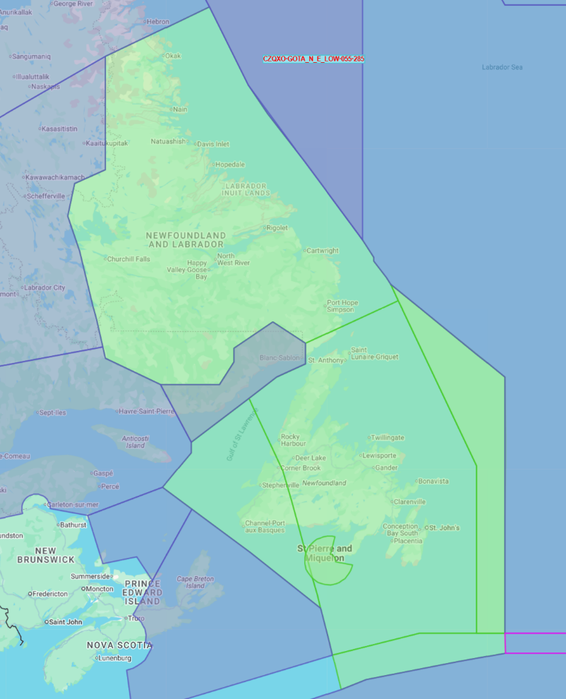{#fig:czqx-low-sfc-fl180 width=75%}

[5.2(a)(ii)(II)] # Flight Level 180 to Below FL290
Above FL180, the area is as shown. Note that the CZQM-CZQX boundary below FL190 is West of Newfoundland. See [[fig:czqx-low-fl180-fl290]].

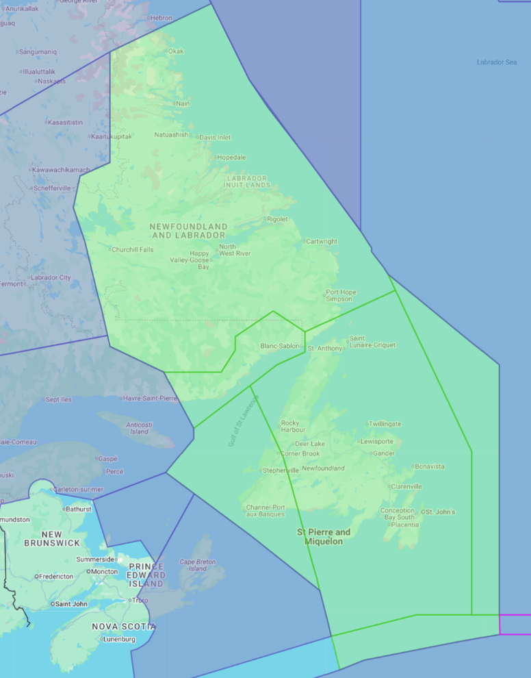{#fig:czqx-low-fl180-fl290 width=75%}

[6] # Terminal Positions (_APP)

[6.1] # Moncton FIR
The Terminal Positions’ cascading relationships are as follows:

- Mega Terminal
  - CYQM
    - CYSJ
  - CYHZ
    - CYZX
    - HZ Arrival

[6.1(a)] # Greenwood Terminal CYZX_APP (SFC-9000)
See [[fig:cyzx-app-sector]] and [[fig:cyzx-app-chart]].

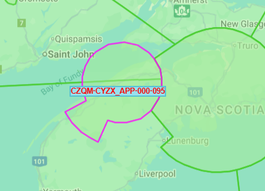{#fig:cyzx-app-sector width=50%}

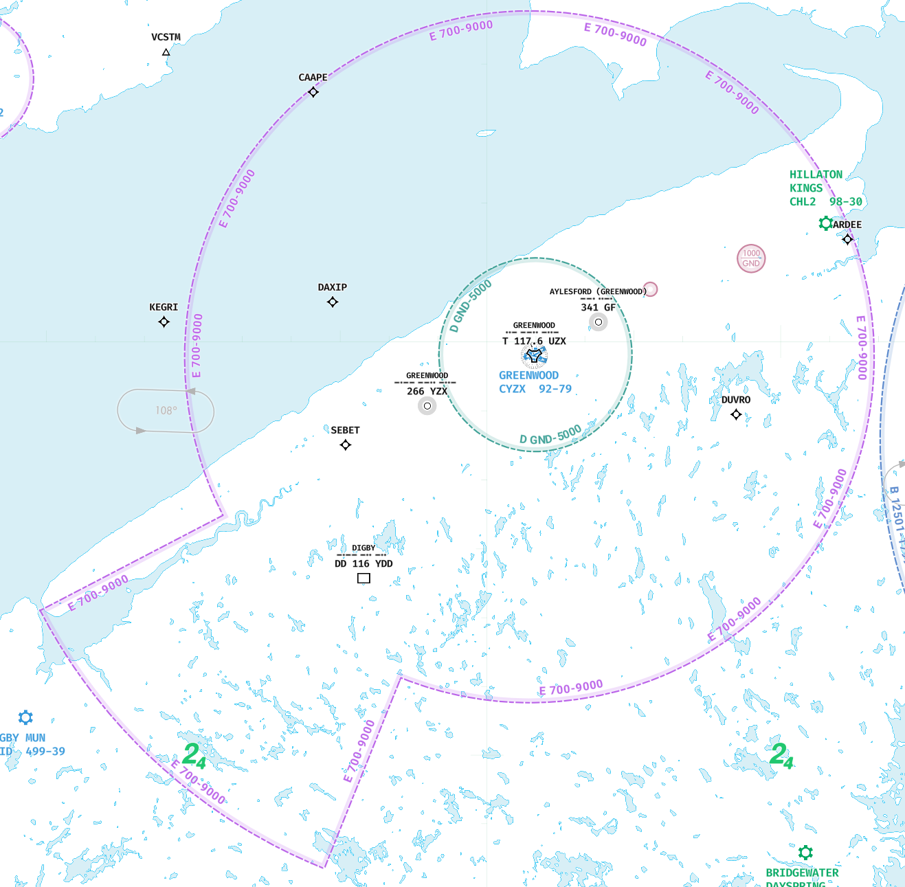{#fig:cyzx-app-chart width=80%}

[6.1(b)] # Halifax APP CYHZ_APP (SFC-BelowFL290)
In addition to CYHZ_APP, we also have the option of activating Halifax Arrival (CYHZ_FI_APP) in cases when there is heavy arrival demand to the degree that approach clearances are not issued via the published transitions and that extensive vectoring to final is required. See [[fig:cyhz-app-sector]] and [[fig:cyhz-app-chart]].

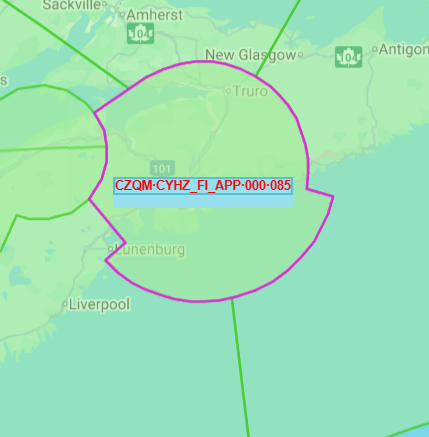{#fig:cyhz-app-sector width=50%}

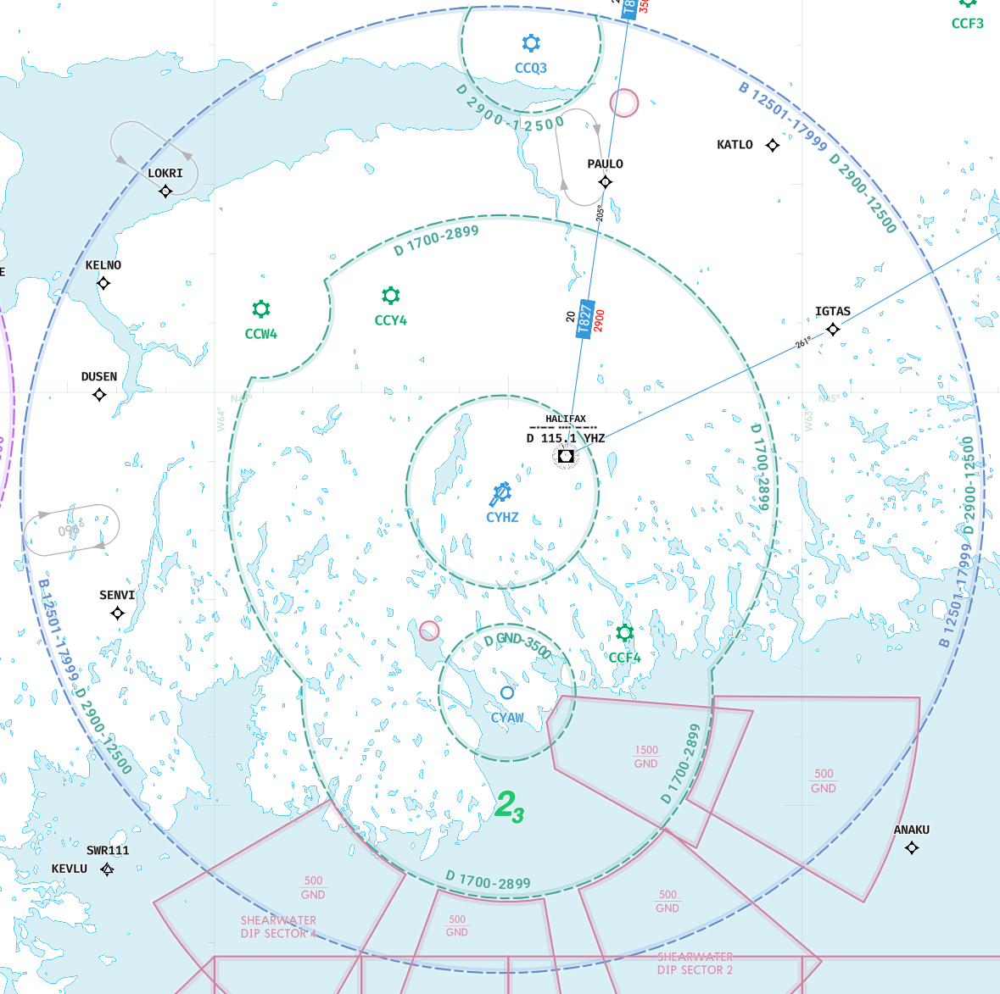{#fig:cyhz-app-chart width=80%}

[6.1(c)] # Saint-John CYSJ_APP (SFC-BelowFL290)
See [[fig:cysj-app-sector]] and [[fig:cysj-app-chart]].

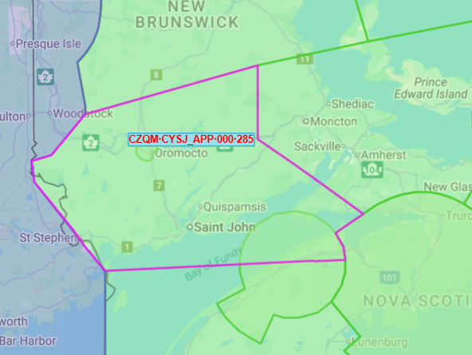{#fig:cysj-app-sector width=55%}

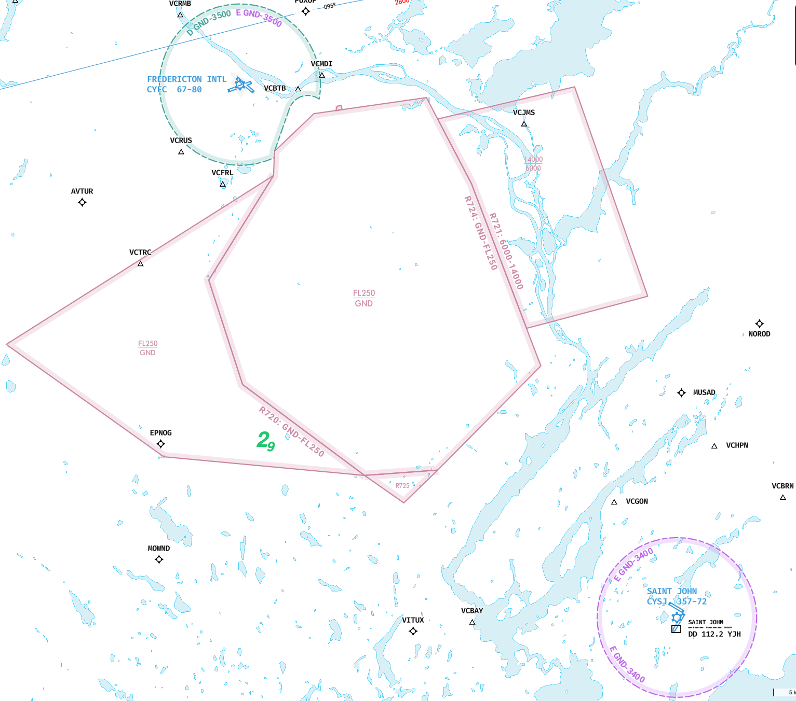{#fig:cysj-app-chart width=85%}

[6.1(d)] # Moncton CYQM_APP (SFC-BelowFL290)
See [[fig:cyqm-app-sector]] and [[fig:cyqm-app-chart]].

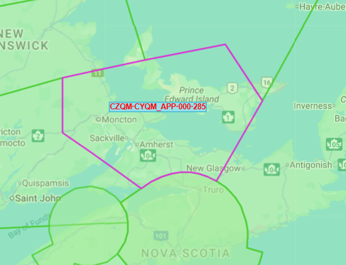{#fig:cyqm-app-sector width=55%}

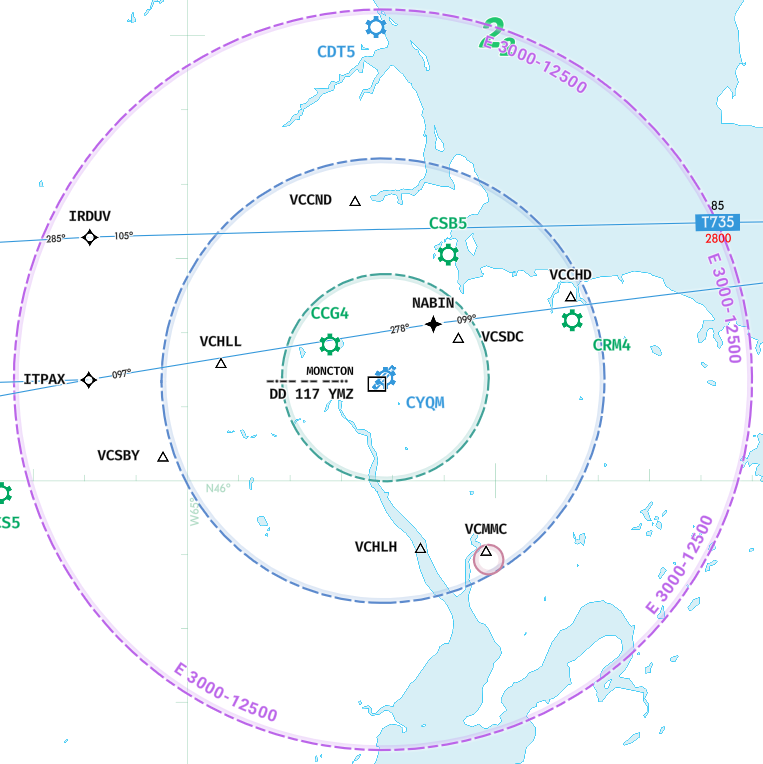{#fig:cyqm-app-chart width=70%}

[6.1(e)] # “Moncton Low”
This figure illustrates CYQM_APP when it absorbs CYSJ_APP, as is normally the case. See [[fig:moncton-low]].

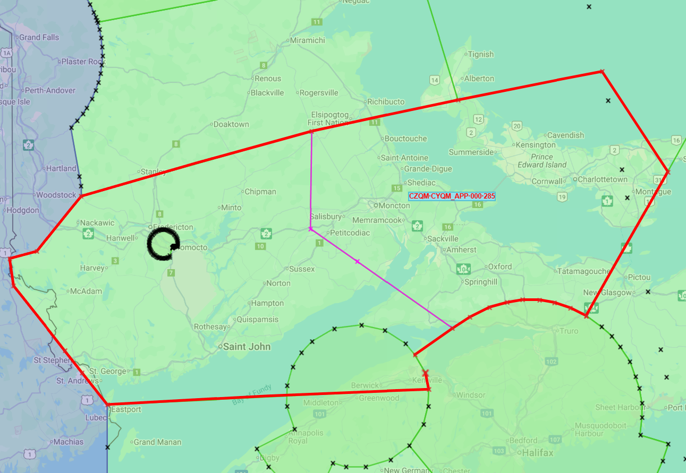{#fig:moncton-low width=90%}

[6.1(f)] # “Mega” Tri-Terminal CZQM_L_APP
The “mega” terminal position can be activated to manage all 4 terminals in the Moncton FIR. See [[fig:tri-terminal]].

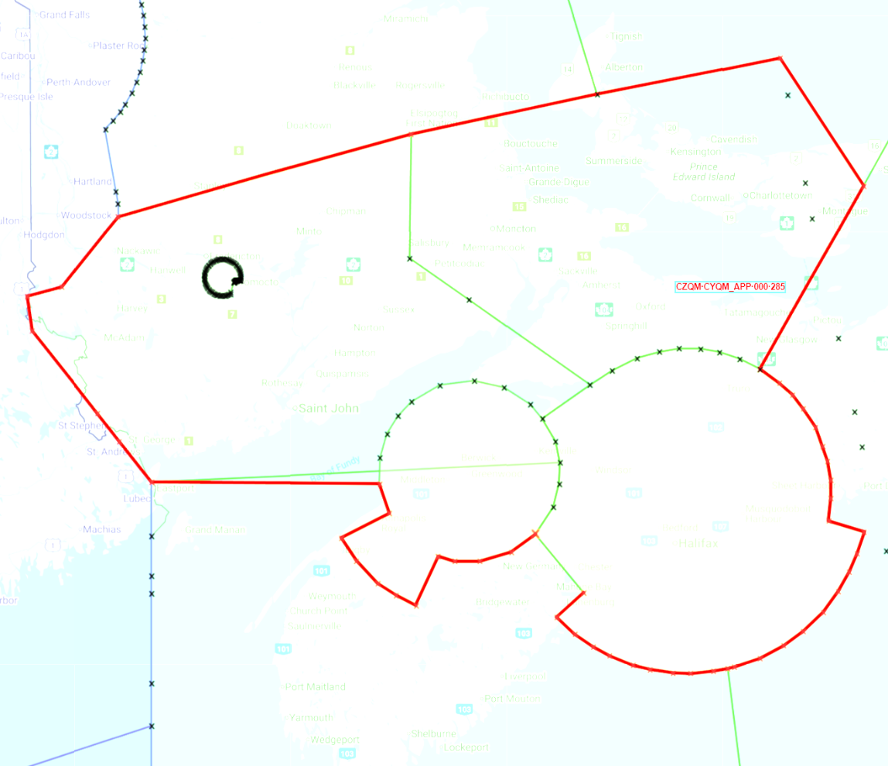{#fig:tri-terminal width=85%}

[6.2] # Gander FIR
All Gander FIR Terminals operate Below FL290

[6.2(a)] # St-John’s CYYT_APP (SFC-BelowFL290)
As depicted in Euroscope.

[6.2(b)] # Gander CYQX_APP (SFC-BelowFL290)
As depicted in Euroscope.

[6.2(c)] # Goose Bay MTCA CYYR_APP (SFC – Below FL290)
Within 87 nautical miles of CYYR. The many CYR airspaces are “occasional by NOTAM” and are deemed to be cold for our purposes. See [[fig:cyyr-mtca]].

Note that the Labrador airspace beyond the 87 NM radius circle around CYYR and the airways YYR – DENSO and YYR – YWK is uncontrolled Class G.

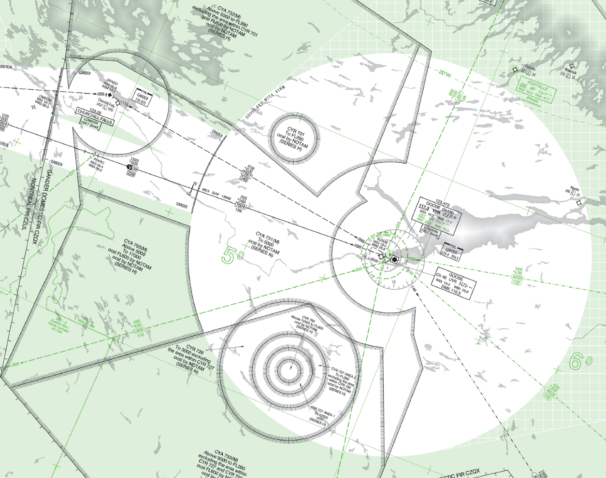{#fig:cyyr-mtca width=90%}

[6.2(d)] # St Anthony (CYAY) Area
Note that the Newfoundland Control Area Extension (CAE) does not extend much North of Gander and Deer Lake. The area shaded in green in [[fig:cyay-area]] is uncontrolled.

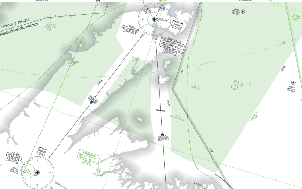{#fig:cyay-area width=60%}

[6.2(e)] # Saint-Pierre LFVP_APP (SFC-BelowFL190)
French Airspace below FL190 delegated to Gander Centre. See [[fig:lfvp-app]].

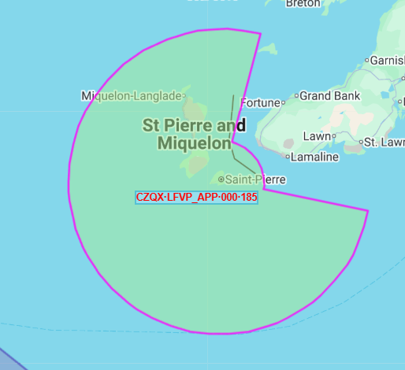{#fig:lfvp-app width=55%}

[7] # Tower Positions (_TWR)

[7.1] # Moncton FIR

[7.1(a)] # Greenwood CYZX_TWR
Class D. The airspace to 5000’ ASL within the area bounded by a circle of 7 miles radius centred on CYZX airport.

[7.1(b)] # Halifax CYHZ_TWR
Class D. The airspace to 3500’ ASL within the area bounded by a circle of 7 miles radius centred on CYHZ airport.

[7.1(c)] # Fredericton CYFC_TWR
Class D. The airspace to 3500’ ASL within the area bounded by a circle of 7 miles radius centred on CYFC airport, minus a carve-out around the Gagetown heliport. Note the presence of CYR724 SFC-FL250 to the southeast. See [[fig:cyfc-twr]].

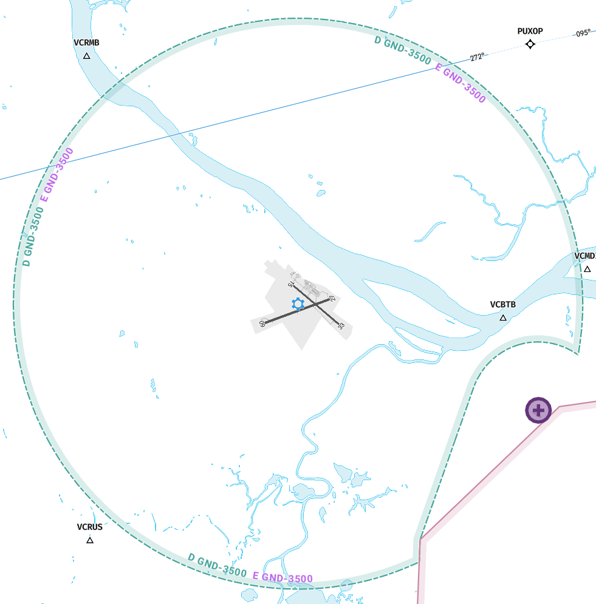{#fig:cyfc-twr width=75%}

[7.1(d)] # Moncton CYQM_TWR
Class D. The airspace to 3500’ ASL within the area bounded by a circle of 7 miles radius centred on CYQM airport.

[7.2] # Gander FIR

[7.2(a)] # St-John’s CYYT_TWR
Class D. The airspace to 3500’ ASL within the area bounded by a circle of 7 miles radius centred on CYYT airport.

[7.2(b)] # Gander CYQX_TWR
Class D. The airspace to 3500’ ASL within the area bounded by a circle of 7 miles radius centred on CYQX airport.

[7.2(c)] # Goose Bay CYYR_TWR
Class D. The airspace to 4000’ ASL within the area bounded by a circle of 10 miles radius centred on CYYR airport. There are several restricted areas defined around CYYR, but they are occasional by NOTAM and are therefore deemed to be cold.

[7.2(d)] # St-Pierre LFVP_TWR
Class D. The airspace to 2000’ ASL within the area bounded by a circle of 6 miles radius centred on LFVP airport.
