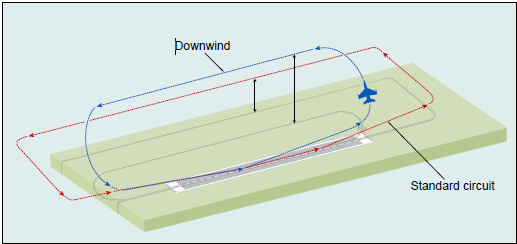
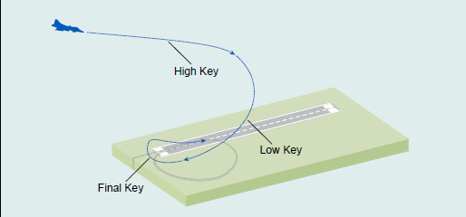

[1] # Control Pages

[1.1] # Document Identification

| Item           | Value                                 |
| -------------- | ------------------------------------- |
| Name           | CZQM FIR Military Operating Practices |
| Identification | CZQM-MIL                              |
| Type           | Operating Practices                   |
| Revision       | 0.2                                   |
| Effective Date | To be confirmed                       |

[1.2] # Revision Records

| Revision ID | Effective Date  | Description of Change |
| ----------- | --------------- | --------------------- |
| 0.1         | To be confirmed | Draft |
| 0.2         | To be confirmed | Formation call sign suffix (FLIGHT) added to terminology. Reformat document to use CZQM docengine. [[2.2]] reflects new git based tracking. |

[2] # Introduction

[2.1] # Scope and Applicability

[2.1(a)] This document provides operational guidance to CZQM controllers providing services to military aircraft, either directly or indirectly (top-down).

[2.1(b)] It was written to support the stand-up of a Virtual Royal Canadian Air Force, but it applies to any military operator on the network.

[2.1(c)] [[3]] through [[14]] apply anywhere in the Moncton and Gander FIRs. [[15]] covers launch and recovery at specific aerodromes.

[2.1(d)] This document covers only what is different about military operations. Normal enroute, terminal and tower practice is unchanged and is found in the current Centre (_CZQM-CTR_), Terminal (_CZQM-APP_) and Tower (_CZQM-TWR_) Operating Practices.

[2.1(e)] FIR policies are contained in the Moncton / Gander FIR General Policy document (CZQM-FGP§2.1).

[2.1(f)] The source material is NAV CANADA guidance material. Where this document simplifies that guidance for the VATSIM environment, the guidance remains the authority.

[2.2] # Amendments

[2.2(a)] Amendments to this document are tracked and versioned using the CZQM-FIR/policies GitHub repository.

[2.3] # How to Use This Document

[2.3(a)] Each topic states a Purpose, being why the procedure exists, and an application, being what you actually do.

[2.3(b)] Phraseology examples are shown in this typeface:

> *COUGAR TWO-FIVE, REPORT INITIAL, RUNWAY ZERO-SEVEN, LEFT BREAK.*

[2.3(c)] Phraseology is a model, not a script. Plain language is always acceptable when it is required for clarity.

[3] # General

[3.1] # Military Aircraft on the Network

[3.1(a)] Military aircraft file and fly like any other IFR or VFR aircraft. Most of what you already do does not change.

[3.1(b)] Four things are different, they may:

[3.1(b)(i)] fly in formation;

[3.1(b)(ii)] use circuits and patterns that civil aircraft do not;

[3.1(b)(iii)] operate in reserved or special-use airspace;

[3.1(b)(iv)] accept responsibility for separating themselves.

[3.1(c)] Treat a military flight as an ordinary flight until the pilot requests something described in this document.

[3.2] # Flight Priority

[3.2(a)] Real-world operations give priority to military aircraft departing on active scrambles or operational air defence flights, and to any aircraft using the radiotelephony call sign RESCUE.

[3.2(b)] Give priority to a military aircraft proceeding to an altitude reservation when flight safety and traffic permit.

[3.2(c)] On VATSIM, apply priority with judgment. Do not disrupt an event arrival flow to expedite a training flight.

[3.3] # Communications

[3.3(a)] Avoid, to the extent possible, instructing a single-piloted military turbojet to change radio frequency during a high workload phase of flight.

[3.4] # Terminology You Will Hear

[3.4(a)] Terms you will hear from military crews:

- INITIAL, BREAK, CLOSED - military jet circuit terms.
- HIGH KEY, LOW KEY, FINAL KEY - practice forced landing positions.
- ECHELON RIGHT, ECHELON LEFT, LINE ASTERN - formation geometry.
- MARSA - the military is separating itself.
- DUE REGARD, or OPERATIONAL - the aircraft is not using ATC separation.
- FLIGHT - suffix on a formation call sign. FINN TWO-ONE FLIGHT is the formation; FINN TWO-ONE alone is the leader or a single aircraft.
- HOLDING HANDS - formation members have visual contact with each other.
- PLAYMATE - the other aircraft a military aircraft is working with.
- ALTRV, MTR, TALEX - reserved airspace and training routes.

[3.4(b)] Definitions are in the Glossary ([[17]]).

[4] # MARSA

[4.1] # Purpose

[4.1(a)] MARSA stands for Military Assumes Responsibility for Separation of Aircraft. The military pilots or commanders involved take responsibility for separating the participating aircraft from each other.

[4.1(b)] It exists because formation flying, air refuelling and interceptions deliberately put aircraft closer together than any ATC separation standard permits.

[4.2] # When It Applies

[4.2(a)] MARSA applies when military aircraft:

- Join or remain within a formation flight.
- Intercept an aircraft during an air defence mission.
- Operate within the same altitude reservation, or within altitude reservations separated by less than the standard minima.
- If you need to split up a formation (e.g. receivers from a tanker) then have the aircraft establish IFR separation between themselves (e.g. altitude) before ceasing application of MARSA.

[4.3] # Application

[4.3(a)] ATC does not initiate MARSA and does not deny it. Your only responsibility is to separate the MARSA aircraft from every non-participating aircraft.

[4.3(b)] Obtain the declaration from the aircraft concerned before you discontinue separation between them.

[4.3(c)] If one of the parties does not accept MARSA, cancel the clearance that depended on it, obtain the intentions of both aircraft, and issue appropriate instructions.

[5] # Formation Flights

[5.1] # Purpose

[5.1(a)] Military aircraft operate in formation as a tactical necessity. For air traffic purposes the whole formation behaves as one aeroplane with one pilot in charge.

[5.2] # The Basic Rules

[5.2(a)] Control a formation flight as one aircraft and issue control instructions to the formation leader.

[5.2(b)] Only the formation leader will be squawking. The remainder will be squawking standby.

[5.2(c)] The formation leader is responsible for separating the aircraft within the formation. You are not.

[5.2(d)] Include the number and type of aircraft in the formation when you coordinate with an adjacent unit. Controllers using TopSky will see the tag reflecting the number of aircraft in the formation. The VATSIM flight plan should also include the number of aircraft.

[5.2(e)] Confirm the number and type of aircraft with the leader on first contact, before you provide a service. Members may check in on frequency one after another. That is a radio check and does not make them separate flights.

[5.2(f)] When you hand off a formation in trail, pass the length of the stream as well as the number of aircraft.

[5.2(g)] Before a formation enters controlled airspace from outside it, obtain the leader’s confirmation that all members are within standard formation dimensions and at the assigned altitude.

[5.3] # Standard Formation

[5.3(a)] A standard formation meets all of the following:

- The leader operates at the assigned altitude and the other aircraft are within 100 feet vertically of the leader.
- The formation occupies a maximum frontal width of 1 mile.
- The first and last aircraft are within 1 mile longitudinally.

[5.3(b)] Note that the longitudinal figure is measured from the first aircraft to the last aircraft, not from each wingman to the leader.

[5.4] # Non-Standard Formation

[5.4(a)] A non-standard formation is any formation whose dimensions exceed the standard. Outside an altitude reservation, the flight leader requests other than standard dimensions and ATC approves them.

[5.4(b)] Formation leaders must inform you of the dimensions of a non-standard formation. If the dimensions of a standard formation are in doubt, confirm them with the leader.

[5.4(c)] A four-ship in trail at 2 miles spacing is about 6 miles long. That is a non-standard formation, and it needs your approval.

[5.5] # Establishing a Formation

[5.5(a)] Aircraft that depart separately are separate IFR flights. They become one formation only when the join-up is complete and MARSA has been declared.

[5.5(b)] Before the join-up, apply normal separation between them. An intention to join up is not a reason to stop separating them. Use of altitudes if IFR is best practice.

[5.5(c)] Participants may depart VFR and join up as such prior to changing to IFR. That simplifies matters.

[5.5(d)] It’s a good practice to coordinate the join-up with the participants prior to departure. Establish who leads, the point and altitude at which the join-up will take place, and the resulting formation size and configuration. You may wish to establish an orbit area, depending on participant preferences.

[5.5(e)] Obtain the MARSA declaration before you discontinue separation between the joining aircraft. Until you have it, they are separate aircraft and you owe them separation.

[5.5(f)] Once MARSA is declared and the join-up is under way, treat the aircraft as one formation under the preceding paragraphs and issue instructions to the leader only.

[5.5(g)] A block altitude is the usual and simplest accommodation if the participants request one to carry out the join-up.

[5.5(h)] The following phraseology is suggested for establishing a formation on departure.

> *QUID ZERO-ONE, MAINTAIN BLOCK ONE-SIX THOUSAND TO ONE-EIGHT THOUSAND FOR JOIN-UP, REPORT FORMATION ESTABLISHED.*
>
> *QUID ZERO-ONE, CONFIRM MARSA WITH QUID ZERO-TWO.*

[5.6] # Separating a Formation from other IFR flights

[5.6(a)] Separate a standard formation from other IFR aircraft using your normal surveillance minimum plus 1 mile. When separating it from another standard formation, use your normal minimum plus 2 miles.

[5.6(b)] Separate a non-standard formation using your normal surveillance minimum measured either to the perimeter of the airspace containing the formation, or from the outermost aircraft, whichever applies.

[5.6(c)] Applying procedural separation to a non-standard formation longer than 1 mile, add the length of the formation to the longitudinal minimum. If it is wider than 1 mile, add the width to the lateral minimum.

[5.6(d)] Do not apply RVSM criteria to a formation.

[5.6(e)] Between FL290 and FL410, treat a formation as non-RVSM and apply 2000 feet vertical separation between it and other aircraft.

[5.6(f)] Where it helps, assign a code to each aircraft, or to the first and last aircraft in trail. On the network each pilot squawks separately in any case, so use the first and last targets to judge the length of the string.

[5.7] # Arrival and Breakup

[5.7(a)] IFR formation flights are expected to take off and land in formation. Unforeseen conditions may prevent a formation from completing an approach and landing together.

[5.7(b)] On initial contact at destination, the formation leader is expected to inform you whether the formation will let down in sections. If the leader does not volunteer this, ask.

[5.7(c)] If a military formation requests a breakup into sections or individual aircraft, issue an IFR clearance to each section or aircraft identified for breakaway. If the formation descends by sections, issue an expect-approach-clearance time to each delayed section.

[5.7(d)] If a formation breaks into sections, each section has its own leader, who is responsible for separation within that section.

[5.7(e)] The formation leader remains responsible for separation between the sections or individual aircraft until either position reports indicate procedural separation has been achieved, or you have surveillance separation. You do not have to create the separation from the first moment.

[5.8] # Splitting a Formation in Flight

[5.8(a)] A formation may split away from destination, most often at the end of an air refuelling bracket or at the end of a tactical portion.

[5.8(b)] The split is not complete, and the aircraft are not separate flights, until an approved form of separation exists between them. MARSA covers them until that point.

[5.8(c)] Issue an IFR clearance to each section or aircraft breaking away, through the leader or directly, and include the point or condition at which MARSA terminates.

[5.8(d)] Do not assume the split has happened because the pilots said they were splitting. Confirm that separation exists before you begin controlling them as individuals.

[5.8(e)] The leader normally creates the separation by differential airspeed, by altitude, or by vectors. Agree the method and the order in which aircraft will leave the formation with the leader before the split begins.

[5.8(f)] Do not issue instructions to individual aircraft until the split is complete and you have identified each one.

[5.8(g)] For air refuelling, the tanker commander requests enroute clearance for both tanker and receivers at least 5 minutes before the end of refuelling and keeps the receivers within 3 miles of the tanker until MARSA is terminated. See [[9]].

[5.9] # Recovery in Trail

[5.9(a)] A formation that cannot or does not wish to fly an overhead break, typically because of weather, may recover in trail. This is common and does not require the flight to be split.

[5.9(b)] Approve non-standard dimensions for the trail geometry, keep the flight as one aircraft, and clear it for the approach in the normal way. Separation between members, including on the runway, remains the leader's responsibility.

[5.9(c)] Protect the runway for the whole formation. Do not land or depart another aircraft until the last member is clear.

[5.9(d)] Brief the overshoot before you clear the approach. The moment one member goes around on its own it becomes a separate aircraft and you owe it separation.

[5.10] # Phraseology

[5.10(a)] Recovery in trail:

> *FINN TWO-ONE FLIGHT, NON-STANDARD FORMATION TWO MILES IN TRAIL APPROVED, REPORT ESTABLISHED IN TRAIL.*
>
> *FINN TWO-ONE FLIGHT, EIGHT MILES FROM FINAL, TURN RIGHT HEADING TWO-FOUR-ZERO, MAINTAIN THREE THOUSAND UNTIL ESTABLISHED, CLEARED I-L-S RUNWAY TWO-SIX APPROACH.*
>
> *FINN TWO-ONE FLIGHT, RUNWAY TWO-SIX, CLEARED TO LAND.*

[5.10(b)] Breakaway clearances follow the normal IFR clearance format with a validity condition:

> *ALOUETTE ONE-EIGHT IS CLEARED TO BAGOTVILLE AIRPORT VIA DIRECT, MAINTAIN ONE-ONE THOUSAND, SQUAWK FOUR-THREE-FOUR-FIVE, CLEARANCE VALID LEAVING ONE-SIX THOUSAND.*

[6] # Military Jet Circuits and Patterns

[6.1] # Applicability

[6.1(a)] These procedures are reserved primarily for military jet aircraft, civilian high-performance jet aircraft, and civilian heritage aircraft operated under a local agreement.

[6.2] # Overhead Break - Purpose

[6.2(a)] The overhead break is the normal way a military jet joins the circuit. It lets a fast aircraft arrive at speed and lose that speed in the turn rather than on a long final.

[6.2(b)] The aircraft flies up the extended runway centreline to a point called INITIAL, then makes a 180-degree VFR turn over the midway point of the runway and joins downwind.

[6.2(c)] INITIAL is a fix 3 to 5 miles on the extended centreline, 500 feet above conventional circuit altitude. The break itself is flown 500 feet above conventional circuit altitude.

[6.2(d)] In formation, the aircraft will be in echelon right or echelon left.

[6.3] # Clearing an Overhead Break

[6.3(a)] For a pilot requesting an overhead break:

[6.3(a)(i)] Instruct the pilot to report INITIAL and specify the direction of the break. You may omit the direction if it is published in an agreement.

> *COUGAR TWO-FIVE, REPORT INITIAL, RUNWAY ZERO-SEVEN, LEFT BREAK.*

[6.3(a)(ii)] When the pilot reports at INITIAL, provide the sequence.

> *COUGAR TWO-FIVE, NUMBER ONE, RUNWAY ZERO-SEVEN.*

[6.3(a)(iii)] Pass the circuit traffic in the order in which it will conflict with the joining aircraft.

> *COUGAR TWO-FIVE, NUMBER THREE, ONE DOWNWIND, ONE ON FINAL FOR TOUCH AND GO, RUNWAY ZERO-SEVEN.*

[6.3(a)(iv)] Clear the aircraft for the requested manoeuvre on or over the runway when the aircraft reports base, for example a touch and go or a low approach.

[6.4] # Formation Overhead Break

[6.4(a)] Treat a formation requesting an overhead break as a single aircraft, unless the formation has completed an approach with the lead aircraft on the overshoot and a closed circuit is requested, or the pilot has coordinated a formation split with the unit.

[6.4(b)] The lead aircraft breaks away first, in the opposite direction to the trailing aircraft, followed by a pause of approximately 3 seconds before the remaining aircraft break.

[6.4(c)] If you require the formation to break in the opposite direction to that requested, allow sufficient time to reposition. A formation in echelon right breaks to the left.

[6.5] # When You Cannot Approve the Break

[6.5(a)] If traffic conflicts with the overhead break manoeuvre, issue alternate instructions. Options include:

- Break departure end.
- Break approach end.
- Tower will call the break.
- Re-cleared to initial.

> *COUGAR TWO-FIVE, UNABLE THE BREAK, FLY THROUGH, RE-JOIN INITIAL VIA THE NORTH.*
>
> *COUGAR TWO-FIVE, BREAK DEPARTURE END.*

[6.5(b)] Ensure no conflict exists between a departing aircraft and an aircraft instructed to delay the break beyond the midway point of the runway.

[6.6] # Closed Patterns

[6.6(a)] A closed pattern is a sharp 180-degree turn to a tight downwind, flown after a touch and go or low approach, at or up to 500 feet above the standard circuit. It keeps a jet in the circuit for repeated approaches. See [[fig:closed-pattern]].

{#fig:closed-pattern width=80%}

[6.6(b)] Approve a request for a closed pattern by stating the direction of the manoeuvre.

> *TOWER, COUGAR TWO-FIVE, REQUEST CLOSED RIGHT.*
>
> *COUGAR TWO-FIVE, CLEARED RIGHT.*

[6.6(c)] Issue the sequence number and pass relevant traffic when the aircraft reports at the midpoint of the downwind leg.

[6.6(d)] When another aircraft has reported INITIAL but has not yet broken, approve a closed circuit only if the closed aircraft is told to manoeuvre in the opposite direction to the break, or to extend upwind until the other aircraft has begun the break, or the aircraft approaching the break has been sequenced to follow, or has been told to fly through.

> *ALOUETTE TWO-ONE, NEGATIVE, CLEARED LEFT.*
>
> *ALOUETTE TWO-ONE, NEGATIVE, EXTEND.*

[6.7] # Practice Forced Landings

[6.7(a)] A practice forced landing, or PFL, is a descending circular pattern about 1 mile in diameter used by single-engine aircraft to simulate an engine failure. The same terms are used during an actual engine failure. See [[fig:pfl]].

{#fig:pfl width=80%}

[6.7(b)] The positions are HIGH KEY overhead, LOW KEY 180 degrees around the pattern flying parallel to the runway, and FINAL KEY, which functions as a base leg.

[6.7(c)] The altitude of the manoeuvre varies by aircraft type, so ask.

[6.7(d)] As a guide, HIGH KEY is typically 2500 to 3500 feet above the aerodrome and LOW KEY about 1500 feet. A pilot may also join the PFL directly at LOW KEY.

[6.7(e)] For a pilot requesting a PFL:

- Obtain the altitude at which the aircraft expects to reach HIGH KEY.
- Instruct the pilot to report HIGH KEY.
- When the pilot reports HIGH KEY, either clear the aircraft to LOW KEY, or delay by issuing an orbit at HIGH KEY or other instructions.
- When the pilot reports LOW KEY, sequence the aircraft.
- When the pilot reports FINAL KEY, issue landing clearance.

> *DRAGON SIX-FIVE, REPORT HIGH KEY.*

[6.7(f)] Landing clearance may be issued at any point in the manoeuvre, but is typically issued when the aircraft reports final.

[6.7(g)] During an actual emergency the pilot may request a clearance direct to LOW KEY.

[6.8] # Wake Turbulence

[6.8(a)] Do not clear a light or medium aircraft to fly through the area where a break was performed until 2 minutes after the break is completed.

[6.9] # Landing Gear Check

[6.9(a)] Military pilots normally report GEAR DOWN with the final call. If a military aircraft reports final without it, include CHECK GEAR DOWN in the landing clearance.

> *COUGAR TWO-FIVE, CHECK GEAR DOWN, RUNWAY ZERO-SEVEN, CLEARED TO LAND.*

[7] # Military Approaches

[7.1] # Successive Military Jets

[7.1(a)] When successive military jets fly the same approach procedure, you may clear the second aircraft earlier than normal, subject to conditions.

[7.1(b)] For a high-altitude approach other than straight-in, all of the following must apply:

- Direct communication is established with each aircraft.
- The initial penetration altitude is not lower than that of the preceding aircraft.
- The leading aircraft has reported intercepting the inbound track.
- The leading aircraft will not circle before landing.
- The missed approach procedure does not involve a reversal of heading.

[7.1(c)] For a straight-in TACAN approach the same conditions apply, and in addition the aircraft must be separated by at least 10 miles, and two DME fixes must be used to establish the approach interval.

[7.2] # Penetration Turns

[7.2(a)] If a penetration-turn report is essential for control, you may request it from the pilot of a military jet.

[7.3] # Approach Bans

[7.3(a)] Military pilots are not subject to approach bans. Do not refuse an approach based on reported visibility alone.

[7.4] # Overhead Break from an Instrument Approach

[7.4(a)] Pilots of military aircraft may request to conduct an overhead break procedure using VFR at the end of an instrument approach. Handle the break under [[6]].

[7.5] # Radar Recovery to INITIAL

[7.5(a)] A military jet recovering in good weather may ask for vectors to INITIAL instead of a full instrument approach, then join the circuit visually for the break.

[7.5(b)] Before you offer it, consider the cloud base and visibility, the tower’s circuit traffic, other traffic on the approach, and terrain. It is a fair-weather procedure.

[7.5(c)] Vector the aircraft to INITIAL at the INITIAL altitude and coordinate with the tower. Transfer the aircraft to the tower when it reports the aerodrome in sight.

> *COUGAR TWO-FIVE, VECTORS FOR INITIAL RUNWAY ZERO-SEVEN, REPORT THE FIELD IN SIGHT.*

[7.5(d)] If the pilot is not visual by INITIAL, or the tower cannot accept the aircraft, turn it outbound onto an instrument recovery, normally vectors to the ILS or a TACAN approach.

[8] # Altitude Reservations

[8.1] # Purpose

[8.1(a)] An altitude reservation, or ALTRV, is a block of airspace reserved for a military mission. It is used when aircraft must be moved with less than standard IFR separation, or within prescribed altitudes, times or areas.

[8.1(b)] An ALTRV may be stationary or moving. A moving ALTRV travels along a route with the formation inside it.

[8.2] # Application on the Network

[8.2(a)] There is no altitude reservation service on VATSIM. ALTRV requests affecting a single FIR will be coordinated with FIR staff in advance. ALTRV requests affecting several FIRs will be coordinated with VATCAN staff or their delegate. Treat a requested ALTRV as a block of airspace agreed in advance between FIR staff and the operating unit, and published in an operations bulletin.

[8.2(b)] Do not create an ALTRV on the fly during normal operations. If a flight wants less than standard separation and there is no published reservation, use a non-standard formation under [[5]] instead.

[8.3] # Clearing Into and Out of a Reservation

[8.3(a)] Clear a military aircraft to the reservation by the ALTRV route where specified, by the requested routing, or by the flight planned route.

[8.3(b)] If necessary, instruct the pilot to obtain further clearance before leaving the reservation.

[8.3(c)] The reservation begins at the designated entry boundary, track or altitude, and ends at the exit point.

[8.3(d)] You are responsible for assisting pilots in meeting their entry times, and for recovering aircraft from the reservation.

> *TABOR FIVE-ONE CLEARED TO ENTER THE ALTITUDE RESERVATION.*

[8.4] # Separation

[8.4(a)] Separate non-participating aircraft from the boundaries of the reservation.

[8.4(b)] You need not separate a non-participating military aircraft from a military reservation if that aircraft is operating at least 1000 feet on top, or in accordance with VFR.

[8.4(c)] Aircraft operating within the same reservation are normally MARSA. See [[4]].

[9] # Air Refuelling

[9.1] # Purpose

[9.1(a)] A tanker and one or more receivers fly in close company along a refuelling track. They cannot be separated from each other by any ATC standard, so the activity runs under MARSA.

[9.2] # Conditions

[9.2(a)] Military IFR formation flights may refuel outside a reservation and outside published refuelling tracks when the formation remains together for the entire mission or joins up in military controlled airspace, or when prior coordination has been completed with all affected units.

[9.2(b)] That coordination should establish the tanker identification, the planned track start and end points and altitude, the receiver identifications, and the formation size and configuration.

[9.2(c)] Refuelling activity should be specified in the remarks of the flight plan.

[9.2(d)] Refuelling missions normally use a block altitude of three flight levels.

[9.3] # The Clearance and MARSA

[9.3(a)] Obtain a MARSA declaration from both the tanker commander and the lead of the receiving formation before you discontinue separation between them.

> *ETHYL TWO-THREE CLEARED TO CONDUCT REFUELLING ALONG ALFA-ROMEO SIX-TWO EAST, MAINTAIN BLOCK FLIGHT LEVEL TWO-THREE-ZERO TO FLIGHT LEVEL TWO-FIVE-ZERO, CONFIRM MARSA WITH EVIL FOUR-FIVE.*

[9.3(b)] If either party does not accept MARSA immediately after the clearance, cancel the clearance that authorized the refuelling, obtain the intentions of both aircraft, and issue appropriate direction.

[9.4] # During Refuelling

[9.4(a)] After MARSA is declared, do not issue course or altitude changes before the rendezvous. Doing so voids MARSA.

[9.4(b)] The tanker commander is responsible for receiver communications with ATC and for navigation along the track.

[9.4(c)] Do not ask a receiver to change code when it is less than 5 miles from the tanker, or to squawk standby when it is less than 3 miles from the tanker.

[9.4(d)] You may provide the tanker commander with vectors or alternate altitudes at any time. Provide cleared routes only after the refuelling aircraft has passed the refuelling control point.

[9.5] # Terminating MARSA

[9.5(a)] Before the end of refuelling, issue IFR clearances to the tanker commander for all tanker and receiver aircraft, including the point at which MARSA terminates.

> *HIFI SIX-TWO CLEARED TO COMOX VIA FLIGHT PLAN ROUTE, CLIMB TO FLIGHT LEVEL THREE-ONE-ZERO, MARSA TERMINATED PASSING FLIGHT LEVEL TWO-NINER-ZERO.*
>
> *MARSA TERMINATED.*

[9.6] # Non-Participating Aircraft

[9.6(a)] You may clear non-participating aircraft through the refuelling airspace after the rendezvous, provided appropriate separation exists from the formation.

[9.6(b)] Do not use the altitude vacated during the refuelling operation until the formation has reported reaching the next vertically separated altitude.

[10] # Military Training Routes and Low-Level Operations

[10.1] # Purpose

[10.1(a)] A military training route, or MTR, is a corridor for high-speed low-level training, normally above 250 knots and below 10 000 feet.

[10.1(b)] There are three types:

- IR route - flown IFR, always on an IFR flight plan.
- VR route - flown VFR.
- TALEX - flown IFR or VFR, from the surface to 5000 feet.

[10.2] # Clearance

[10.2(a)] Clear a military aircraft to an MTR by the requested routing or the flight planned route. If necessary, instruct the pilot to obtain further clearance before exiting.

[10.2(b)] If the planned exit point is below communications coverage, issue the exit clearance before the aircraft enters the route.

[10.2(c)] For communication failure purposes, the clearance limit is the aircraft's planned exit point from the route.

[10.3] # Separation

[10.3(a)] Apply normal separation between an aircraft outside the route and the geographical and vertical limits of the route.

[10.3(b)] An MTR is not an altitude reservation, but the same rules and procedures apply to it.

[10.4] # Modifications

[10.4(a)] Except in the interest of flight safety, do not change the altitude of an aircraft established in an MTR.

[10.4(b)] Bring any conflict you detect within the route to the attention of the participating aircraft.

[10.4(c)] You may clear an aircraft to leave the route before its planned exit point if the pilot requests it, the aircraft will not re-enter, and you assume responsibility for separation afterwards.

[10.4(d)] Aircraft cleared out of an MTR remain MARSA until a position report or your situation display shows them clear of the protected airspace. An ATC clearance to leave then supersedes the route clearance and cancels MARSA.

[11] # Special-Use Airspace

[11.1] # Purpose

[11.1(a)] Military activity is frequently contained inside charted airspace so that other traffic can simply be kept out of it. Your job is to separate non-participating aircraft from the airspace, not from the aircraft inside it.

[11.2] # Canadian Restricted Airspace

[11.2(a)] Do not allow non-participating aircraft to enter active Class F restricted airspace (CYR).

[11.3] # Canadian Military Operations Area

[11.3(a)] Apply separation in controlled airspace between an aircraft and the boundary of a Canadian MOA as you would with Class F advisory airspace (CYA).

[11.4] # American Special-Use Airspace

[11.4(a)] American special-use airspace may abut Canadian airspace or lie within airspace delegated to a Canadian ACC. It includes prohibited, restricted and warning areas, American MOAs, and ATCAAs.

[11.4(b)] Apply lateral surveillance separation between a non-participating aircraft and American special-use airspace as follows:

- IFR at or above FL600 - 6 miles.
- IFR or CVFR below FL600 - 3 miles.
- VFR - no part of the target enters or touches the area.

[11.4(c)] Apply vertical separation as follows:

- IFR above FL290 - 1000 feet.
- IFR or CVFR at or below FL290 - 500 feet.
- VFR - the aircraft must not penetrate.

[11.5] # Application on the Network

[11.5(a)] Charted restricted areas in the Moncton and Gander FIRs are not active on VATSIM unless an event or operations bulletin says so.

[11.5(b)] If a military operator asks for an area to be treated as active, handle it as a coordinated block under [[8]] and advise adjacent sectors.

[12] # Due Regard

[12.1] # Purpose

[12.1(a)] ATC is not responsible to provide separation to state aircraft that have declared “Due Regard”. Due Regard will not normally be utilized in Canadian Domestic Airspace, and under no circumstances will it be applied within the 12 NM coastal limit.

[12.1(b)] Due Regard is a declaration by a state aircraft that it is operating on its own authority and is not using ATC separation. ATC is not responsible for separating an aircraft that has declared Due Regard.

[12.1(c)] Missions planning to operate under “Due Regard” will normally file a VATSIM flight plan indicating the point and/or time the aircraft will begin operations under “Due Regard”. The flight plan may include a point and/or time of an expected return to normal Air Traffic Services handling. You may be asked to use terms to signify a pre-coordinated waypoint or coordinates in lieu of published waypoints in order to prevent compromising the status of a covert operation.

[12.2] # Conditions

[12.2(a)] Before declaring Due Regard the aircraft commander is responsible for ensuring one or more of the following is met:

- The aircraft is operated in VMC.
- The aircraft is within radar surveillance and radio communications of a surface radar facility.
- The aircraft has airborne radar sufficient to separate itself and any aircraft it is controlling from other aircraft.
- The aircraft is operated outside controlled airspace.

[12.3] # Application

[12.3(a)] When informed that a flight is proceeding Due Regard, acknowledge the transmission.

[12.3(b)] Pilots may use the word OPERATIONAL to mean the same thing. If they do, confirm that they are declaring Due Regard.

[12.3(c)] Provide available traffic information, terminate surveillance service if applicable, and maintain alerting service if requested.

[12.3(d)] When recovery is planned within Canadian airspace, obtain the expected location, altitude and time, and the routing to the recovery destination. Provide the appropriate frequency for the recovery before terminating control service.

[12.3(e)] Due Regard is not normally used in Canadian Domestic Airspace. Under no circumstances is it applied within the 12 mile coastal limit.

[12.4] # Application Offshore in CZQM and CZQX

[12.4(a)] Canadian Domestic Airspace is not confined to the Canadian sovereign airspace. As delineated in the Designated Airspace Handbook, it comprises all airspace over the Canadian land mass, the Canadian Arctic and the Canadian archipelago, and over ocean areas within 12 NM of the coastline. Offshore does not by itself mean outside Canadian Domestic Airspace.

[12.4(b)] Due Regard operations still affect us, because our domestic control areas extend well offshore over the high seas. Over the high seas it is a normal and lawful mode of operation for a state aircraft, not an irregularity.

[12.4(c)] The offshore portions of the Moncton and Gander domestic control areas lie over the high seas but remain within Canadian Domestic Airspace.

[12.4(d)] The classic case in this FIR is maritime patrol. Anti-submarine and surveillance sorties flown from 14 Wing Greenwood operate offshore in Moncton domestic airspace, where the mission profile does not fit inside an ATC clearance. Expect Due Regard from these flights.

[12.4(e)] Handle the declaration as written and do not challenge it on frequency. If it raises a question, take it up afterwards through FIR staff.

[12.4(f)] The only absolute geographic bar is the 12-mile coastal limit.

[13] # Mission Blocks and Recovery

[13.1] # Purpose

[13.1(a)] A common military profile is to depart IFR, work a defined area or track for a period, then recover IFR. The working portion often cannot be flown under an ordinary IFR clearance because the mission needs free manoeuvre.

[13.1(b)] This is a composite flight plan. IFR for the transit out, something else for the working portion, IFR again for the recovery, all on one flight plan.

[13.2] # Choosing the Method

[13.2(a)] There are four ways to accommodate the working portion. Use the least disruptive one that fits.

- Local IFR flight - the aircraft stays IFR inside a block you define, with a time to expect further clearance. Preferred, and usually sufficient.
- Cancelling IFR - the pilot cancels IFR and works VFR, then requests a new IFR clearance to recover.
- Class F airspace - the aircraft works inside a CYR, CYA or CYD with the permission of the user agency.
- Due Regard - a state aircraft operating on its own authority offshore. See [[12]].

[13.3] # Local IFR Flight

[13.3(a)] When a pilot requests a local IFR flight, clear the aircraft to fly within a specified airspace, maintain an approved altitude, and expect further clearance at a specified time.

> CLEARED TO (fix) TO FLY (path and area) OF (fix) WITHIN (number) MILES OF (location), MAINTAIN (altitude), EXPECT FURTHER CLEARANCE AT (time).
>
> *RESCUE THREE-ONE-FOUR, CLEARED TO THE GREENWOOD V-O-R TO FLY WITHIN FOUR-ZERO MILES SOUTH OF GREENWOOD, MAINTAIN SIX THOUSAND, EXPECT FURTHER CLEARANCE AT ONE-SEVEN-THREE-ZERO ZULU.*

[13.3(b)] You may define the flight path and area using radials, quadrants, courses, bearings or sectors.

[13.3(c)] This keeps the aircraft IFR and separated throughout. Nothing is cancelled, and recovery needs only the further clearance you have already promised.

[13.4] # Cancelling IFR

[13.4(a)] The decision to cancel IFR belongs to the pilot and is not subject to ATC approval. Do not suggest or ask a pilot to cancel IFR.

[13.4(b)] If VFR flight is not permitted because of airspace classification or weather, inform the pilot, pass the most recent weather if appropriate, and ask intentions.

[13.4(c)] Acknowledge the cancellation, then ask whether the pilot is closing the flight plan.

> *ROGER, ARE YOU CLOSING YOUR FLIGHT PLAN?*

[13.4(d)] If the pilot is closing it, acknowledge the closure and state that alerting service is terminated.

> *ROGER, I-F-R FLIGHT PLAN CLOSED AND ALERTING SERVICE TERMINATED.*

[13.4(e)] If the pilot is not closing it, the flight plan stays open. By regulation the phrase CANCELLING IFR does not close a flight plan or itinerary. That is what makes the composite profile work.

[13.4(f)] If the aircraft will land at an aerodrome with no operating ATS unit, advise that an arrival report is required after landing.

> *ROGER, AN ARRIVAL REPORT IS REQUIRED AFTER LANDING.*

[13.5] # Class F Airspace

[13.5(a)] You do not clear an aircraft into Class F airspace. Entry is the business of the user agency, not ATC.

[13.5(b)] Stop applying separation between an aircraft and Class F airspace or a Canadian MOA only when one of the following applies:

- The aircraft is operating in an altitude reservation.
- The pilot states having obtained permission from the user agency to enter the airspace.
- The user agency has released the airspace to the controlling agency.
- The pilot has been cleared for a contact or visual approach.

[13.5(c)] Where the user agency has released the area, you may advise the aircraft that the airspace is inactive and issue a clearance.

[13.5(d)] If a pilot asks to be cleared to penetrate Class F advisory airspace without user agency permission, advise that you are unable to provide an IFR clearance. If the pilot penetrates it anyway, issue an advisory.

[13.6] # Clearance Limits and Expect Further Clearance (EFC)

[13.6(a)] EFC decodes to expect further clearance. It is ATC telling a pilot when, or by what route, a clearance beyond the present limit can be expected.

[13.6(b)] Expect-further-clearance phraseology is applicable for three situations:

- A clearance limit short of the destination, where the route beyond the limit differs from the routing last assigned.
- Holding.
- A local IFR flight.

> …EXPECT FURTHER CLEARANCE VIA (airways / routes / fixes)…
>
> *CLEARANCE LIMIT SMITHS FALLS N-D-B, EXPECT FURTHER CLEARANCE ONE-ZERO MINUTES AFTER TAKE-OFF.*
>
> EXPECT FURTHER CLEARANCE AT (time).
>
> EXPECT APPROACH CLEARANCE AT (time).

[13.6(c)] There is no phraseology written specifically for entering an altitude reservation or Class F airspace, but the first of those three covers it. Clear the aircraft to a fix short of the area, make that the clearance limit, and give an expect-further-clearance time. That is the normal way to hold an aircraft outside a working area until it can be let in or sent on.

> *SWORDFISH 5 1 [CLEARED TO / CLEARANCE LIMIT] 4528N6614W EXPECT FURTHER CLEARANCE AT 2 3 4 5*

[13.6(d)] The reserved-airspace sections add one instruction of their own. Where necessary, instruct the pilot to obtain further clearance before leaving the reservation or before exiting the route. Same family of wording, opposite direction. The pilot obtains it rather than ATC promising it.

[13.6(e)] Choose by what the aircraft is actually doing. Clearance limit with an expect-further-clearance time when it must stop short and wait. Local IFR flight when it is to work inside the area. Holding wording only when it is holding.

[13.7] # Recovery

[13.7(a)] Recovery is an ordinary IFR clearance issued to an airborne aircraft, in the normal format.

[13.7(b)] If the working portion was a local IFR flight, issue the further clearance at or before the time you promised.

[13.7(c)] If the pilot cancelled IFR, they must request a new IFR clearance. Handle it as any airborne IFR request, subject to traffic.

[13.7(d)] If the aircraft was Due Regard, obtain the expected location, altitude and time for recovery and the routing, and provide the recovery frequency before terminating service. See [[12]].

[13.7(e)] Plan the recovery before it is needed. A four-ship, or a tanker and its receivers arriving together, is a sequencing problem and not merely a clearance.

[14] # Air Defence Activity [PROVISIONAL]

[14.1] # Scope

[14.1(a)] Real air defence coordination runs through the Canadian Air Defence Sector and a teleconference called TANR. Neither exists on VATSIM. We may expect training exercises that seek to replicate such operations. Military aircraft are not allowed to conduct interceptions on VATSIM aircraft unless previously agreed. Only the parts that affect what you do at the scope are reproduced here.

[14.2] # Application

[14.2(a)] Ensure that the intercepting aircraft or the controlling agency declares MARSA before the fighters approach a track of interest or any non-participating IFR aircraft.

[14.2(b)] Do not pass traffic to a track of interest with respect to immediate response fighter aircraft.

[14.2(c)] Omit the aircraft type when passing traffic about air defence aircraft to other aircraft during an active operation.

[14.2(d)] On the network, treat an intercept as a coordinated event activity. Separate every non-participating aircraft from it and let the participants separate themselves.

[15] # Launch and Recovery - Aerodrome Specific

[15.1] # General

[15.1(a)] [[3]] through [[14]] apply throughout the Moncton and Gander FIRs. This section covers only what differs at a specific aerodrome.

[15.2] # CYZX Greenwood

[15.2(a)] Greenwood is the maritime patrol base for the east coast. Sorties departing here routinely operate offshore in Moncton domestic airspace and are the most likely source of a Due Regard declaration in this FIR. See [[12]].

[15.2(b)] Remaining local procedures: (RESERVED)

[15.3] # CYYR Goose Bay

[15.3(a)] (RESERVED)

[15.4] # Other Aerodromes

[15.4(a)] Where no entry exists, apply the generic guidance in this document together with any local agreement.

[16] # Phraseology Summary

[16.1] # Overhead Break

> *COUGAR TWO-FIVE, REPORT INITIAL, RUNWAY ZERO-SEVEN, LEFT BREAK.*
>
> *COUGAR TWO-FIVE, NUMBER ONE, RUNWAY ZERO-SEVEN.*
>
> *COUGAR TWO-FIVE, UNABLE THE BREAK, FLY THROUGH, RE-JOIN INITIAL VIA THE NORTH.*
>
> *COUGAR TWO-FIVE, BREAK DEPARTURE END.*
>
> *COUGAR TWO-FIVE, NUMBER THREE, ONE DOWNWIND, ONE ON FINAL FOR TOUCH AND GO, RUNWAY ZERO-SEVEN.*
>
> *COUGAR TWO-FIVE, VECTORS FOR INITIAL RUNWAY ZERO-SEVEN, REPORT THE FIELD IN SIGHT.*
>
> *COUGAR TWO-FIVE, CHECK GEAR DOWN, RUNWAY ZERO-SEVEN, CLEARED TO LAND.*

[16.2] # Closed Pattern

> *COUGAR TWO-FIVE, CLEARED RIGHT.*
>
> *ALOUETTE TWO-ONE, NEGATIVE, EXTEND.*

[16.3] # Practice Forced Landing

> *DRAGON SIX-FIVE, REPORT HIGH KEY.*

[16.4] # Formation

> *FINN TWO-ONE FLIGHT, NON-STANDARD FORMATION TWO MILES IN TRAIL APPROVED, REPORT ESTABLISHED IN TRAIL.*
>
> *ALOUETTE ONE-EIGHT IS CLEARED TO BAGOTVILLE AIRPORT VIA DIRECT, MAINTAIN ONE-ONE THOUSAND, SQUAWK FOUR-THREE-FOUR-FIVE, CLEARANCE VALID LEAVING ONE-SIX THOUSAND.*

[16.5] # Altitude Reservation

> *TABOR FIVE-ONE CLEARED TO ENTER THE ALTITUDE RESERVATION.*

[16.6] # Air Refuelling

> *ETHYL TWO-THREE CLEARED TO CONDUCT REFUELLING ALONG ALFA-ROMEO SIX-TWO EAST, MAINTAIN BLOCK FLIGHT LEVEL TWO-THREE-ZERO TO FLIGHT LEVEL TWO-FIVE-ZERO, CONFIRM MARSA WITH EVIL FOUR-FIVE.*
>
> *HIFI SIX-TWO CLEARED TO COMOX VIA FLIGHT PLAN ROUTE, CLIMB TO FLIGHT LEVEL THREE-ONE-ZERO, MARSA TERMINATED PASSING FLIGHT LEVEL TWO-NINER-ZERO.*
>
> *MARSA TERMINATED.*

[16.7] # Formation Join-Up and Split

> *QUID ZERO-ONE, MAINTAIN BLOCK ONE-SIX THOUSAND TO ONE-EIGHT THOUSAND FOR JOIN-UP, REPORT FORMATION ESTABLISHED.*
>
> *QUID ZERO-ONE, CONFIRM MARSA WITH QUID ZERO-TWO.*

[16.8] # Mission Block and Recovery

> *RESCUE THREE-ONE-FOUR, CLEARED TO THE GREENWOOD V-O-R TO FLY WITHIN FOUR-ZERO MILES SOUTH OF GREENWOOD, MAINTAIN SIX THOUSAND, EXPECT FURTHER CLEARANCE AT ONE-SEVEN-THREE-ZERO ZULU.*
>
> *ROGER, ARE YOU CLOSING YOUR FLIGHT PLAN?*
>
> *ROGER, I-F-R FLIGHT PLAN CLOSED AND ALERTING SERVICE TERMINATED.*

[17] # Glossary

[17.1] # Terms

| Term | Definition |
| --- | --- |
| ARCP | Air refuelling control point. The geographical point over which the receiver arrives in the observation or refuelling position with respect to the assigned tanker. |
| ARIP | Air refuelling initial point. The geographical point at which the receiver enters the refuelling track, initiates radio contact with the tanker, and begins the manoeuvre to rendezvous. |
| Composite flight plan | A flight plan on which different portions of the flight are conducted under different flight rules. |
| EFC | Expect Further Clearance. ATC advice of when, or by what route, a clearance beyond the present limit may be expected. |
| Local IFR flight | An IFR clearance to fly within a specified airspace at an approved altitude, with a time to expect further clearance. |
| ALTRV | Altitude Reservation. Airspace reserved for the use of a civil or military agency during a specified period. |
| CYA | Class F advisory airspace. |
| CYR | Class F restricted airspace. |
| Closed pattern | A sharp 180-degree turn to a tight downwind after a touch and go or low approach, flown at or up to 500 feet above the standard circuit. |
| Due Regard | A declaration by a state aircraft that it is operating on its own authority without ATC separation. |
| Echelon left / right | A formation where the trailing aircraft is to the left, or right, and behind the lead aircraft. |
| Final Key | In a practice forced landing, the position that functions as a base leg. |
| High Key | In a practice forced landing, the position overhead where the pilot reports with intentions. |
| Holding hands | The elements of a formation have visual contact with each other. |
| Initial | A fix 3 to 5 miles on the extended runway centreline, 500 feet above conventional circuit altitude, for aircraft joining military jet circuit profiles. |
| Low Key | In a practice forced landing, the position 180 degrees around the pattern from High Key, flying parallel to the runway. |
| MARSA | Military Assumes Responsibility for Separation of Aircraft. |
| MOA | Military Operations Area. |
| MTR | Military Training Route. |
| Non-standard formation | A formation flight whose dimensions, subject to ATC approval, exceed the criteria for a standard formation. |
| Overhead break | A method of joining the circuit for military jets, involving a VFR 180 degree turn 500 feet above conventional circuit altitude at the midway point of the active runway. |
| PFL | Military Practice Forced Landing. A descending circular pattern about 1 mile in diameter used by single-engine aircraft to simulate an engine failure. |
| Playmate | The other aircraft a military aircraft is working with, such as a tanker, a receiver or a target. |
| Standard formation | A formation in which the leader is at the assigned altitude with the others within 100 feet vertically, the frontal width is not more than 1 mile, and the first and last aircraft are within 1 mile longitudinally. |
| TALEX | A military training route flown IFR or VFR from the surface to 5000 feet. |
