[1] # Control Pages

[1.1] # Document Identification

| Item | Value |
| --- | --- |
| Name | CZQM FIR Terminal Operating Practices |
| Identification | CZQM-APP |
| Type | Operating Practices |
| Revision | 1.2 |
| Effective Date | To be confirmed |

[1.2] # Revision Records

| Revision ID | Effective Date | Description of Change |
| --- | --- | --- |
| 1.0 | 2025-05-24 0300Z | initial release |
| 1.1 | 2025-06-09 0300Z | Errata corrected |
| 1.2 | To be confirmed | Added Holding section ([[8.5]]). Minor edits throughout. Placeholders added for wake turbulence separation ([[6.2]]), STAR amendment phraseology ([[9.9]]) and missed approach phraseology ([[9.10]]). Reformat document to use CZQM docengine. [[2.2]] reflects new git based tracking. |

[2] # Introduction

[2.1] # Scope and Applicability

[2.1(a)] This document is intended to provide operational guidance to CZQM controllers providing services to virtual pilots from this FIR’s Terminal areas (_APP) either directly or indirectly (top-down).

[2.1(b)] FIR policies are contained in the Moncton / Gander FIR General Policy document (CZQM-FGP§2.1).

[2.2] # Amendments

[2.2(a)] Amendments to this document are tracked and versioned using the CZQM-FIR/policies GitHub repository.

[3] # General

[3.1] # Departure Control

[3.1(a)] A departure controller provides lateral and vertical control instructions to create a sequence and ensure separation for aircraft departing an aerodrome and joining the enroute environment.

[3.2] # Approach Control

[3.2(a)] VATSIM uses the expression “Approach Control” for what we, in Canada, call “Arrival Control.” An arrival controller provides lateral and vertical control instructions to aircraft leaving the enroute environment and guides them to their arrival aerodrome. The arrival controller ensures separation between aircraft, sequences arrivals and issues approach clearances and instructions.

[3.3] # Terminal Control

[3.3(a)] In Canada, a position providing both Departure and Arrival control services is called Terminal.

[3.4] # Separation

[3.4(a)] _APP positions provide terminal control service and will apply the pertinent horizontal separation minimum of 3 nm.

[4] # Terminal Positions – Generic Guidance

[4.1] # Airport Capacity from Terminal

[4.1(a)] An airport’s capacity is limited by its runway capacity. If more than one runway is active, the capacity is increased.

[4.1(b)] There are building blocks to a runway’s capacity. These are principally driven by Runway Occupancy Times (ROTs).

[4.1(c)] ROTs will increase in periods of reduced visibility or runway contamination (water, snow, ice).

[4.1(d)] In periods of high arrival demand and low departure demand, Terminal can deliver aircraft to the arrival runway using minimum separation, keeping in mind the time it will take for the preceding arrival to exit the runway before the succeeding arrival can be cleared to land. We call this operating in Arrival Mode.

[4.1(e)] In periods of balanced arrival and departure demand, space must be provided between successive arrivals to allow a departure to take off between each arrival pair. This is called Balanced Mode. A good rule of thumb is to allow for 5 nm between successive arrivals in nominal conditions.

[4.1(f)] In periods of high (or pent up) departure demand versus arrival demand, it’s appropriate to convert to Departure Mode. In this mode, spacing between successive arrivals is increased as required to depart multiple departures between each arrival pair. This is a tactical decision, coordinated between Tower and Terminal. The arrival spacing should not result in excessive arrival delays, especially as these are burning more fuel than departures.

[4.2] # Aircraft Arriving at / Departing from controlled aerodromes

[4.2(a)] By “controlled aerodrome” we mean one that is served by an air traffic control tower.

[4.2(b)] Standard Instrument Departures (SIDs) are published for some aerodromes within this FIR and are normally applied. If required, the terminal controller may instruct the tower to issue alternative departure instructions such as a new heading or altitude that differs from the published SID.

[4.2(c)] Tower release (TR) authority for IFR departures from controlled aerodromes is set out in the current Tower Operating Practices (_CZQM-TWR§3.4_).

[4.3] # Aircraft Arriving / Departing at uncontrolled aerodromes

[4.3(a)] An “uncontrolled aerodrome” refers to an aerodrome that is not served by an air traffic control tower. At these aerodromes, advisory services may, in some cases, be provided by a flight service station.

[4.3(b)] As there is no control tower, the terminal controller will provide the requested IFR clearance directly to the pilot. See [[8.3]] below for best practices.

[4.3(c)] Arriving and departing traffic will be instructed to contact [local frequency] for traffic and to report when airborne if departing or when on the ground or canceling IFR if arriving. CTAFs are not published in Canada. Some aerodromes have Aerodrome Traffic Frequencies (ATF) published; others have Mandatory Frequencies (MF). The expression “change to local frequency” is a reasonable choice that should be clear to pilots.

[5] # Airspace Design

[5.1] # STARs Construction

[5.1(a)] STARs are designed to give controllers and pilots predictability. The use of STARs means that the aircraft Flight Management Systems can predict their vertical profiles and manage their energy and speeds to achieve continuous descent profiles rather than the inefficient “dive and drive” of yesteryear where the aircraft and pilots could not read the controllers’ minds.

[5.2] # Transition to a Metering Fix

[5.2(a)] In STAR construction, the final segment leading to a metering fix serves as the interface between enroute arrival management and terminal sequencing. This segment typically begins at a common transition point—often the end of multiple enroute transitions—and guides aircraft toward a designated metering fix, which acts as a flow control point for terminal entry.

[5.2(b)] This segment is normally designed with altitude and speed constraints to support consistent spacing and facilitate sequencing into the approach stream. The metering fix itself may be part of a delay program or time-based metering, particularly during periods of high demand.

[5.2(c)] In [[fig:minas]], the leg from OMVEV to LOKRI is the transition leg. Note the name OMVEV.MINAS1.

[5.3] # Metering Fix to an approach

[5.3(a)] This leg connects the metering fix (e.g., LOKRI on the MINAS 1 RNAV STAR) to the start of an approach. It includes a sequence of waypoints, optionally with altitude and speed constraints that manage descent and spacing into the terminal area. The segment ends near a waypoint like AVRIX, where aircraft are either vectored or cleared to proceed on a published approach.

[5.4] # Closed or open STAR

[5.4(a)] Closed STARs are designed to guide aircraft all the way from the enroute phase to a specific final approach fix, often including altitude and speed constraints. These typically culminate in a transition directly onto an instrument approach, requiring minimal controller intervention. In contrast, Open STARs terminate before reaching the final approach course, leaving a gap that must be closed with vectors to final by the controller or with a clearance that permits the pilot to self-navigate by closing the STAR. Open STARs provide greater tactical flexibility and are common in complex or high-density terminal environments. [[fig:minas]] shows the MINAS1 arrival. It is closed for RWY14 and open for the other runways.

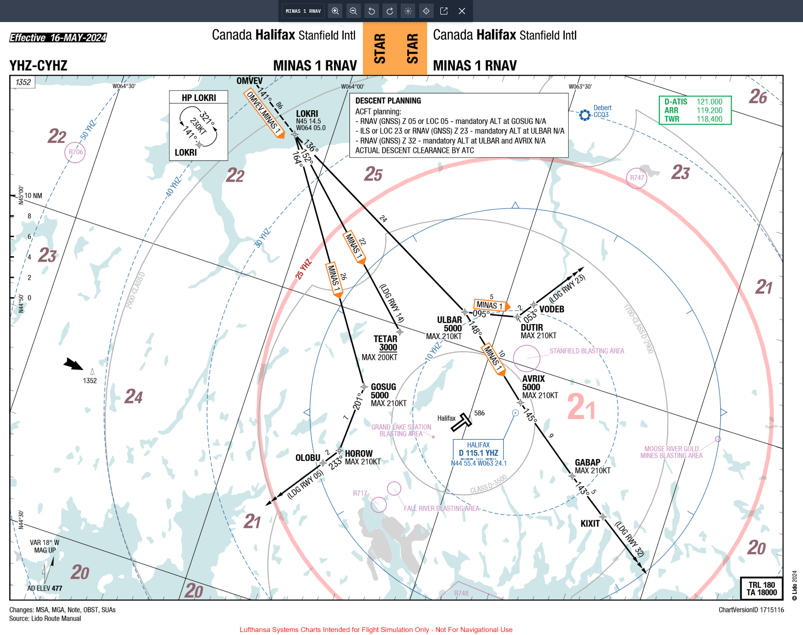{#fig:minas width=90%}

[6] # Separation Standards

[6.1] # Lateral Separation

[6.1(a)] Separation standards are determined based on a set of concentric error rings. One of those rings is the display range, which enables you to accurately determine spacing between aircraft.

[6.1(b)] When logged in as _APP you are deemed to be providing Terminal service, and the 3 nm lateral separation standard applies.

[6.1(c)] If logged in as a _CTR and controlling a designated terminal area, controllers should provide 5 NM separation unless using a separate window to provide terminal service, scaled to a normal Terminal range.

[6.2] # Wake Turbulence Separation

[6.2(a)] (reserved)

[7] # Understanding Aircraft Performance

[7.1] # Mach to IAS Transition

[7.1(a)] At higher altitudes (typically above FL280), aircraft operate based on Mach number rather than IAS, as compressibility effects become significant. Mach number represents the ratio of the aircraft’s speed to the speed of sound, which decreases with altitude. During descent, as ambient pressure increases, a constant Mach number results in increasing IAS. Around the transition altitude (often FL280–FL300 depending on aircraft and SOP), pilots switch from Mach to IAS reference. Controllers should be aware that a descent from Mach 0.78 at FL350 will naturally result in increasing IAS even without pilot input. Speed control in the descent phase may require careful coordination if trying to maintain specific IAS values below transition altitude.

[7.2] # Difficulty Meeting Hard Constraints

[7.2(a)] Aircraft may struggle to meet “hard” constraints—specific crossing altitudes and speeds—especially when these are closely spaced or occur during transitions (e.g., descent from cruise). A constraint like “cross at 10,000 ft and 250 knots” may be physically unachievable from high altitude if issued too late, due to descent rate limits and energy management. Jets descending from cruise altitudes typically require 30–40 NM or more to reduce both altitude and speed simultaneously. Controllers should account for this by issuing early descent clearances and avoiding short-notice altitude/speed combinations that demand rapid energy dissipation. Flexibility with “at or above/below” constraints can help maintain flow while reducing pilot workload and missed restrictions.

[7.3] # Climb Performance and Acceleration Limits

[7.3(a)] Aircraft performance during climb is constrained by available thrust, aircraft weight, and configuration. After takeoff, most aircraft prioritize reaching a clean configuration (gear and flap retraction) before accelerating. Below 10,000 feet, jets are typically restricted to 250 knots IAS, limiting acceleration unless a higher speed is specifically issued. During initial climb, especially when heavy or operating from short runways, aircraft may struggle to both climb and accelerate simultaneously. This is particularly relevant for SID compliance where altitude and speed targets occur close together. Issuing early level-offs or assigning speeds without considering climb capability can lead to missed restrictions or inefficient profiles. Controllers should allow sufficient vertical and horizontal space for aircraft to clean up and accelerate, and avoid assigning aggressive speeds during high-drag, low-energy phases of flight.

[7.4] # Speeds versus Altitude

[7.4(a)] True airspeed (TAS) increases with altitude due to decreasing air density, while indicated airspeed (IAS) remains constant for a given dynamic pressure. As altitude increases, an aircraft maintaining a constant IAS is moving faster through the air mass. This is because TAS is a function of IAS and ambient air density. For example, at FL350, 250 knots IAS corresponds to approximately 420 knots TAS. This has implications for longitudinal spacing, sequencing, and descent planning. Two aircraft flying the same IAS at different altitudes will not arrive at a fix simultaneously, as the one at higher altitude will cover more ground per unit time.

[7.4(b)] Controllers must consider altitude and aircraft type when estimating arrival intervals, issuing speed control, or assigning crossing restrictions, as IAS alone is not sufficient to gauge performance over the ground.

[7.5] # Cost Index Flying

[7.5(a)] Previously, airlines operated their aircraft using standardized climb and descent profiles. Controllers could expect an Air Canada A320 to fly like the other Air Canada A320s and the Westjet B737s to fly like their siblings. This is no longer the case.

[7.5(b)] If you use SimBrief, you may have noticed a Cost Index field in the flight plan input table. A Cost Index is basically a ratio of the Cost of Time versus the Cost of Fuel. A Cost Index of 0 means that you want the aircraft to operate as efficiently as possible. A high value Cost Index[^ci-max] means that it’s more important to get to destination rapidly and the company is willing to pay more for the fuel. In real-world operations, companies may operate using standardized cost indices or adapt them to each flight, depending on their sophistication. In our VATSIM environment, the number is at the pilot’s choice. See [[fig:simbrief]].

[^ci-max]: Maximum numbers vary based on aircraft manufacturers and types.

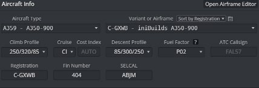{#fig:simbrief width=80%}

[7.5(c)] Pilots operating their flight at a low Cost Index will climb at a high rate with a lower forward speed and will descend earlier and less steeply. The net effect on us is that we need to be prepared for a range of eventualities in terms of performance even within the same aircraft types.

[7.6] # Speed Profiles

[7.6(a)] Airliners can be expected to descend within a range of IAS to achieve the vertical profile necessary to reach the altitude constraints published in the STAR or the Approach.

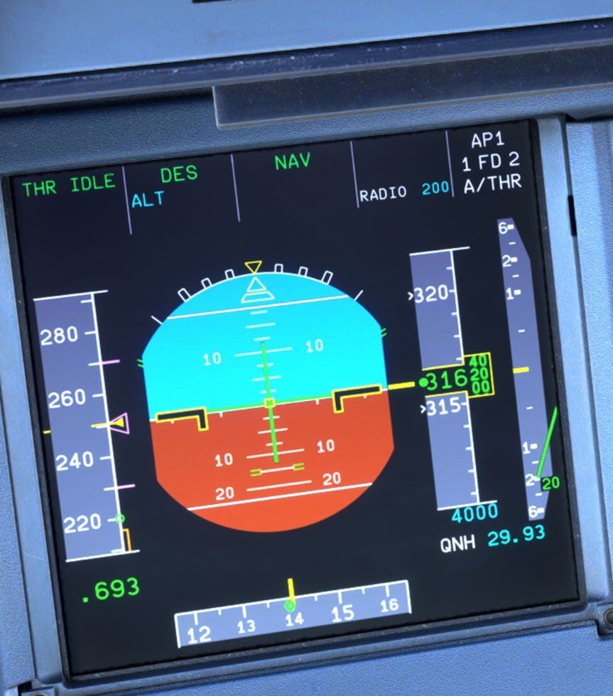{#fig:speeds width=70%}

[7.6(b)] In [[fig:speeds]], note that the aircraft speed band is 250 – 270 knots and that the aircraft is directly on the ideal descent profile, as shown by the green dot to the left of the altitude.

[7.7] # Caveat – Not All Pilots are Created Equal

[7.7(a)] Pilot experience and capability on VATSIM vary widely—from real-world airline captains to first-time sim users. Controllers should remain adaptable and patient, recognizing that some pilots may be unfamiliar with STARs, altitude constraints, or phraseology. Use plain language when needed, offer clarification proactively, and prioritize safe, efficient service over rigid adherence to expectations. When workload permits, brief guidance can improve the pilot’s understanding and benefit future operations. The goal is to maintain realism while ensuring that all participants enjoy a positive and inclusive experience.

[7.7(b)] Of particular concern in the terminal environment are pilots who have ‘closed’ the STAR by deleting the discontinuity well before being cleared for the approach! This means that they will make a turn to final when you may be expecting them to continue on the published heading after passing a given fix. See [[fig:discontinuity]].

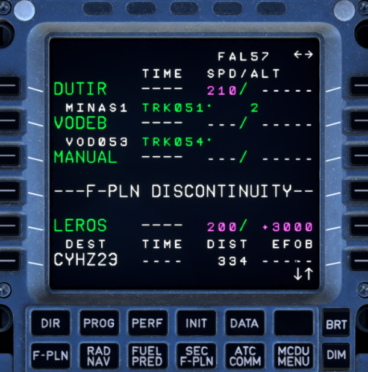{#fig:discontinuity width=70%}

[8] # Best Practices

[8.1] # Do not overcontrol

[8.1(a)] If you don’t need it to provide separation, why give yourself more work?

[8.1(b)] There is nothing wrong with “Cleared to the XXX airport for an approach”. The pilot decides what suits them…

[8.1(c)] Assign altitudes based on real or anticipated traffic. Don’t paint yourself into a corner.

[8.2] # Use of STARs to manage arrival sequences

[8.2(a)] The STARs in this FIR are recent and very well designed.

[8.2(b)] They provide you with downwind legs that are a good distance (5 NM) abeam the airport. This is good to cross departures underneath and to manage a good base leg if required. Make good use of them.

[8.2(c)] If you will not assign a T[^t-transition] approach transition, beware of pilots who may have “closed” an open STAR without clearance. You should ensure they will continue on the downwind leg by use of a positive instruction. Keep it simple and unambiguous.

[^t-transition]: T shaped transition typically as part of an ILS or RNAV Z approach.

[8.3] # IFR Clearances at non-SID aerodromes

[8.3(a)] As seen in the current Tower Operating Practices (_CZQM-TWR§5.2_), IFR clearances are composed according to a standard format:

> (aircraft identification) CLEARED TO (clearance limit), (SID identifier) DEPARTURE (if SID required), (routing details), CLIMB TO (altitude) (if required), MAINTAIN MACH DECIMAL (separate digits) (if Mach # required), (additional clearance details or instructions, if required), TRAFFIC IS (traffic information) (if required).

[8.3(b)] In the case of non-SID aerodromes, the SID portion does not exist, requiring a more detailed clearance formulation.

[8.3(c)] IFR clearances are required to permit the flight to fly in accordance with IFR to its destination. Ad hoc clearances shall consider the tactical situation:

- What is the traffic situation?
- How detailed do I need to be?
- Do I need to specify a runway?
- How long shall I keep the clearance valid prior to departure?[^validity]

[^validity]: 30 minutes is a reasonable rule of thumb, but it may be adapted as required based on the circumstances.

[8.3(d)] There is no need or value in making clearances any more complicated than necessary.

[8.3(e)] If necessary for control, specify the following items in the departure clearance:

- Direction of takeoff and turn after takeoff.
- Initial heading or track to be flown before proceeding on course.
- Any interim altitude restrictions.
- Time or point at which an altitude or heading change is to be commenced or completed.
- Any other necessary manoeuvre.

[8.3(f)] Sample IFR Clearances:

| Example | Clearance |
| --- | --- |
| Simple | GMAZ, cleared to the Deer Lake airport, via flight planned route, maintain 8000 feet, squawk 3021, when leaving 3000 Contact Me on this frequency, Clearance cancelled if not airborne before (time / event) |
| Specifying runway and a heading | GMAZ, cleared to the Deer Lake airport, via direct, maintain 8000 feet, depart runway zero six turn left heading zero four zero until able direct, squawk 3021, when leaving 3000 Contact Me on this frequency, Clearance cancelled if not airborne before (time / event) |
| Specifying an altitude restriction (due to aircraft holding to the northeast for example) | GUGH, cleared to the Goose Bay airport, via direct IRKON Direct NUDOV, flight planned route, maintain Flight Level 220, depart runway 27 proceed on course, not above 5000 until IRKON, squawk 3021, Clearance cancelled if not airborne before (time / event) |

[8.4] # Crossing Departure versus Arrival Traffic

[8.4(a)] Best practice is to cross a departure under the (STAR) path of arrival aircraft close to the departure airport. The further the crossing point is from the airport, the more likely that both aircraft will want to operate at the same altitude.

[8.5] # Holding

[8.5(a)] Holding aircraft is a traffic management strategy that can be employed for several reasons:

- The aircraft requests it for training purposes.
- The aircraft requests it to address a technical issue.
- The aircraft requests it while it waits for weather to improve.
- At the end of a published Missed Approach Procedure, while the controller makes other arrangements to re-sequence the flight.
- There is excessive air traffic demand that cannot be adequately managed using other strategies.
- An arriving aircraft is so high on descent that it cannot reach the runway without significant path stretching, and a hold is the best solution.

[8.5(b)] Sample clearances. It is standard practice to include the cleared altitude with the holding instructions.

| Situation | Clearance |
| --- | --- |
| Clearance to a published hold with Expect Further Clearance Time | “BAW4, CLEARED TO MUVOX, MAINTAIN 1 1 THOUSAND, HOLD AS PUBLISHED. EXPECT FURTHER CLEARANCE AT (time)” |
| Clearance to a published hold with instruction to depart the holding fix at a specific time | “BAW4, CLEARED TO MUVOX, HOLD AS PUBLISHED. DEPART MUVOX AT (time)” |
| Clearance to a non-published hold | “CLEARED TO KATLO, HOLD EAST ON 270 INBOUND TRACK. EXPECT FURTHER CLEARANCE AT (time)” |
| Instruction to leave the hold and resume following a STAR | “BAW4 PROCEED DIRECT MUVOX, rejoin STAR.” |

[8.5(c)] Although holding patterns can be established anywhere, it is best to hold aircraft at a published holding pattern.

[8.5(d)] It is best to hold aircraft higher than lower, for fuel conservation.

[8.5(e)] The usual strategy to manage holding stacks is to

[8.5(e)(i)] Hold the first (lowest) aircraft at a reasonable altitude that will allow it to rejoin the STAR upon exiting the hold. In the case of the CYHZ holding patterns, 14000 feet is a good base altitude.

[8.5(e)(ii)] Establish aircraft in the hold and descend them while in the hold to the exit (base) altitude.

[8.5(e)(iii)] No horizontal separation exists between holding aircraft. Vertical separation must be applied.

[8.5(e)(iv)] Subsequent holding aircraft cannot be cleared lower than the altitude vacated by the next lowest aircraft. E.g. WJA275 is holding at MUVOX; Cleared to 140; Mode C observed at 167 descending. DAL220 is the next aircraft cleared to hold at MUVOX; it could be cleared as low as 170. Aircraft performance must be kept in mind to ensure that a minimum of 1000 separation will exist through the evolution.

[8.5(e)(v)] The lower aircraft reports vacating 160, then it can be assigned to the next aircraft.

[8.5(e)(vi)] As aircraft descend in the hold, the controller “ladders down” each subsequent aircraft, while ensuring vertical separation.

[8.5(f)] Once the lowest aircraft is clear laterally of the holding stack, the remaining aircraft can then be descended progressively.

[9] # Phraseologies

[9.1] # Landing Information

[9.1(a)] You need not issue information included in the current ATIS broadcast, provided that conditions are not changing rapidly.

[9.2] # Vector Initiation Examples
When initiating a vector, the controller must include the reason for the vector, and as required, the point or course to which the aircraft will be vectored. Controllers should provide an estimate of the number of track miles to be flown on the vector for an arriving aircraft, if known, to aid the pilot’s ability to manage descent.

[9.2(a)] Initiating a vector

- VECTORS DUE TRAFFIC, FLY HEADING THREE-ONE-ZERO, EXPECT DIRECT OKREV IN TWO-ZERO MILES.
- FLY HEADING THREE-ONE-ZERO, VECTORS FOR SEQUENCING, EXPECT A ONE-FIVE MILE FINAL.
- STAR CANCELLED, FLY HEADING ONE-FOUR-ZERO, VECTORS TO FINAL EXPECT BASE TURN IN SIX MILES.

[9.2(b)] After the approach interface waypoint to continue a downwind (e.g. DUTIR)

- MAINTAIN PRESENT HEADING, EXPECT A ONE-ZERO MILE FINAL.
- MAINTAIN PRESENT HEADING, EXPECT BASE LEG SIX MILES.

[9.2(c)] Terminating vector by sending aircraft direct a waypoint to rejoin the STAR

- PROCEED DIRECT MUVOX, REJOIN STAR.

[9.3] # Vector Method Examples

[9.3(a)] Examples

- FLY HEADING (number)
- LEAVE LOGPO HEADING 050
- MAINTAIN PRESENT HEADING
- TURN RIGHT HEADING 1 4 0
- TURN RIGHT 30 DEGREES

[9.4] # Weather Deviation Examples

[9.4(a)] Examples

- DEVIATION APPROVED. ADVISE CLEAR OF WEATHER.
- DEVIATION NORTH APPROVED. WHEN ABLE, PROCEED DIRECT MIILS ON COURSE
- DEVIATION NO FURTHER THAN THREE-ZERO MILES OF ROUTE APPROVED
- DEVIATION FOUR-ZERO DEGREES RIGHT APPROVED. WHEN ABLE, FLY HEADING TWO-FIVE-ZERO AND ADVISE.

[9.5] # Speed

[9.5(a)] Requests

- SAY AIRSPEED
- SAY MACH NUMBER

[9.5(b)] Maintain Speed Assignment Examples

- MAINTAIN PRESENT SPEED
- MAINTAIN SPEED 250 KNOTS
- SPEED 210 KNOTS

[9.5(c)] Reduction Examples

- MAINTAIN SPEED 250 KNOTS OR LESS
- REDUCE SPEED 210 KNOTS OR LESS
- REDUCE TO MINIMUM CLEAN SPEED
- REDUCE TO MINIMUM APPROACH SPEED
- REDUCE SPEED BY 30 KNOTS

[9.5(d)] Increase Examples

- MAINTAIN 280 KNOTS OR GREATER
- INCREASE [SPEED] TO 280 KNOTS OR GREATER
- INCREASE [SPEED] BY 20 KNOTS

[9.5(e)] Speed Assignment to a Fix

- (speed assignment) UNTIL (fix)
- Cross MITIK at 160 knots

[9.5(f)] Terminating

- RESUME NORMAL SPEED (does not cancel published speed restrictions).
- RESUME PUBLISHED SPEED

[9.5(g)] Combined Speed reductions and descents

[9.5(g)(i)] A simultaneous descent and speed reduction can be a difficult manoeuvre for some types of aircraft. It may be necessary for the pilot to level off temporarily and reduce speed before descending. Phrase the clearance to specify which action must be accomplished first to remove any confusion as to intent or priority:

- REDUCE TO 230 KNOTS [OR LESS], THEN DESCEND [TO] 6000.
- DESCEND [TO] 6000, THEN REDUCE TO 230 KNOTS [OR LESS].
- DESCEND [TO] 6000, THEN REDUCE [SPEED] BY 30 KNOTS [OR LESS].

[9.6] # Non-Specific Approach Clearance

[9.6(a)] Traffic permitting, you may issue a non-specific approach clearance. ...FOR AN APPROACH.

[9.7] # Visual Approach

[9.7(a)] Requires Ceiling 500 feet or more above the minimum IFR altitude (CYHZ 2100 = 2600) and ground visibility of 3 statute miles or more.

[9.7(b)] For a single approaching aircraft that has reported sighting the airport: … CLEARED VISUAL APPROACH RUNWAY 23.

[9.7(c)] For multiple approaching aircraft and the pilot reports sighting the leading IFR traffic and confirms the type and position of the aircraft to be followed: … CLEARED VISUAL APPROACH RUNWAY 23 FOLLOW THE A320.

[9.8] # Approach Clearance Examples

[9.8(a)] CLEARED [ [ TO THE ] ( name ) AIRPORT ] ( approach name ) RUNWAY ( runway id ) APPROACH ( approach transition name ) TRANSITION.

CLEARED TO THE HALIFAX AIRPORT ILS RUNWAY 23 APPROACH DUTIR TRANSITION

[9.8(b)] RNAV-capable aircraft can project the extended final approach course to any distance and therefore may be vectored to intercept outside the IF or IWP. They can also navigate direct to the IF or IWP and intercept the final approach course from any point downwind of the approach interface waypoint.

[9.8(c)] Examples

- PRM4211 TURN RIGHT HEADING 260 TO INTERCEPT FINAL APPROACH COURSE INBOUND (followed by an approach clearance when suitable)
- PRM4211 PROCEED DIRECT LEROS, CLEARED ILS RUNWAY 2 3 APPROACH
- PRM4211 CLEARED TO THE HALIFAX AIRPORT RNAV ZULU RUNWAY 2 3 APPROACH
- PRM4211, VIA FUNDY5 ARRIVAL, CLEARED ILS RUNWAY 2 3 APPROACH.
- PRM4211, VIA DIRECT DUTIR, CLEARED HALIFAX AIRPORT ILS RUNWAY 2 3 APPROACH

[9.8(d)] Do not clear a VFR aircraft for a simulated approach. You may, however, approve a simulated approach: GMPC ILS 23 APPROACH APPROVED. MAINTAIN V F R.

[9.9] # STAR Amendments

[9.9(a)] (reserved)

[9.10] # Missed Approach

[9.10(a)] (reserved)

[10] # Unit-Specific Guidance

[10.1] # CYHZ [CYHZ_APP]

[10.1(a)] (reserved)

[10.2] # CYQM [CYQM_APP]

[10.2(a)] (reserved)

[10.3] # CYFC

[10.3(a)] Approaches to Rwy 33 are restricted to those aircraft that can fly an RNAV Y approach. Runway 33 will not normally be advertised as an IFR arrival runway.

[10.3(b)] Due to the proximity of the CYRs to the Southeast of the airport, aircraft from the East and Southeast will normally be cleared to CYFC for an approach via NOSUL (or VIBMA from CYQM and East), which provide a long transition for the ILS, RNAV Z and RNAV Y approaches.

[10.4] # CYSJ [CYSJ_APP]

[10.4(a)] Due to the proximity of the CYRs between CYFC and CYSJ, aircraft from the West, North and East of CYSJ will normally be cleared to CYSJ for an approach via an Initial Fix that provides a long transition for the approaches while ensuring separation from the Restricted airspace. See [[fig:cysj-apch-05]], [[fig:cysj-apch-14]] and [[fig:cysj-apch-23]].

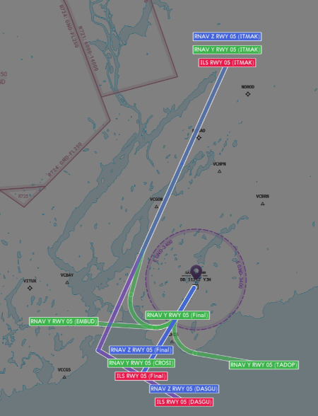{#fig:cysj-apch-05 width=60%}

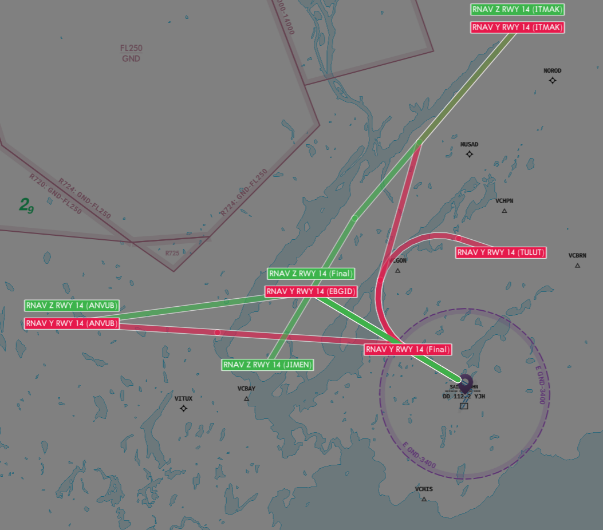{#fig:cysj-apch-14 width=75%}

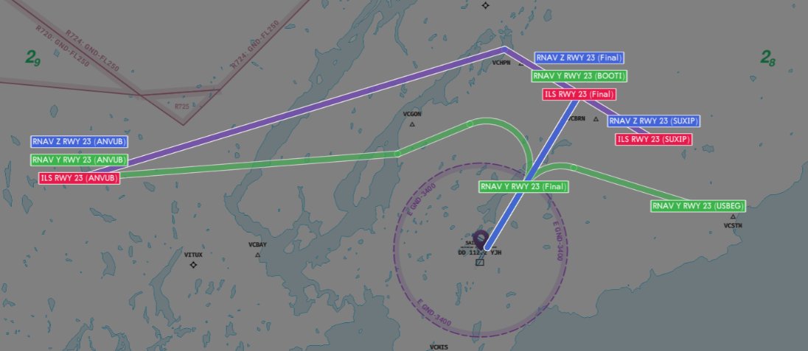{#fig:cysj-apch-23 width=100%}

[10.5] # Tri-Terminal [CZQM_L_APP]

[10.5(a)] The “Tri-Terminal” sector has been created to expand the Moncton Low consolidation of the CYSJ and CYQM Terminal Sectors with the Halifax Terminal. This is to offer a greater challenge to controllers and improve the services to our pilot customers. The Sector name is CZQM_L_APP. Callsign is Moncton Centre, which is analogous to Moncton Low.

[10.5(b)] CZQM_L_APP shall only be operated if none of the three TCAs are online. Should CYHZ_APP log on, the controller on CZQM_L_APP should reconnect as CYQM_APP or CYSJ_APP. The same applies vice versa.

[10.5(c)] Operation of this sector requires an S3 rating or above.

[10.5(d)] CZQM_L_APP will automatically connect as 119.200 but should cross-couple 124.400 manually using the Audio For VATSIM XC function, or the identical Track Audio function.

[10.5(e)] When aircraft transfer between the CYHZ and CYQM / CYSJ Terminals, they should be instructed to change to the respective frequency. For instance, ACA123 flying CYHZ to CYQM should be told to contact 124.400 prior to crossing the boundary. Though one controller operates both frequencies, this is done for operational clarity and pilot understanding, ensuring both effective controller relief and effective flying. Phraseology is as follows: [CALLSIGN], Moncton Centre, Change to my frequency [FREQ].

[10.5(f)] The CYSJ_APP frequency of 124.300 does not need to be cross coupled. CZQM_L_APP operates under the assumption that CYQM_APP and CYSJ_APP are combined into CYQM_APP. See [[fig:tri-terminal]].

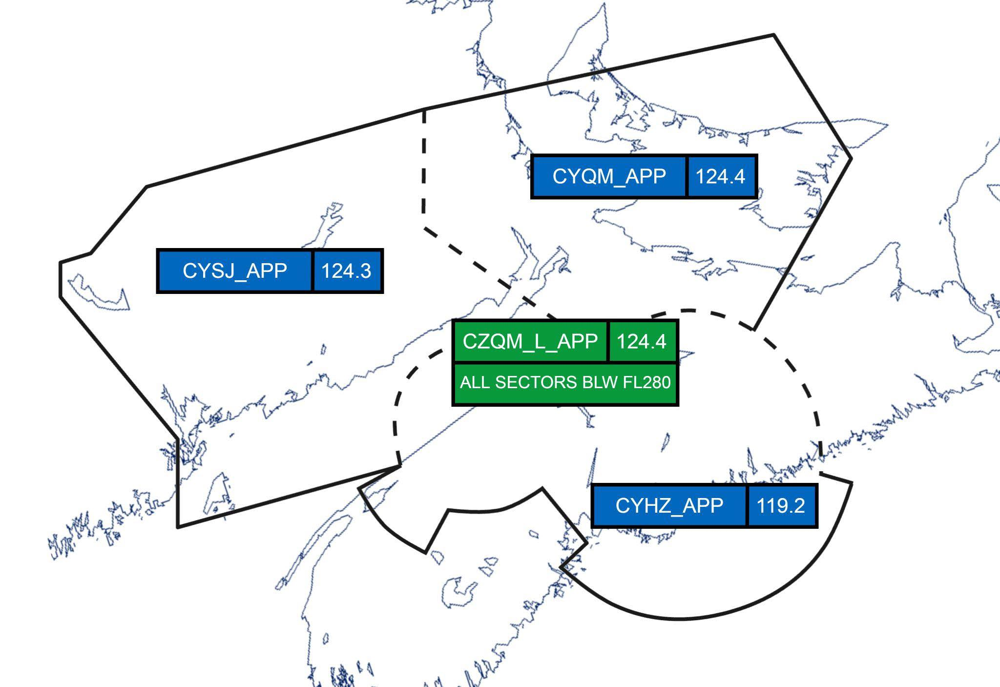{#fig:tri-terminal width=90%}

[10.6] # CYYT

[10.6(a)] (reserved)

[10.7] # CYQX

[10.7(a)] (reserved)

[11] # Glossary

[11.1] # Terms

| Term | Definition |
| --- | --- |
| ACARS | Aircraft Communications Addressing and Reporting System |
| active runway | Any runway or runways currently being used for takeoff or landing. When multiple runways are used, they are all considered active runways. |
| aerodrome | Any area of land, water (including the frozen surface thereof) or other supporting surface used, designed, prepared, equipped or set apart for use, either in whole or in part, for the arrival, departure, movement, or servicing of aircraft. This includes any buildings, installations, and equipment situated thereon or associated therewith. |
| AGL | above ground level |
| ATC clearance | An authorization issued by an ATC unit for an aircraft to proceed within controlled airspace in accordance with the conditions specified by that unit. |
| APP | approach control service |
| ASL | above sea level |
| ATIS | automatic terminal information service |
| AVANA | Approval Void if Aircraft Not Airborne by (time) |
| Backtrack | The taxiing of an aircraft on a runway in use in a direction opposite to the landing or take-off direction. |
| base leg | A flight path extending from the end of the downwind leg to the extended centreline of the approach end of the landing runway (or landing path). |
| BPOC | before proceeding on course |
| capacity | The number of aircraft that may be safely handled by an ATS system, or any of its subsystems or operating positions, within a defined portion of airspace during a specific period of time |
| CAVOK | A term (pronounced KAV-OH-KAY), derived from the words "ceiling and visibility OK," that may be used in air-ground communication when meteorological information is transmitted to aircraft. CAVOK refers to the simultaneous occurrence at an airport of all of the following meteorological conditions: no cloud below 5000 ft, or below the highest minimum sector altitude (MSA), whichever is higher, and no cumulonimbus; a visibility of 6 SM or more; and no precipitation, thunderstorm, shallow fog, or drifting snow. |
| CLEARED FOR THE OPTION | For an arriving aircraft, ATC authorization for an aircraft to make a touch-and-go, low approach, missed approach, stop and go, or full stop landing at the discretion of the pilot. For a departing aircraft, ATC authorization for an aircraft to make a simulated rejected takeoff, reduced power takeoff and a simulated engine out failure on departure procedure at the discretion of the pilot. |
| closed STAR | A STAR that provides a continuous path from the enroute structure and automatically joins up with the final approach course. |
| controlled VFR flight | A flight conducted under VFR within Class B airspace and in accordance with an ATC clearance. |
| CPDLC | Controller-Pilot Data Link Communications. A means of communication between controller and pilot, using data link for ATC communications. |
| crosswind component | The wind speed measured in knots at angles from 20° to 90° from the runway in use that would equal the effect of a wind applied at 90° to the runway in use. |
| cruise climb | A cruising technique resulting in a net increase in altitude as the aircraft mass decreases. A clearance or instruction to carry out a cruise climb allows the pilot the option of climbing at any given rate, as well as the option of levelling off at any intermediate altitude. |
| CYR | Class F airspace of defined dimensions above the land areas or territorial waters within which the flight of aircraft is restricted in accordance with certain specified conditions |
| DAR | designated arrival runway. A runway to be used by arrivals, as coordinated between a tower and an ACC |
| downwind leg | A flight path parallel to the landing runway (or landing path) in the direction opposite to landing. The downwind leg normally extends between the crosswind leg and the base leg. |
| EAC | expected approach clearance time |
| EFC | expected further clearance time |
| FACF | A fix and/or waypoint located at any of the following points on the final approach course of an instrument approach procedure: prior to the point of glide path (GP) intercept on a precision approach procedure; prior to the final approach fix (FAF) on a non-precision approach procedure that has a designated FAF; prior to any stepdown fixes on a non-precision approach procedure with designated fixes but no FAF; or at a point that would permit a normal landing approach on a non-precision approach procedure with no FAF or stepdown fixes. |
| FAF | final approach fix. That fix of an instrument approach procedure where the final approach segment commences. |
| final approach course | A bearing/radial/track of an instrument approach leading to a runway or an extended runway centreline, all without regard to distance |
| HAVE NUMBERS | An expression used by pilots to indicate that they have received runway, wind, and altimeter information only. |
| HOLD SHORT | Instructions to hold at least 200 ft from the edge of a runway while awaiting permission to cross or proceed onto a runway unless other holding positions are established by the aerodrome operator. |
| hover taxi | The movement of a helicopter or vertical takeoff and landing aircraft above the surface of an aerodrome and in ground effect at airspeeds less than approximately 20 kt. |
| IAF | (initial approach fix) The fix of an instrument approach procedure at which the aircraft leaves the enroute phase of operations to commence the approach |
| IF | (intermediate fix) The fix at which the aircraft enters the intermediate approach segment of an instrument approach |
| IFR Departure Release | A procedure used by airport controllers to assume responsibility for the release of IFR departures. |
| LAHSO | (Land and Hold Short Operations) Operations that include simultaneous takeoffs and landings and/or simultaneous landings when a landing aircraft is able and is instructed by the controller to hold-short of the intersecting runway/taxiway or designated hold-short point. |
| Mach number | The ratio of the speed of an object to the local speed of sound. |
| MAYDAY | An expression meaning "I am in distress." It is the international radiotelephony distress signal. Preferably spoken three times, it indicates imminent and grave danger and means that immediate assistance is requested. |
| MEDEVAC | A term used to request Air Traffic Service priority handling for a medical evacuation flight, based on a medical emergency in the transport of patients, organ donors, organs, or other urgently needed life-saving medical material. The term is used on flight plans and in radiotelephony communications if a pilot determines that a priority is required. |
| metering fix | A fix along an established arrival route from over which aircraft will be metered prior to entering terminal airspace |
| MINIMUM FUEL | An expression used to inform ATC that an aircraft's fuel supply has reached a state that is sufficient to reach destination, provided that unexpected delays are not encountered |
| minimum IFR altitude | The lowest IFR altitude established for use in a specific airspace. Depending on the airspace concerned, the minimum IFR altitude may be a minimum obstacle clearance altitude (MOCA), a minimum enroute altitude (MEA), a minimum sector altitude (MSA), a minimum vectoring altitude (MVA), a safe altitude 100 NM, a terminal arrival area (TAA), an area minimum altitude (AMA), a transition altitude, or a missed approach altitude. The minimum IFR altitude provides obstacle clearance but may or may not be within controlled airspace. |
| open STAR | A STAR that provides a continuous path from the enroute structure but does not automatically join up with the final approach course. |
| PAN PAN | The international radiotelephony urgency signal. Preferably spoken three times, it indicates a condition that concerns the safety of an aircraft or another vehicle, or of some person on board or within sight, but that does not require immediate assistance. |
| PDC | (pre-departure clearance) An initial IFR clearance delivered electronically via air-ground data link (AGDL) to airline companies with an on-site computer capable of interfacing with ATC and the data link service provider. |
| readback | A procedure whereby the receiving station repeats a received message or an appropriate part thereof to the transmitting station so as to obtain confirmation that the message was received correctly |
| runway occupancy time | The length of time required for an arriving aircraft to proceed from over the runway threshold to a point clear of the runway |
| tailwind component | The wind speed measured in knots at angles from 91° to 179° from the runway in use that would equal the effect of a wind applied at 180° to the runway in use. Components are specified in a component table for a specified permissible tailwind. |
| ZULU | Spoken expression for: Co-ordinated Universal Time. |

[12] # Flight Management Illustrations

[12.1] # STAR and Approach Selection

[12.1(a)] Initial flight plan and approach selection: [[fig:initial-fp]], [[fig:approach]], [[fig:star-selection]], and [[fig:star-transition]].

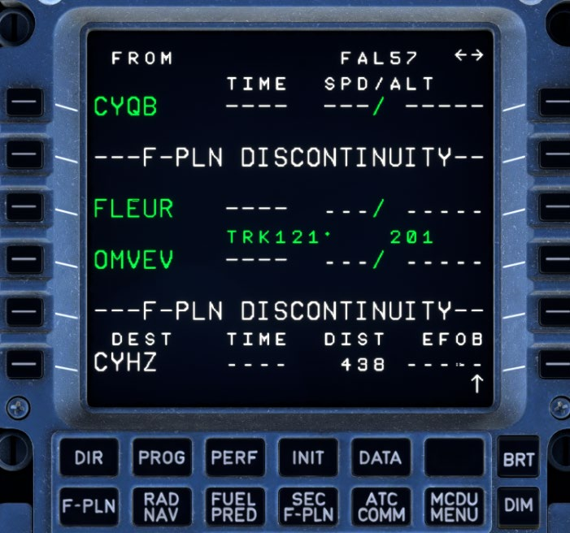{#fig:initial-fp width=80%}

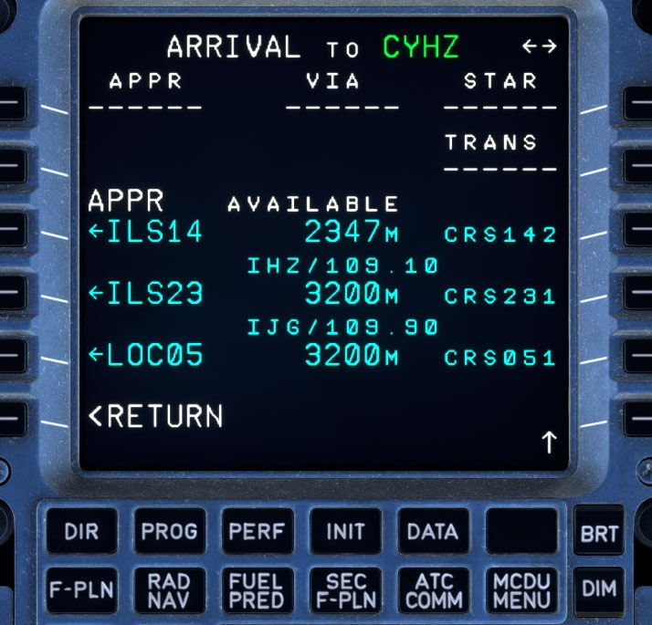{#fig:approach width=80%}

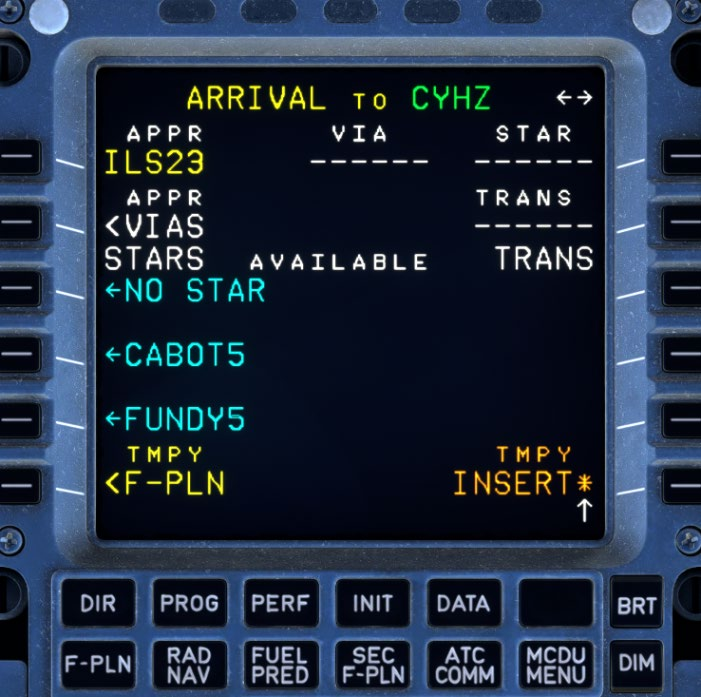{#fig:star-selection width=80%}

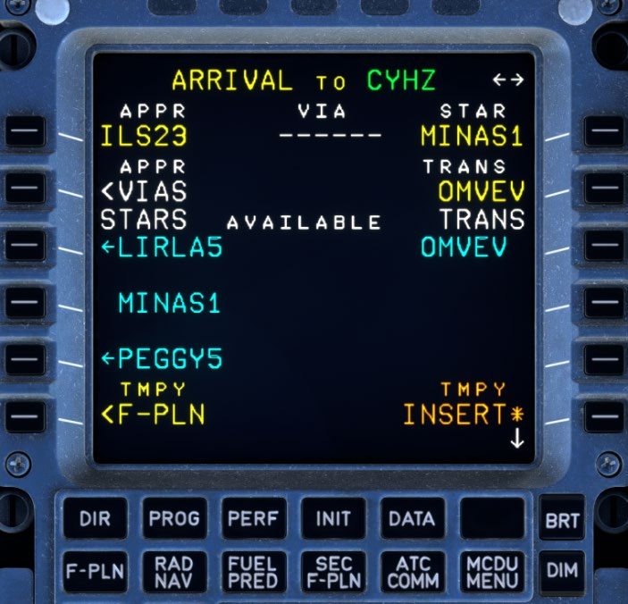{#fig:star-transition width=80%}

[12.1(b)] Approach Via selection and its effect on the STAR: [[fig:approach-via]], [[fig:no-via]], [[fig:open-star]], [[fig:no-via-confirmed]], [[fig:dutir-via]], and [[fig:closed-star]].

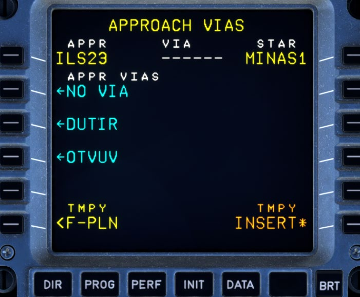{#fig:approach-via width=80%}

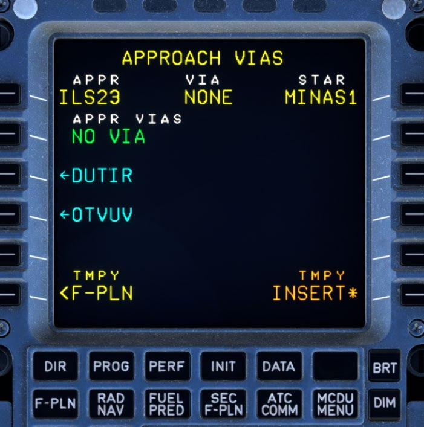{#fig:no-via width=80%}

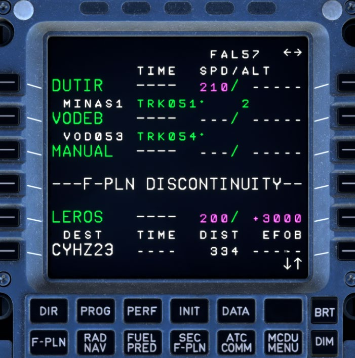{#fig:open-star width=80%}

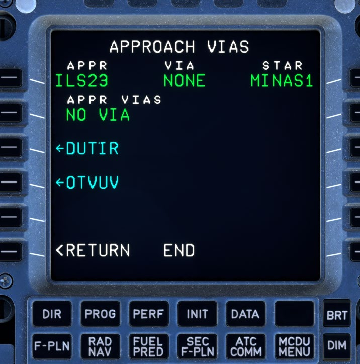{#fig:no-via-confirmed width=80%}

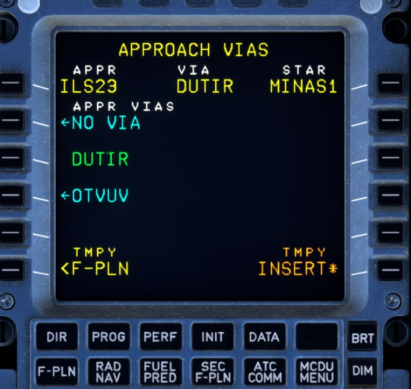{#fig:dutir-via width=80%}

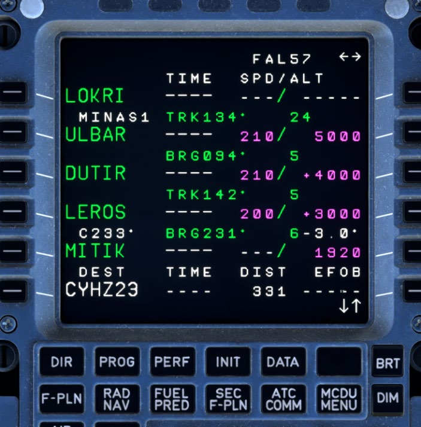{#fig:closed-star width=80%}

[12.2] # Descent Performance and Speed

[12.2(a)] Cost index and manually selected descent speed: [[fig:ci-5]], [[fig:ci-100]], [[fig:manual-speed]], and [[fig:manual-active]].

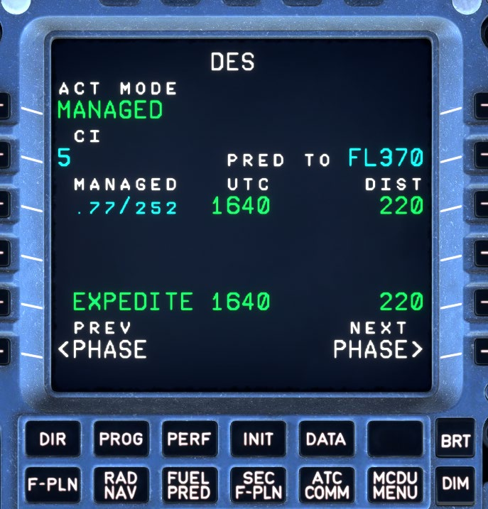{#fig:ci-5 width=80%}

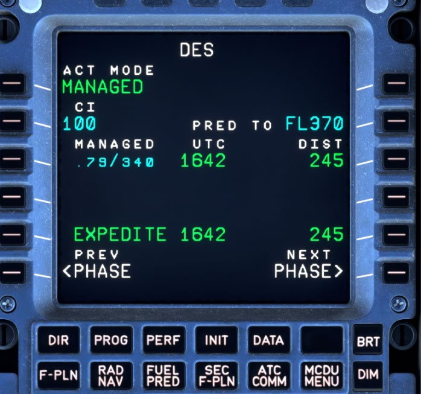{#fig:ci-100 width=80%}

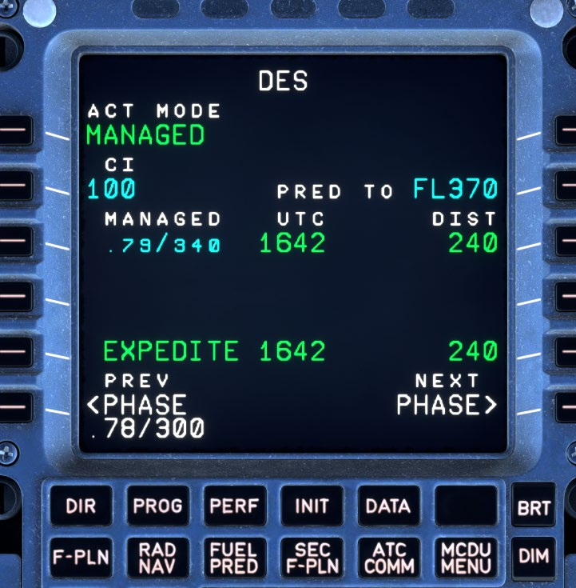{#fig:manual-speed width=80%}

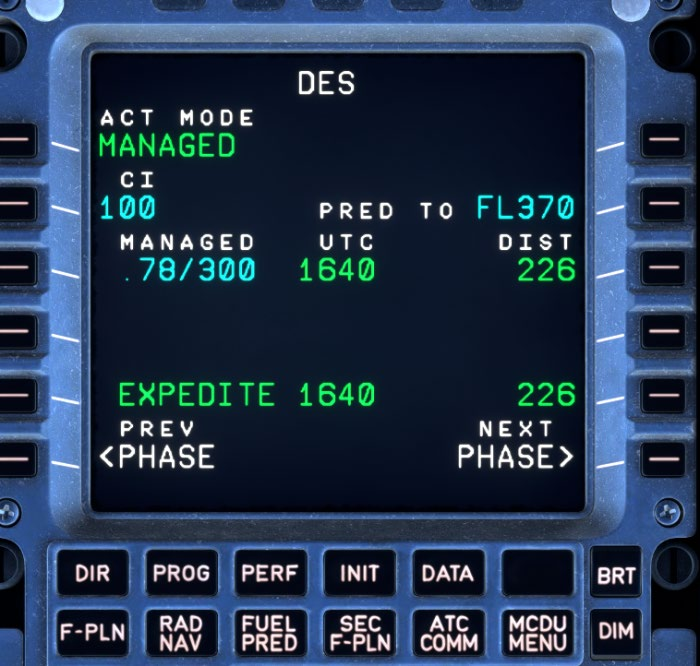{#fig:manual-active width=80%}

[12.2(b)] Speed tape and descent profile examples: [[fig:green-dot]], [[fig:ci-20-route]], [[fig:ci-20-280]], [[fig:ci-20-250]], [[fig:ci-20-flight-plan]], [[fig:speed-tape]], and [[fig:descent-profile]].

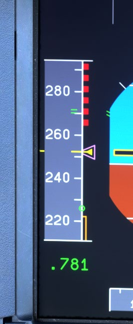{#fig:green-dot width=45%}

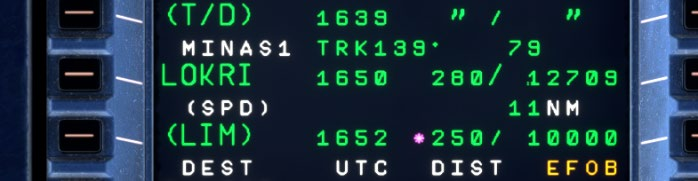{#fig:ci-20-route width=90%}

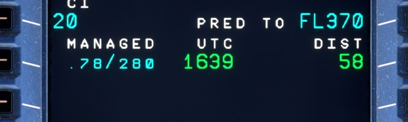{#fig:ci-20-280 width=90%}

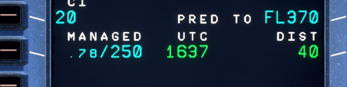{#fig:ci-20-250 width=90%}

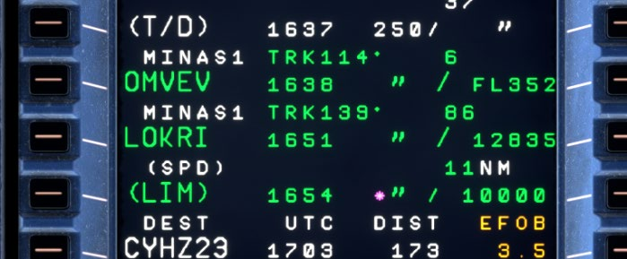{#fig:ci-20-flight-plan width=90%}

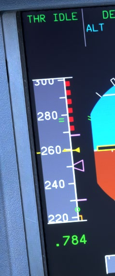{#fig:speed-tape width=45%}

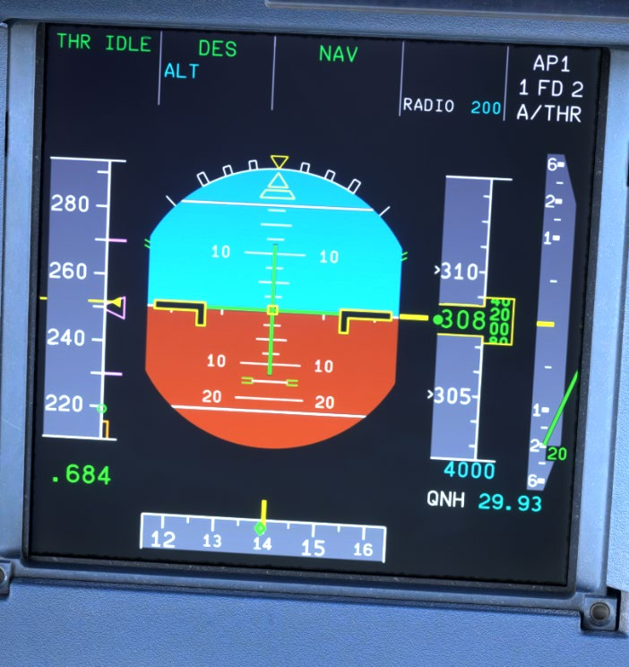{#fig:descent-profile width=80%}
