[1] # Control Pages

[1.1] # Document Identification

| Item           | Value                              |
| -------------- | ---------------------------------- |
| Name           | CZQM FIR Tower Operating Practices |
| Identification | CZQM-TWR                           |
| Type           | Operating Practices                |
| Revision       | 1.3                                |
| Effective Date | To be confirmed                    |

[1.2] # Revision Records

| Revision ID | Effective Date   | Description of Change |
| ----------- | ---------------- | --------------------- |
| 1.0         | 2025-05-24 0300Z | Initial version |
| 1.1         | 2025-08-15 0300Z | Modification to 4.1.2.2 compulsory routes to reflect real world changes |
| 1.2         | 2025-12-27 0400Z | Editorial. Change markups. Further mods to 4.1.2.2 mandatory routes. Additional procedures added for several airports |
| 1.3         | To be confirmed  | VFR procedures added for CYFC. Readback and acknowledgement rules (CAR 602.31 as amended, in force 2026-11-19) added to [[3.1]], [[3.2]], [[3.3]]; immediate take-off and ATIS identifier paragraphs added to [[3.3]]; new Phraseologies chapter ([[5]]) (Delivery, Ground, Tower, VFR, helicopters); MANOPS references replaced by references to NAV CANADA guidance material. Phraseology Supplement and Corrections rolled in: push-back ([[5.2]]), unable-clearance and protected-area forms ([[5.3]]), backtrack after landing ([[5.3]]), departure instructions before take-off and pilot-applied visual separation ([[5.4]]), circuit extras, VFR over-the-top and VFR departure on an IFR clearance ([[5.6]]), and radiotelephony fundamentals ([[5.8]]). Tower release (TR) authority ([[3.4]]) and approximate take-off distances for each airport (chapter [[4]], new [[4.6]] CYYR and [[4.7]] LFVP) incorporated from the former reference documents. Reformat document to use CZQM docengine. [[2.2]] reflects new git based tracking. |

[2] # Introduction

[2.1] # Scope and Applicability

[2.1(a)] This document is intended to provide operational guidance to CZQM controllers providing services to virtual pilots from this FIR’s control towers, either directly or indirectly (top-down).

[2.1(b)] FIR policies are contained in the Moncton / Gander FIR General Policy document (CZQM-FGP§2.1).

[2.2] # Amendments

[2.2(a)] Amendments to this document are tracked and versioned using the CZQM-FIR/policies GitHub repository.

[3] # Control Tower Positions – Generic Guidance

[3.1] # Clearance Delivery

[3.1(a)] A clearance delivery controller provides clearances after verifying the validity of a requested flight plan route. This role includes adjusting flight plans where appropriate.

[3.1(b)] When reviewing and validating the filed flight plans, Clearance Delivery shall:

- Assign an SSR code.
- Assign the appropriate SID.
- Update the Cleared Flight Level (CFL) field to reflect the SID altitude.[^cfl]
- Ensure that the flight plan route is compliant with unit directives.

[^cfl]: This is 5000 ft or 050 in ATC notation.

[3.1(c)] Obtain a readback of every IFR clearance (CAR 602.31(1)(b)(i)). When the clearance contains a published SID and the filed route is unchanged, the pilot may acknowledge with the call sign and the transponder code (CAR 602.31(2)); a full readback is required for any route change and whenever you ask for one. If a detailed readback is given, correct every error in it before the aircraft taxis. See [[5.1]].

[3.2] # Ground

[3.2(a)] A ground controller is tasked with providing control instructions to aircraft operating on movement areas, such as taxiways, to and from runways and parking positions.

[3.2(b)] Ground controllers also provide what VATSIM calls Ground Sequencing. A ground sequencing controller is involved in strategic sequencing of departing traffic (on the ground), planning delays and meeting restrictions set on departures. Ground controllers should sequence departures to provide optimally efficient use of the active runway(s).

[3.2(c)] In this FIR, apron surfaces are normally uncontrolled. However, if the ground controller is of the opinion that congestion exists or will soon exist on an apron, the controller is allowed to take control of the apron and issue pushback clearances and other instructions as necessary to mitigate potential disruptions.[^apron-events]

[^apron-events]: This is typically during events, such as Moncton Mondays, FNOs, etc.

[3.2(d)] Taxi instructions are acknowledged, not read back; do not require a pilot to repeat the route. Obtain a readback of every HOLD and HOLD SHORT instruction — mandatory for the pilot under CAR 602.31(1)(c) from 19 November 2026 — and say READBACK HOLD SHORT INSTRUCTIONS when it is not given. Readback of CROSS, LINE UP and BACKTRACK is recommended, not required. “Holding short” used as a location in a frequency change is not a readback.

[3.2(e)] Issue the initial taxi instruction only as far as the first hold area (normally the first runway on the route), with CROSS or HOLD SHORT for every runway on the route and authorize each crossing as the aircraft approaches it. Do not authorize a crossing from the apron. See [[5.3]].

[3.3] # Tower

[3.3(a)] A tower controller provides instructions relating to movements on or near runways, including take-off and landing clearances and managing the separation of local visual traffic.

[3.3(b)] As specified in NAV CANADA guidance material, crosswind limits (considering gusts) are 25 kt for dry runways and 15 knots for wet runways.

[3.3(c)] The NAV CANADA AeroView website provides access to “Live RVR” pages for CYFC, CYHZ, CYQM, CYQX, and CYYT. These pages include current airport information and crosswind analysis that is useful in calculating crosswind components. Controllers are reminded that the VATSIM environment only uses published METAR and SPECI weather products to control the environment. Controllers should not use the live winds shown on these pages as they may not reflect the weather experienced by our customers.

[3.3(d)] Pilots requesting a different runway for operational reasons should be accommodated.

[3.3(e)] Pilots can be instructed to proceed via or report over a VFR reporting point (landmark).

[3.3(f)] VFR reporting waypoints, as noted on the pertinent VFR Terminal Procedures charts, can be displayed in the appropriate Euroscope ASR by using Other Set > Display settings > Fixes, then navigating to the applicable Ident and selecting symbol and / or name for display – then apply. They are depicted by default on GNG TWR ASRs.

[3.3(g)] Take-off and landing clearances are clearances: an IFR flight reads them back; a VFR flight may acknowledge with its call sign (CAR 602.31(1)(b)). A LAHSO clearance is read back in full by every aircraft. Every take-off clearance is to be acted on without delay; a pilot who intends a static take-off is expected to say so when requesting it.

[3.3(h)] CLEARED FOR IMMEDIATE TAKEOFF is a separation tool. It means one continuous movement from the hold line into the take-off roll with no stop on the runway, and it is used only when the gap exists only if the aircraft rolls now. Determine ability first (ARE YOU ABLE AN IMMEDIATE DEPARTURE?) or include IF UNABLE, HOLD SHORT RUNWAY (number). Cancel with TAKE-OFF CLEARANCE CANCELLED (reason) if the gap collapses before the roll. See [[5.4]].

[3.3(i)] From 19 November 2026 pilots must state the ATIS identifier on initial contact (CAR 602.31(1)(d)). Omit wind and altimeter from taxi and initial clearances when they have; if a pilot reports only “with the ATIS”, confirm the letter.

[3.3(j)] Approximate distance available for take-off is given for each airport in chapter [[4]]: the full runway length, and the distance remaining from each intersection used for departure ([[4.1(h)]], [[4.2(d)]], [[4.3(c)]], [[4.4(e)]], [[4.5(b)]], [[4.6(a)]], [[4.7(a)]]). Since these are approximations, controllers should use “APPROXIMATE DISTANCE AVAILABLE …” phraseology.

[3.4] # Tower Release (TR) Authority

[3.4(a)] CYHZ. Tower release (TR) is automatically granted once confirmation of the active runway is communicated. Should YHZ_TWR utilize a non-active runway for departure they must obtain a TR from the position covering YHZ_APP.

[3.4(b)] All other CZQM/CZQX airports require prior coordination of a TR. The radar position covering terminal or departure services may authorize blanket TR authority depending on their circumstances.

[3.4(c)] A TR request may be verbally processed or through the use of the VATCANSitu release request function. If the Tower prefers VATCANSitu, inform the departure controller so they can be vigilant of requests.

[4] # Airport-Specific Guidance

[4.1] # CYHZ

[4.1(a)] Layout

[4.1(a)(i)] Runways and Taxiways are as per [[fig:cyhz-airport]]. The default runway in use at CYHZ is runway 23. It should be selected unless crosswind or tailwind limits are exceeded.[^cyhz-limits]

[^cyhz-limits]: Normally Tailwind > 5 kts or Crosswind > 15 kts, inclusive of gusts, unless otherwise specified by the pilot.

{#fig:cyhz-airport width=90%}

[4.1(a)(ii)] Taxiway N leading to Runway 14 is not depicted in the default MSFS 2020 scenery. Backtracking may be required.

[4.1(a)(iii)] We understand Taxiway A to terminate in line with the west side of the terminal apron (Apron 1), becoming Apron 1 at that time.

[4.1(b)] Low Vis Procedures (RVR <1200 > 600)

[4.1(b)(i)] Low visibility Taxi Routes for RWY 23 are as depicted in [[fig:cyhz-low-visibility]]. Flight simulator scenery does not support the required lights although the XPGuard[^xpguard] module for MSFS / X-Plane 12 does.

[^xpguard]: https://xpguard.net

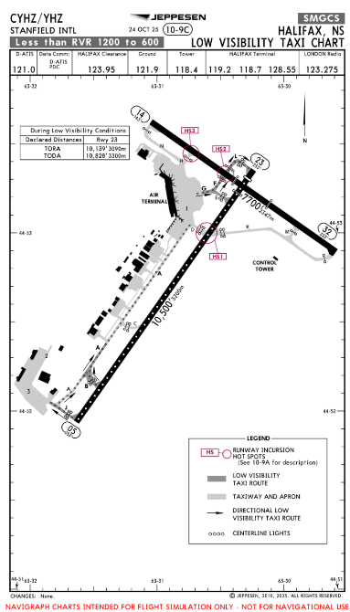{#fig:cyhz-low-visibility width=70%}

[4.1(c)] Land and Hold Short Operations (LAHSO)

[4.1(c)(i)] Land And Hold Short Operations (LAHSO) are published for Runway 05 to hold short of runway 14/32. During such operations, you may authorize simultaneous landings or a simultaneous landing and takeoff by restricting the aircraft landing on runway 05 to hold short of the other active runway (14 or 32).

[4.1(c)(ii)] Conditions for use of LAHSO include:

- The entire runway surface is DRY (RSC 6/6/6).
- Weather is VMC.
- Crosswind not to exceed 25 knots, including gusts, and no tailwind; or,
- If a tailwind < 10 kts is present, pilot requests the runway where a hold-short restriction will be issued or the controller suggests that runway and the pilot accepts.

[4.1(c)(iii)] Phraseology.

- Before or with the landing clearance, and in time for the pilot to take another action if required, issue a hold-short instruction and traffic information.[^lahso-full-length]
- Get a readback of the hold-short instruction.  
  HOLD SHORT (runway ID), [9500 FEET AVAILABLE TO THE INTERSECTION], (traffic) CLEARED TO LAND (runway ID).
- To the aircraft without the Hold-short Restriction, issue traffic details either before or with a take-off or landing clearance, and in time for the pilot to take another action.  
  (traffic) WILL HOLD SHORT (runway ID), CLEARED (TO LAND / FOR TAKEOFF) (runway ID).

[^lahso-full-length]: A pilot who prefers to use the full length of a runway or a different runway is expected to advise the controller in time to allow for other arrangements.

[4.1(d)] Apron Management

[4.1(d)(i)] In the real world, Halifax aprons are uncontrolled. Pilots are expected to exercise judgment to avoid collisions.

[4.1(d)(ii)] During busy events, such as Moncton Mondays, it will be up to the discretion of the Ground Controller whether to manage one or several apron(s). In such a case, pushbacks, pushback directions, etc. will be as directed by Ground.

[4.1(e)] De-icing

[4.1(e)(i)] De-icing at CYHZ is performed at one of the de-icing bays. See [[fig:cyhz-deicing]]. The De-icing bays are located on Apron 1 and are normally uncontrolled, see [[4.1(d)(ii)]] above. Aircraft will call for taxi clearance after having been de-iced.

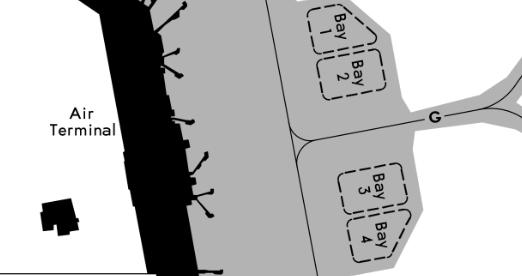{#fig:cyhz-deicing width=80%}

[4.1(e)(ii)] It is possible for large cargo aircraft to be de-iced at Stand 301 as well.

[4.1(f)] IFR Routes

[4.1(f)(i)] Pilots often include the Halifax VOR [YHZ] in their flight plan. It should be removed.

[4.1(f)(ii)] This table shows the mandatory routes from CYHZ – CYHZ Clearance Delivery should not seek out exceptions to these from higher positions:

| Destination                    | Conditions                                  | Initial Route                          |
| ------------------------------ | ------------------------------------------- | -------------------------------------- |
| CYYZ CYUL [Northwest]          | Jet aircraft                                | KELNO MOWND Q806                       |
| [Northwest]                    | Non-Jet aircraft                            | DUSEN TOPPS                            |
| [Northwest][^rte-west-of-yyz]  | Jet aircraft                                | KELNO EMLOB                            |
| KBOS                           |                                             | ACADN DUVIN [EURRO or AJJAY] OOSHN[^rte-bva] |
| KBOS                           | Non-Jet aircraft                            | ACADN ALLEX Q822 ENE PEASE STEVO LWRNC[^rte-bva] |
| [West] (JFK, EWR, BDL)         |                                             | ACADN DUVIN                            |
| [West]                         | Those who must remain within 50NM from land | SENVI VIGMA ALLEX[^rte-no-rafts]       |
| CYYT [East]                    |                                             | IGTAS NOTOP PERLU                      |
| CYYG [Northeast]               | Depart RWY 23                               | KELNO                                  |
| CYYG [Northeast]               | Not Departing 23                            | KATLO                                  |
| CYQM                           |                                             | KELNO CYQM[^rte-ifr-request]           |

CYHZ Compulsory outbound Routes – Source: Canada Flight Supplement / Planning / Mandatory IFR Routes.

[^rte-west-of-yyz]: Alternative routing normally for those aircraft going further West than YYZ.

[^rte-bva]: To comply with BVA CZQM Letter of Agreement.

[^rte-no-rafts]: Required by aircraft having no life rafts on board. This route will not normally be approved as it conflicts with inbound STARs.

[^rte-ifr-request]: Or as previously requested by IFR control.

[4.1(g)] VFR Terminal Procedures Chart

[4.1(g)(i)] See [[fig:cyhz-vtpc]].

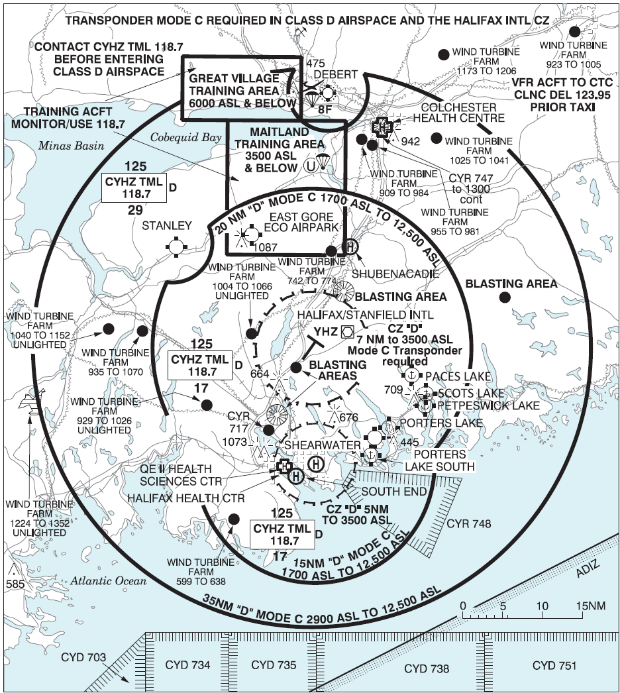{#fig:cyhz-vtpc width=90%}

[4.1(h)] Intersection departures. Approximate distance available for take-off; see [[3.3(j)]].

| Runway | Full length (approx.) | Distance remaining from intersection (approx.) |
| ------ | --------------------- | ---------------------------------------------- |
| 05 | 10 500 ft | B 9100 ft; C 6500 ft; D 2500 ft |
| 23 | 10 500 ft | C 4000 ft; D 8000 ft; E 9100 ft |
| 14 | 7700 ft | H 6100 ft; F 4500 ft; 23 3900 ft |
| 32 | 7700 ft | F 3000 ft; 23 3700 ft; M 6100 ft |

[4.2] # CYQM

[4.2(a)] Layout

[4.2(a)(i)] See [[fig:cyqm-airport]].

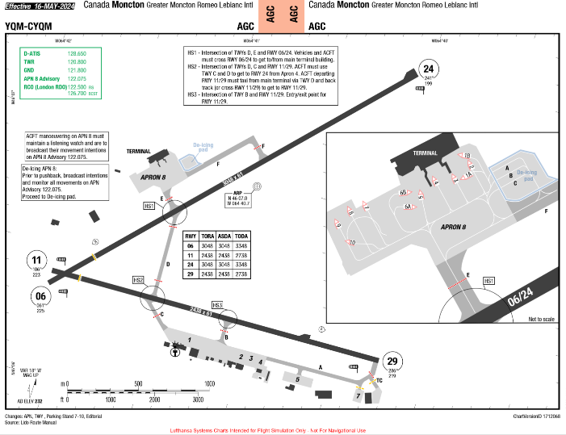{#fig:cyqm-airport width=100%}

[4.2(b)] Aprons

[4.2(b)(i)] The aprons are uncontrolled.

[4.2(b)(ii)] The De-icing facility is located on Apron 8. Aircraft are expected to de-ice at the pad and then call Ground for Taxi.

[4.2(c)] VFR Terminal Procedures

[4.2(c)(i)] VFR Chart. See [[fig:cyqm-vfr-chart]].

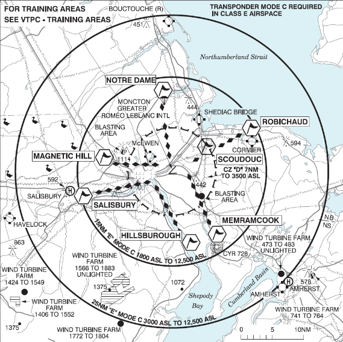{#fig:cyqm-vfr-chart width=85%}

[4.2(c)(ii)] VFR Reporting Points. [[fig:cyqm-vfr-points]] itemizes the VFR reporting points published for the Moncton area. These are depicted on the YQM_TWR GRP ASR.

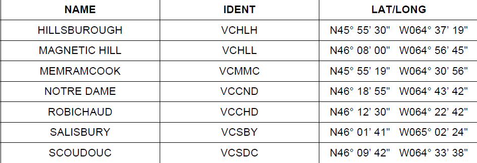{#fig:cyqm-vfr-points width=100%}

[4.2(d)] Intersection departures. Approximate distance available for take-off; see [[3.3(j)]].

| Runway | Full length (approx.) | Distance remaining from intersection (approx.) |
| ------ | --------------------- | ---------------------------------------------- |
| 06 | 10 001 ft | E 6500 ft; F 3900 ft |
| 24 | 10 001 ft | F 6100 ft; E 3501 ft |
| 11 | 8000 ft | C 5500 ft; B 3700 ft |
| 29 | 8000 ft | B 4300 ft; C 2500 ft |

[4.3] # CYFC

[4.3(a)] Layout

[4.3(a)(i)] See [[fig:cyfc-layout]].

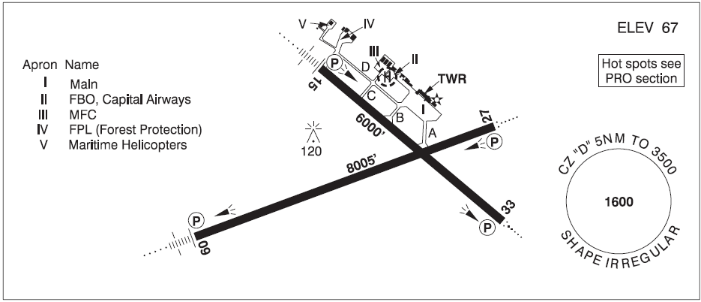{#fig:cyfc-layout width=100%}

[4.3(a)(ii)] Be aware of the Restricted airspace to the Southeast. See [[fig:cyfc-cautions]], [[fig:cyfc-airspace]], and [[fig:cyfc-airport]].

{#fig:cyfc-cautions width=60%}

{#fig:cyfc-airspace width=90%}

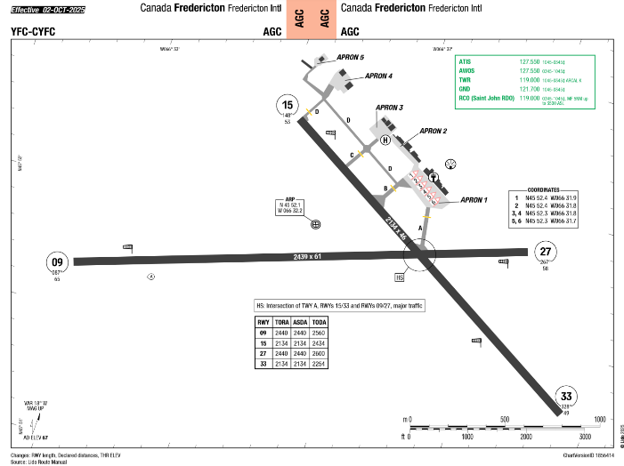{#fig:cyfc-airport width=100%}

[4.3(b)] Fredericton VFR procedures

[4.3(b)(i)] VFR Departures

- MACTAQUAC (NW): Outbound clear circuit, direct MACTAQUAC Dam enroute. Altitude: Climb to and maintain 2600 ft until clear of CZ.
- RIPPLES (ENE): Outbound clear circuit, direct RIPPLES enroute, maintain North of the VOR at all times. Altitude: Climb to and maintain 2600 ft until clear of CZ and then maintain 3000 ft until training area or at/abeam Grand Lake.
- PENNIAC DEPARTURE (N): Outbound clear circuit direct PENNIAC enroute. Altitude: Climb to and maintain 2600 ft until clear of CZ.
- JEMSEG (SE): Outbound: Follow RIPPLES DEPARTURE, then turn right (south) to JEMSEG enroute. Altitude: Climb to and maintain 3000 ft until at/abeam JEMSEG.
- TRACY (SW): Outbound clear circuit, direct TRACY enroute. Altitude: Climb to and maintain 2600 ft until clear of CZ.
- Departing aircraft must join the route as soon as practicable after departure (i.e. once clear of the circuit unless instructed by ATC to turn after departure), follow the routes as described and maintain 2,600 feet until they have departed the Fredericton CZ.

[4.3(b)(ii)] VFR Arrivals

- HWY10 (ENE): Inbound direct RIPPLES, follow Hwy 10 until North of airport, then direct CYFC. Maintain North of VOR at all times. Altitude: If inbound from East, descend to 2500 ft before Grand Lake, then descend to and maintain 1600 ft prior to entering CZ.
- LAKE GEORGE (NW): Inbound direct Hwy 2 and Hwy 3 intersection, direct CYFC, maintain North of apch Rwy 09 at all times. Altitude: Descend to and maintain 1600 ft prior to entering CZ.
- PENNIAC (N): Inbound direct PENNIAC, direct CYFC. Altitude: Descend to and maintain 1600 ft prior to entering CZ.
- JEMSEG (SE): Inbound direct JEMSEG, direct RIPPLES, then follow HWY10 ARRIVAL. Altitude: Descend to 2500 ft at/abeam JEMSEG, then descend to and maintain 1600 ft prior to entering CZ.
- TRACY: Inbound direct TRACY, direct CYFC. Altitude: Descend to and maintain 1600 ft prior to entering CZ.
- Arriving aircraft must enter the Zone at 1,600', once inside CZ, descend at pilot's discretion, unless otherwise instructed, cleared or requested to maintain a specific altitude.
- The VFR reporting points are depicted on the YFC_TWR GRP ASR. See [[fig:cyfc-vtpc]] and [[fig:cyfc-vfr-points]].

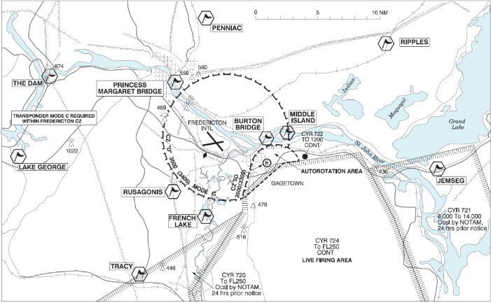{#fig:cyfc-vtpc width=100%}

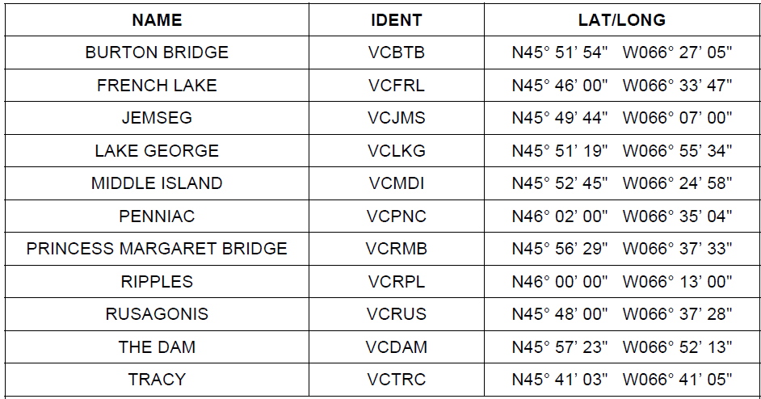{#fig:cyfc-vfr-points width=100%}

[4.3(b)(iii)] Training areas. Due to limited demand, VFR training areas and procedures are not in current use. They are provided here for information in case a pilot mentions them. See [[fig:cyfc-training]].

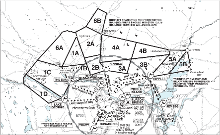{#fig:cyfc-training width=70%}

[4.3(c)] Intersection departures. Approximate distance available for take-off; see [[3.3(j)]].

| Runway | Full length (approx.) | Distance remaining from intersection (approx.) |
| ------ | --------------------- | ---------------------------------------------- |
| 27 | 8005 ft | 33 6100 ft |
| 09 | 8005 ft | 33 2000 ft |
| 15 | 6000 ft | C 4700 ft; B 3800 ft; 27 2600 ft |
| 33 | 6000 ft | 27 3400 ft; B 2200 ft; C 1300 ft |

[4.4] # CYYT

[4.4(a)] Layout

[4.4(a)(i)] Microsoft charts are not included for CYYT, and the default scenery is terrible… See [[fig:cyyt-airport]] and [[fig:cyyt-sketch]].

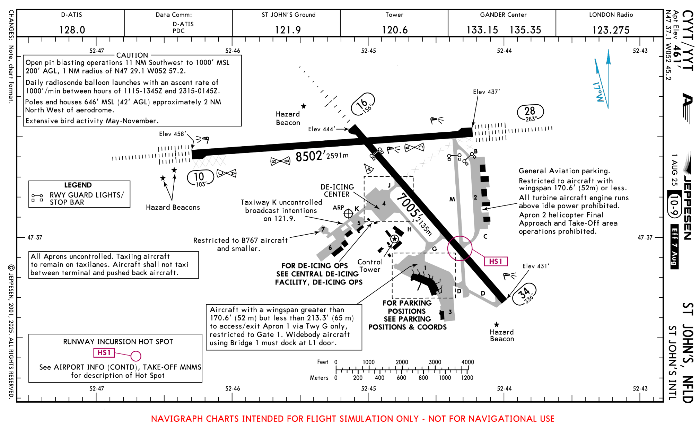{#fig:cyyt-airport width=100%}

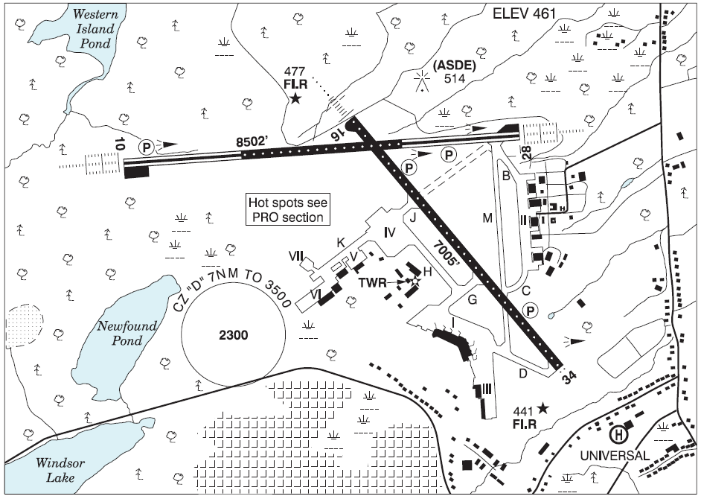{#fig:cyyt-sketch width=100%}

[4.4(b)] Low Vis Procedures (RVR <1200 > 600)

[4.4(b)(i)] Low visibility Taxi Routes for RWY 10/28 are as depicted in [[fig:cyyt-low-visibility]]. Flight simulator scenery requires the use of the XPGuard add-on to depict the required lights…

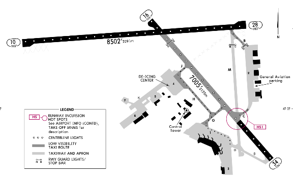{#fig:cyyt-low-visibility width=90%}

[4.4(c)] Aprons

[4.4(c)(i)] All aprons are uncontrolled.

[4.4(c)(ii)] De-icing. See [[fig:cyyt-deicing]].

{#fig:cyyt-deicing width=80%}

Aircraft will be taxied to the Central De-icing Facility via TWY H to hold short of the facility. Aircraft shall be instructed to contact Ground when de-ice is complete. Aircraft will then proceed, as per a notional ICEMAN’s instructions, to a suitable Bay to be de-iced. Once the procedure is completed, they will contact Ground for Taxi. Note that aircraft approaching the De-Ice Facility from K are uncontrolled.

[4.4(d)] VFR Terminal Procedures Chart

[4.4(d)(i)] See [[fig:cyyt-vtpc]].

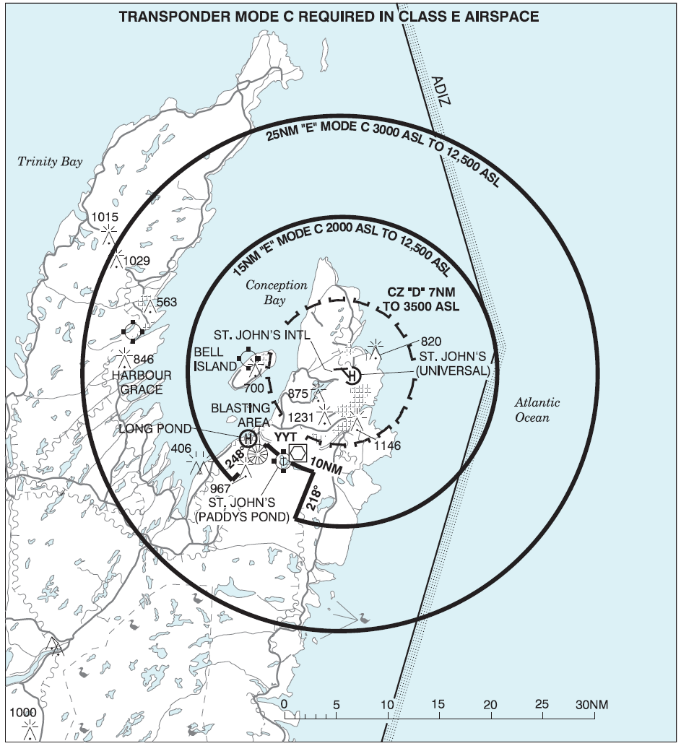{#fig:cyyt-vtpc width=90%}

[4.4(e)] Intersection departures. Approximate distance available for take-off; see [[3.3(j)]].

| Runway | Full length (approx.) | Distance remaining from intersection (approx.) |
| ------ | --------------------- | ---------------------------------------------- |
| 28 | 8502 ft | 02 7900 ft; 34 5200 ft |
| 10 | 8502 ft | 34 3000 ft; 02 N/A |
| 34 | 7005 ft | 02 5400 ft; 10 N/A |
| 16 | 7005 ft | 10 6600 ft; J 4800 ft; G 3000 ft |
| 02[^cyyt-0220] | 5000 ft | 34 3600 ft; C 1800 ft |
| 20[^cyyt-0220] | 5000 ft | B 4800 ft |

[^cyyt-0220]: Runway 02/20 does not appear on the current aerodrome chart; these values are to be verified.

[4.5] # CYQX

[4.5(a)] Gander, CYQX, is a shadow of its former self. Note the backtracks required for several runways. There are several abandoned areas. There is no CDF. See [[fig:cyqx-airport]] and [[fig:cyqx-vtpc]].

{#fig:cyqx-airport width=80%}

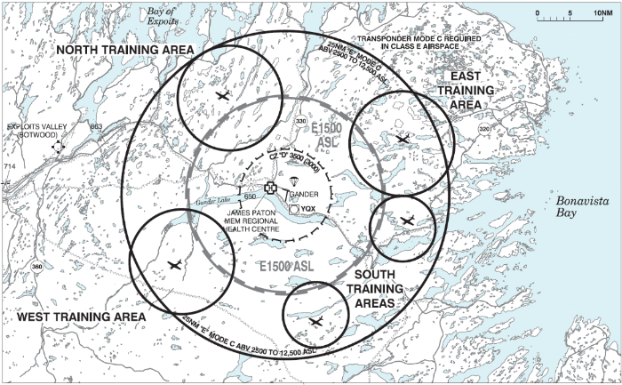{#fig:cyqx-vtpc width=100%}

[4.5(b)] Intersection departures. Approximate distance available for take-off; see [[3.3(j)]].

| Runway | Full length (approx.) | Distance remaining from intersection (approx.) |
| ------ | --------------------- | ---------------------------------------------- |
| 31 | 8900 ft | D 2400 ft; E 4200 ft; 21 6600 ft |
| 13 | 8900 ft | D 6000 ft; E 4800 ft; 21 2400 ft |
| 21 | 10 200 ft | 31 9700 ft; F 4200 ft; A 2400 ft |
| 03 | 10 200 ft | A 8500 ft; F 6000 ft |

[4.6] # CYYR

[4.6(a)] Intersection departures. Approximate distance available for take-off; see [[3.3(j)]].

| Runway | Full length (approx.) | Distance remaining from intersection (approx.) |
| ------ | --------------------- | ---------------------------------------------- |
| 15 | 9584 ft | N 6000 ft |
| 33 | 9584 ft | 26 7200 ft; N 3000 ft |
| 08 | 11 052 ft | D 7800 ft; C 6000 ft; B 3000 ft |
| 26 | 11 052 ft | 15/33 9700 ft; B 7800 ft; C 4800 ft; D 3000 ft |

[4.7] # LFVP

[4.7(a)] Intersection departures. Approximate distance available for take-off; see [[3.3(j)]]. No intersection take-off distances are published for LFVP.

| Runway | Full length (approx.) | Distance remaining from intersection (approx.) |
| ------ | --------------------- | ---------------------------------------------- |
| 08 | 6299 ft (1920 m) | Not published |
| 26 | 6299 ft (1920 m) | Not published |

[5] # Phraseologies
Phraseology in this chapter follows NAV CANADA guidance material, IFR and VFR phraseology guides, with the AIM RAC 4 examples where they exist. Numbers are spoken as grouped digits (TWO-THREE). Unit identification is omitted after initial contact. Where the CZQM/CZQX Phraseology Guide and this chapter differ, this chapter governs tower positions.

[5.1] # Readback and acknowledgement

[5.1(a)] The regulation is CAR 602.31. The pilot must (a) comply with and acknowledge every ATC instruction, and (b) comply with every clearance accepted and, on an IFR flight, read back the text of any clearance received; on a VFR flight, read back a clearance only when asked. From 19 November 2026 the pilot must also read back an instruction to hold short of a runway and the runway, altimeter and transponder code when passed by voice, and must state the ATIS identifier on initial contact.

[5.1(b)] The distinction that matters is clearance versus instruction. A clearance (anything containing CLEARED, and altitude, route and holding clearances) is read back by an IFR flight. An instruction (taxi, hold, line up, cross, backtrack, heading, speed, frequency) is acknowledged; a call sign is a complete acknowledgement, except for a hold-short, which is read back by everyone.

[5.1(c)] Obtain what the regulation requires and no more. Do not require a pilot to read back a taxi route. Correct every wrong readback, whether or not a readback was required; if there is any possibility of misunderstanding, cancel and restate.

[5.1(d)] Readback obtained

> (aircraft identification) READBACK CORRECT.

[5.1(e)] Readback missing

> (aircraft identification) READBACK HOLD SHORT INSTRUCTIONS.

[5.1(f)] ATIS identifier missing

> (aircraft identification) CONFIRM YOU HAVE INFORMATION (identifier).

[5.2] # Clearance Delivery

[5.2(a)] The IFR clearance is issued in the order given in NAV CANADA guidance material: aircraft identification, CLEARED TO the destination airport, the SID (or the departure instructions when there is none), the route, the altitude when it is not in the SID, the transponder code. The runway is not an element of the clearance; it is passed with the taxi instruction or stated when the SID depends on it.

> (aircraft identification) CLEARED TO THE (destination) AIRPORT, (SID name) DEPARTURE, FLIGHT PLANNED ROUTE, SQUAWK (code).
>
> *AIR CANADA SIX-ONE-FOUR, CLEARED TO THE TORONTO AIRPORT, HALIFAX FOUR DEPARTURE, FLIGHT PLANNED ROUTE, SQUAWK THREE-ONE-ZERO-FIVE.*
>
> *Pilot: SQUAWK THREE-ONE-ZERO-FIVE, AIR CANADA SIX-ONE-FOUR.*
>
> *AIR CANADA SIX-ONE-FOUR, READBACK CORRECT.*

[5.2(b)] No SID

> (aircraft identification) CLEARED TO THE (destination) AIRPORT, FLIGHT PLANNED ROUTE, (departure instructions), MAINTAIN (altitude), SQUAWK (code).
>
> *JAZZ EIGHT-NINE-TWO, CLEARED TO THE MONTREAL AIRPORT, FLIGHT PLANNED ROUTE, DEPART RUNWAY ZERO-SIX, FLY RUNWAY HEADING, MAINTAIN FIVE THOUSAND, SQUAWK THREE-FOUR-FIVE-THREE.*

[5.2(c)] Route change — full readback required

> (aircraft identification) ROUTING CHANGE, ADVISE READY TO COPY.
>
> *WESTJET FIVE-THREE-TWO, ROUTING CHANGE. CLEARED TO THE MONTREAL AIRPORT, HALIFAX FOUR DEPARTURE, KELNO, MOWND, FLIGHT PLANNED ROUTE, SQUAWK THREE-TWO-FOUR-ONE.*

[5.2(d)] VFR departure

> (aircraft identification) SQUAWK (code), RUNWAY (number), ADVISE READY FOR TAXI.

[5.2(e)] Push-back and engine start — not a clearance; the controller cannot see all obstructions

> (aircraft identification) PUSH BACK AT YOUR DISCRETION [traffic information].
>
> *WESTJET TWO-FIVE-ONE, PUSH BACK AT YOUR DISCRETION, TRAFFIC DASH EIGHT TAXIING BEHIND YOU.*

[5.2(f)] Where Ground has taken control of a congested apron ([[3.2(c)]]), push-back instructions become control instructions and are worded as such: PUSH BACK APPROVED, FACE NORTH; HOLD POSITION, TRAFFIC PASSING BEHIND. — AIM RAC 1.6.1(e), 4.2.4

[5.3] # Ground

[5.3(a)] The taxi instruction is issued in the order given in NAV CANADA guidance material: aircraft identification, unit, runway, wind, altimeter, movement instructions, supplementary information. Wind and altimeter are omitted when the pilot has stated the ATIS identifier. The instruction goes as far as the first hold area; every runway on the route gets CROSS or HOLD SHORT; the crossing is authorized separately as the aircraft approaches it.

> (aircraft identification) [unit] RUNWAY (number), [WIND (direction) AT (speed), ALTIMETER (setting),] TAXI VIA (route), HOLD SHORT RUNWAY (number).
>
> *WESTJET TWO-FIVE-ONE, HALIFAX GROUND, RUNWAY TWO-THREE, TAXI VIA GOLF, FOXTROT, HOLD SHORT RUNWAY ONE-FOUR.*
>
> *Pilot: GOLF, FOXTROT, HOLD SHORT RUNWAY ONE-FOUR, WESTJET TWO-FIVE-ONE.*

[5.3(b)] Crossing, issued as the aircraft approaches the runway

> (aircraft identification) CROSS RUNWAY (number), [CONTINUE VIA (route)].
>
> *WESTJET TWO-FIVE-ONE, CROSS RUNWAY ONE-FOUR, CONTINUE VIA LIMA.*

[5.3(c)] Crossing not available

> *WESTJET TWO-FIVE-ONE, HOLD SHORT RUNWAY ONE-FOUR, TRAFFIC LANDING RUNWAY ONE-FOUR.*

[5.3(d)] Transfer — “holding short” is a location, not a readback

> (aircraft identification) CONTACT TOWER (frequency) HOLDING SHORT.

[5.3(e)] Segmented taxi at CYHZ. A King Air leaves an FBO apron off Taxiway Alfa for runway 23: Alfa, across an uncontrolled apron, Golf, Foxtrot to the holding position for runway 14, then across 14 and Lima to 23. Taxiway Alfa becomes Apron 1 at the west side of the terminal apron ([[4.1(a)(iii)]]); the apron segment is at the pilot’s discretion unless Ground has taken control of the apron ([[3.2(c)]] and [[4.1(d)]]).

> *Pilot: HALIFAX GROUND, KING AIR GOLF ALFA BRAVO CHARLIE, (FBO) APRON WITH INFORMATION DELTA, REQUEST TAXI.*
>
> *GOLF ALFA BRAVO CHARLIE, HALIFAX GROUND, RUNWAY TWO-THREE, TAXI VIA ALFA, APRON ONE AT YOUR DISCRETION, GOLF, FOXTROT, HOLD SHORT RUNWAY ONE-FOUR.*
>
> *Pilot: VIA ALFA, APRON AT MY DISCRETION, GOLF, FOXTROT, HOLD SHORT RUNWAY ONE-FOUR, GOLF ALFA BRAVO CHARLIE.*
>
> *GOLF ALFA BRAVO CHARLIE, CROSS RUNWAY ONE-FOUR, CONTINUE VIA LIMA.*
>
> *Pilot: CROSS RUNWAY ONE-FOUR, LIMA, GOLF ALFA BRAVO CHARLIE.*
>
> *GOLF ALFA BRAVO CHARLIE, CONTACT TOWER ONE-ONE-EIGHT DECIMAL FOUR HOLDING SHORT.*

[5.3(f)] Progressive taxi

> (aircraft identification) TAXI AT YOUR DISCRETION (location).
>
> *CARAVAN GOLF VICTOR INDIA INDIA, TAXI RIGHT ONTO HOTEL, LEFT ON FOXTROT, HOLD SHORT RUNWAY ONE-TWO.*
>
> *VICTOR INDIA INDIA, CROSS RUNWAY ONE-TWO, CONTINUE FOXTROT, LEFT ON GOLF, ENTER APRON STRAIGHT AHEAD AT YOUR DISCRETION.*
>
> *FOXTROT ALFA BRAVO CHARLIE, TAXIWAY NOT VISIBLE, TAXI AT YOUR DISCRETION ON TAXIWAY ALFA.*

[5.3(g)] Unable to issue a clearance — runway closed, minima not met, or the runway may not be clear; always end with ADVISE INTENTIONS

> (aircraft identification) UNABLE CLEARANCE, (reason). (alternative), ADVISE INTENTIONS.
>
> *GOLF JULIETT ALFA LIMA, UNABLE CLEARANCE, REDUCED VISIBILITY PROCEDURES IN EFFECT, RUNWAY THREE-TWO CLOSED. RUNWAY TWO-FIVE AVAILABLE, ADVISE INTENTIONS.*
>
> *GOLF JULIETT ALFA LIMA, UNABLE CLEARANCE RUNWAY ONE-EIGHT, LANDING NOT AUTHORIZED. ADVISE INTENTIONS.*
>
> *GOLF ALFA DELTA ALFA, TAKE-OFF CLEARANCE CANCELLED, AIRCRAFT INSIDE THE RUNWAY PROTECTED AREA AT CHARLIE, ADVISE INTENTIONS.*

[5.3(h)] Runway protected area and ILS critical area

> (aircraft identification) HOLD SHORT ILS CRITICAL AREA. / EXIT THE RUNWAY PROTECTED AREA. / CROSS RUNWAY (number) WITHOUT DELAY, REPORT OFF.

[5.3(i)] Protect the ILS critical area when the ceiling is below 1 000 ft or the visibility below 3 SM and an arrival is inside the FAF. REPORT OFF means report when all of the aircraft is across the hold-short line. — AIM RAC 1.6.1; NAV CANADA Ground Traffic Phraseology

[5.3(j)] After landing

> (aircraft identification) (exit instructions), CONTACT GROUND (frequency) WHEN OFF.
>
> (aircraft identification) TAXI TO (apron or parking area) [VIA (route)] (traffic, cautions).
>
> *WESTJET TWO-FIVE-ONE, HALIFAX GROUND, TAXI VIA CHARLIE, ALFA APRON AT YOUR DISCRETION.*

[5.3(k)] Backtrack after landing on a dead-end runway — the pilot reports it; the aircraft is not clear until all of it is past the hold line

> *Pilot: CHARLIE FOXTROT ALFA, BACKTRACKING RUNWAY TWO-FIVE, WILL REPORT IN THE HOLDING BAY.*
>
> (aircraft identification) BACKTRACK RUNWAY (number), EXIT (taxiway), CONTACT GROUND (frequency) WHEN OFF.

[5.3(l)] Helicopter ground movement — air taxi is the default; HOLD means hold in the current state, on the ground or in the hover

> (aircraft identification) AIR TAXI [VIA (route)] [TO (location)], [HOLD SHORT RUNWAY (number)], (traffic, downwash caution, wind).
>
> *HELICOPTER GOLF X-RAY ALFA CHARLIE, AIR TAXI VIA PAPA, ECHO, DELTA, HOLD SHORT RUNWAY TWO-NINE.*

[5.3(m)] Do not ask a single-pilot helicopter to change frequency while it is hovering, air-taxiing or at low level, and do not route an air taxi over people, vehicles or aircraft.

[5.4] # Tower — departures

[5.4(a)] Line up. State the entry point whenever the aircraft enters at a taxiway or runway intersection, and the threshold when another entry point for the same runway is in use. Use LINE UP AND WAIT, with the reason when it is not apparent, when a delay is expected. At night, in IFR conditions, or when the aircraft will not be visible from the tower, line up only if the take-off clearance can be issued within three minutes of the aircraft reaching the take-off point.

> (aircraft identification) [AT (taxiway)] LINE UP RUNWAY (number).
>
> (aircraft identification) AT (taxiway) LINE UP AND WAIT RUNWAY (number), (reason).
>
> *AIR CANADA SIX-ONE-FOUR, AT CHARLIE LINE UP AND WAIT RUNWAY TWO-FOUR, TWO MINUTE I-F-R DELAY.*

[5.4(b)] Backtrack — the entry point is always stated

> (aircraft identification) AT (taxiway) BACKTRACK RUNWAY (number) [, ADVISE WHEN READY].
>
> (aircraft identification) AT (taxiway) LINE UP RUNWAY (number), BACKTRACK APPROVED.
>
> (aircraft identification) AT (taxiway) BACKTRACK RUNWAY (number) AND LINE UP AT (taxiway).
>
> *GOLF ALFA BRAVO CHARLIE, AT CHARLIE BACKTRACK RUNWAY TWO-FOUR TO LINE UP AND WAIT AT THE THRESHOLD, TRAFFIC LANDING RUNWAY TWO-EIGHT.*
>
> (aircraft identification) RUNWAY (number) LENGTH REMAINING FROM (taxiway) IS UNKNOWN. DO YOU REQUIRE A BACKTRACK?

[5.4(c)] Take-off clearance. The order given in NAV CANADA guidance material is: aircraft identification, [unit], special information (hazards, obstructions), control instructions (turn or heading after take-off), wind when 15 knots or more, FROM (intersection or threshold) when applicable, CLEARED FOR TAKEOFF RUNWAY (number) [SHORTENED]. Every take-off clearance is to be acted on without delay.

> (aircraft identification) (special information) (control instructions) [WIND (direction) AT (speed)] [FROM (intersection)] CLEARED FOR TAKEOFF RUNWAY (number).
>
> *JAZZ TWO-FIVE-ONE, TURN RIGHT HEADING TWO-EIGHT-ZERO, CLEARED FOR TAKEOFF RUNWAY TWO-THREE.*
>
> *GOLF ALFA BRAVO CHARLIE, FROM GOLF, CLEARED FOR TAKEOFF RUNWAY ZERO-FIVE.*
>
> *DELTA FIVE-ONE, AIRBORNE CONTACT HALIFAX DEPARTURE ONE-ONE-NINE DECIMAL TWO, WIND TWO-FIVE-ZERO AT SIXTEEN, CLEARED FOR TAKEOFF RUNWAY TWO-THREE.*
>
> *Pilot: CLEARED FOR TAKEOFF RUNWAY TWO-THREE, DELTA FIVE-ONE.* (IFR: reads back the clearance)
>
> *Pilot: GOLF ALFA BRAVO CHARLIE.* (VFR: call sign is sufficient)

[5.4(d)] Departure instructions issued before the take-off clearance — read back; not a take-off clearance

> (aircraft identification) AFTER DEPARTURE, (turn / heading / altitude restriction).
>
> *ZULU YANKEE ZULU, AFTER DEPARTURE, RIGHT TURN TO LABERGE WHEN ABLE, NOT ABOVE THREE THOUSAND THREE HUNDRED FEET.*

[5.4(e)] Do not issue a speed-control instruction coincident with a take-off clearance (AIM RAC 6.5.2). Wind is included in the take-off clearance only when 15 knots or more or when it has changed significantly.

[5.4(f)] Immediate take-off. Used for separation only: the aircraft taxis onto the runway and takes off in one continuous movement. Consider the aircraft type and the surface conditions; determine ability when there is time, otherwise include the alternate instruction. A pilot unable to comply holds position and says so.

> (aircraft identification) ARE YOU ABLE AN IMMEDIATE DEPARTURE?
>
> (aircraft identification) CLEARED FOR IMMEDIATE TAKEOFF RUNWAY (number).
>
> (aircraft identification) LINE UP [location], BE READY FOR IMMEDIATE DEPARTURE.
>
> (aircraft identification) CLEARED FOR IMMEDIATE TAKEOFF RUNWAY (number). IF UNABLE, HOLD SHORT RUNWAY (number).

[5.4(g)] Cancelling a take-off clearance, and aborting

> (aircraft identification) TAKE-OFF CLEARANCE CANCELLED, (reason).
>
> (aircraft identification) ABORT ABORT. (aircraft identification) ABORT ABORT, (reason).

[5.4(h)] Take-off clearance denied for wake turbulence — give the type and position so the pilot may waive (VFR only)

> *NEGATIVE, HOLD SHORT, WAKE TURBULENCE. HEAVY BOEING SEVEN-FOUR-SEVEN ROTATING AT SIX THOUSAND FEET.*
>
> *LINE UP AND WAIT, WAKE TURBULENCE, HEAVY D-C TEN AIRBORNE AT TWO MILES.*

[5.4(i)] Take-off from a surface other than a runway (helicopters)

> (aircraft identification) (traffic) (control instructions) [WIND (direction) AT (speed)] TAKE OFF AT YOUR DISCRETION FROM (location).
>
> *HELICOPTER GOLF TANGO HOTEL JULIETT, TRAFFIC FIVE MILE FINAL RUNWAY ZERO-FIVE, BOEING SEVEN-FIVE-SEVEN, REMAIN NORTH OF RUNWAY ZERO-FIVE, WIND CALM, TAKE OFF AT YOUR DISCRETION FROM (apron).*

[5.4(j)] Transfer of a departure

> (aircraft identification) CONTACT (unit) TERMINAL (frequency).
>
> (aircraft identification) NO FURTHER CONTROLLERS ONLINE, CHANGE TO ENROUTE FREQUENCIES.

[5.4(k)] Visual separation between successive departures, pilot-applied — in a control zone or TCA at 12 500 ft and below; not used where wake-turbulence separation is required

> (aircraft identification) TRAFFIC (position, type, intentions), CONFIRM TRAFFIC IN SIGHT?
>
> *Pilot: (aircraft identification) TRAFFIC IN SIGHT.*
>
> (aircraft identification) MAINTAIN VISUAL SEPARATION [other instructions] CLEARED FOR TAKEOFF RUNWAY (number).

[5.4(l)] Visual separation is discontinued when either aircraft is observed on a diverging heading, unless otherwise advised. — AIM RAC 6.5.4

[5.5] # Tower — arrivals

[5.5(a)] Landing clearance. Issue it when the aircraft is on final and the runway is, or will be, clear; include wind when 15 knots or more. A landing clearance is a clearance: an IFR flight reads it back, a VFR flight may acknowledge with its call sign.

> (aircraft identification) [unit identification] (special information) (control instructions) [wind information] CLEARED (operation) (runway identification)
>
> *JAZZ ONE-TWO-THREE, WIND TWO-FIVE-ZERO AT EIGHTEEN, CLEARED TO LAND RUNWAY TWO-THREE.*
>
> *JAZZ ONE-TWO-THREE, EXIT LEFT ON DELTA, CLEARED TO LAND RUNWAY TWO-THREE.*
>
> (aircraft identification) NUMBER (sequence), FOLLOW (type) (position).

[5.5(b)] Runway may not be clear

> (aircraft identification) CONTINUE APPROACH, POSSIBLE PULL-UP.
>
> (aircraft identification) PULL UP AND GO AROUND, (reason).

[5.5(c)] Circuit exercises

> (aircraft identification) CLEARED TOUCH-AND-GO / STOP-AND-GO / FOR THE OPTION RUNWAY (number).
>
> (aircraft identification) CLEARED MULTIPLE TOUCH-AND-GOS, RUNWAY (number).

[5.5(d)] Land and hold short — conditions and the CYHZ application in [[4.1(c)]]; the hold-short instruction is read back in full by every aircraft

> (aircraft identification) HOLD SHORT RUNWAY (number), [(distance) FEET AVAILABLE TO THE INTERSECTION], (traffic), CLEARED TO LAND RUNWAY (number).
>
> (aircraft identification) (traffic) WILL HOLD SHORT RUNWAY (number), CLEARED TO LAND / FOR TAKEOFF RUNWAY (number).

[5.5(e)] Exit and transfer

> (aircraft identification) EXIT (direction) ON (taxiway), CONTACT GROUND (frequency) WHEN OFF.

[5.6] # Tower — VFR in the control zone

[5.6(a)] Initial clearance. Unless the pilot has stated the ATIS identifier, give runway, wind and altimeter, then the clearance. “Cleared to the circuit” means join the downwind leg at circuit height, crossing midfield from the inactive side if necessary; a straight-in joins final only.

> (aircraft identification) [unit] [RUNWAY (number), WIND (direction) AT (speed), ALTIMETER (setting),] CLEARED TO THE CIRCUIT / CLEARED TO LEFT BASE / CLEARED LEFT DOWNWIND / CLEARED STRAIGHT-IN APPROACH, [REPORT (point)].
>
> *CESSNA FOXTROT ALFA BRAVO CHARLIE, HALIFAX TOWER, RUNWAY TWO-THREE, WIND TWO-FOUR-ZERO AT TEN, ALTIMETER TWO-NINER-NINER-TWO, CLEARED LEFT DOWNWIND, REPORT ENTERING THE ZONE.*

[5.6(b)] Sequence and circuit instructions

> (aircraft identification) NUMBER (sequence), FOLLOW (type) (position).
>
> TURN CROSSWIND NOW. / EXTEND DOWNWIND. / CONTINUE DOWNWIND, I WILL ADVISE BASE TURN. / WIDEN APPROACH. / MAKE LEFT THREE-SIXTY. / MAKE THE NEXT CIRCUIT RIGHT HAND. / MAKE FULL-STOP LANDING.
>
> TURN CROSSWIND TO FOLLOW TRAFFIC. / EXTEND DOWNWIND TO FOLLOW TRAFFIC ON FINAL. / DIRECT TO THRESHOLD RUNWAY (number). / CAUTION, POSSIBLE TURBULENCE FROM LANDING (type and position).
>
> (aircraft identification) UNABLE (exercise) DUE TO (reason). / POWER OFF ONE EIGHTY APPROVED, CLEARED TO LAND RUNWAY (number).

[5.6(c)] Restrictions — geographic and altitude; cancel them as soon as they are no longer needed

> (aircraft identification) REMAIN NORTH / SOUTH / EAST / WEST OF (runway or landmark).
>
> (aircraft identification) NOT ABOVE (altitude) / NOT BELOW (altitude).
>
> (aircraft identification) ALTITUDE RESTRICTION IS CANCELLED, MAINTAIN VISUAL SEPARATION FROM (type).
>
> (aircraft identification) ORBIT (location), (LEFT / RIGHT TURNS), ANTICIPATE (length) DELAY, (traffic).
>
> (aircraft identification) REMAIN OUTSIDE THE CONTROL ZONE UNTIL FURTHER ADVISED.

[5.6(d)] Visual separation runs one way: an IFR aircraft may be instructed to FOLLOW a VFR aircraft or to MAINTAIN VISUAL SEPARATION from it once in sight; do not instruct a VFR aircraft to separate itself from an IFR aircraft on an instrument approach — restrict the VFR aircraft instead.

[5.6(e)] Traffic information

> (aircraft identification) TRAFFIC, (clock position / direction) (distance) MILES, (direction of flight), (type), (altitude).

[5.6(f)] Special VFR — approval from the IFR unit when one is online; no vectors, headings or altitudes to an SVFR aircraft; at night, helicopters only

> (aircraft identification) WEATHER BELOW VFR MINIMA, VISIBILITY (number) MILES, ONLY IFR OR SPECIAL VFR OPERATIONS ARE PERMITTED. WHAT ARE YOUR INTENTIONS?
>
> (aircraft identification) SPECIAL VFR IS APPROVED IN THE (name) CONTROL ZONE, (instructions).

[5.6(g)] VFR over-the-top transit of the zone

> (aircraft identification) CLEARED THROUGH THE (name) CONTROL ZONE VFR OVER THE TOP.

[5.6(h)] VFR departure on an IFR clearance — pilot request only; Class C, D or E; the clearance comes from the IFR unit and is relayed by the tower

> (IFR clearance), MAINTAIN VFR UNTIL (time / altitude / fix) [, IF NOT POSSIBLE, (alternate instructions) AND ADVISE].
>
> (aircraft identification) UNABLE REQUEST, (reason).

[5.6(i)] Special VFR is requested by the pilot; ATC does not offer it. — VFR Phraseology TWR VFR Departure on an IFR Clearance

[5.6(j)] VFR departure and release

> (aircraft identification) RIGHT-HAND CIRCUITS APPROVED, REPORT DOWNWIND, [WIND …] CLEARED FOR TAKEOFF RUNWAY (number).
>
> (aircraft identification) (traffic information), CHANGE TO ENROUTE FREQUENCY.

[5.7] # Tower — helicopters

[5.7(a)] What to expect: no ground roll, so a helicopter can land and take off from any approved surface and usually wants the apron or helipad rather than the runway; it can stop, turn and hold in the hover; it may fly a non-standard circuit or none; it is slow and prefers to operate into wind. It is an aircraft for wake purposes and produces rotor downwash in the hover. IFR helicopters in IMC depart from a runway or heliport and arrive via an instrument approach, then air-taxi.

> (aircraft identification) CLEARED FOR TAKEOFF (taxiway / location). / CLEARED TO LAND (taxiway / location).
>
> (aircraft identification) (traffic) [WIND …] TAKE OFF / LAND AT YOUR DISCRETION (location).
>
> (aircraft identification) REMAIN NORTH / SOUTH / EAST / WEST OF RUNWAY (number).
>
> (aircraft identification) CROSS RUNWAY (number) [AT (point)] [NOT ABOVE (altitude)].
>
> (aircraft identification) HOLD. / HOLD SHORT OF RUNWAY (number).
>
> *JULIETT HOTEL TANGO SIERRA, WIND ZERO-FIVE-ZERO AT TEN, LAND AT YOUR DISCRETION APRON TWO.*

[5.7(b)] A helicopter may be cleared to land on a threshold while an aircraft is taxiing at the other end of the runway if traffic is exchanged and a restriction applied. For LAHSO the helicopter’s landing point must be at least 700 ft from the centreline of the other runway.

[5.8] # Radiotelephony fundamentals

[5.8(a)] These conventions are common to every position in the FIR and are taken from the NAV CANADA IFR and VFR phraseology guides. ATS uses NINER and FIFE when issuing altimeters and altitudes. Altitudes below 18 000 ft are spoken as thousands and hundreds; flight levels, headings and transponder codes digit by digit. Grouping is permitted for aircraft type numbers, flight numbers, cloud heights, wind speeds and clock positions.

| Item                                  | Spoken as                                              |
| ------------------------------------- | ------------------------------------------------------ |
| 2 500 / 11 000                        | TWO THOUSAND FIVE HUNDRED / ONE ONE THOUSAND           |
| FL180 / heading 005                   | FLIGHT LEVEL ONE EIGHT ZERO / HEADING ZERO ZERO FIVE   |
| 29.95 / 127.7                         | TWO NINER DECIMAL NINER FIFE / ONE TWO SEVEN DECIMAL SEVEN |
| 25 NM / 25 DME                        | TWO FIVE MILES / TWO FIVE D-M-E                        |
| Wind 270/10                           | WIND TWO SEVEN ZERO AT TEN                             |
| Airbus 320 / WestJet 620 / 10 o’clock | AIRBUS THREE TWENTY / WESTJET SIX TWENTY / TEN O’CLOCK |

[5.8(b)] Standard words

| Word                    | Meaning                                                                                                     |
| ----------------------- | ----------------------------------------------------------------------------------------------------------- |
| ACKNOWLEDGE             | Let me know you have received and understood.                                                               |
| AFFIRMATIVE / NEGATIVE  | Yes / No (also: permission not granted, not correct, not capable).                                          |
| APPROVED                | Permission granted.                                                                                         |
| BREAK / BREAK BREAK     | Separation between portions of a message / between messages to two aircraft. Only when urgency requires it. |
| CONFIRM                 | Verify the clearance, instruction, action or information given.                                             |
| CORRECTION              | An error was made; the correction follows.                                                                  |
| DISREGARD               | Ignore.                                                                                                     |
| EXPEDITE / IMMEDIATELY  | Comply as soon as possible / immediate action required for safety.                                          |
| I SAY AGAIN / SAY AGAIN | Repeating for clarity / repeat all or the specified part of your last transmission.                         |
| MONITOR                 | Listen to (frequency) without checking in.                                                                  |
| READ BACK               | Repeat all, or the specified part, of the message.                                                          |
| RECLEARED               | This clearance supersedes the previous one, or the stated part of it.                                       |
| ROGER                   | I have received your transmission. Not an answer to a question.                                             |
| STAND BY                | Wait; I will re-establish contact.                                                                          |
| UNABLE                  | Cannot comply.                                                                                              |
| WITHOUT DELAY           | Follow the instruction expeditiously, specifically and safely.                                              |
| WORDS TWICE             | Communication difficult: say every word or group twice / I will say every word twice.                       |

[5.8(c)] GO AHEAD means only “proceed with your transmission.” It is never an authorization to taxi or an approval of a request. — VFR Phraseology p. 18

[5.8(d)] Transponder

| Phrase                                                  | Meaning                                              |
| ------------------------------------------------------- | ---------------------------------------------------- |
| SQUAWK (code) / SQUAWK IDENT                            | Set the assigned code / press ident.                 |
| SQUAWK MODE CHARLIE / STOP SQUAWK MODE CHARLIE          | Select / deselect Mode C.                            |
| RESET TRANSPONDER / SQUAWK STANDBY                      | Cycle the transponder off and on / select standby.   |
| CONFIRM SQUAWK                                          | Visually and vocally confirm the selected code.      |
| SAY YOUR ALTITUDE                                       | State current altitude (validates the Mode C readout). |
| YOUR TRANSPONDER APPEARS UNSERVICEABLE / MALFUNCTIONING | Not displaying correctly; cycle it.                  |

> *PORTER FOUR-TWO-THREE, SQUAWK IDENT. … PORTER FOUR-TWO-THREE, IDENTIFIED.*

[5.8(e)] Similar call signs. When two or more similar call signs are on frequency: warn both to listen carefully; add the aircraft type (PIPER GRF, CESSNA GRF); require the full four-letter registration (FGRF); or instruct an airline flight to append two letters of its registration (AIR CANADA FOUR-THREE-TWO NOVEMBER CHARLIE). — IFR Phraseology p. 8

[5.8(f)] HEAVY and SUPER. HEAVY is an aircraft type with a maximum certificated take-off mass of 136 000 kg (300 000 lb) or more; SUPER is the A380 (Super Heavy). The suffix is required on initial contact with each ATS unit and may be dropped thereafter by both parties; the controller uses it the same way. Non-surveillance departure intervals behind a heavy: 2 minutes from the same threshold; 3 minutes when the follower starts from an intersection or will use more runway, or when the flight paths cross. ATC does not apply the 2-minute interval to a light behind a medium but issues a wake-turbulence cautionary. A VFR pilot may waive wake separation on their own initiative (the controller still issues the cautionary); the controller remains responsible for IFR departures. Surveillance wake minima are in the current Terminal Operating Practices (_CZQM-APP§6.2_). — IFR Phraseology p. 7; AIM RAC 4.1.1

> *FEDEX THREE-SEVEN-TWO HEAVY, HALIFAX TOWER, RUNWAY TWO-THREE, WIND TWO-FOUR-ZERO AT TWELVE, CLEARED TO LAND RUNWAY TWO-THREE.*

[5.8(g)] Radio check — a single figure, 1 to 5; not “3 by 5”

> (aircraft identification) READ YOU (readability number) [, (remarks)].
>
> *SENECA GOLF OSCAR MIKE GOLF, READ YOU THREE, BACKGROUND STATIC.*

[5.8(h)] Establishing two-way contact is normally sufficient confirmation that the radios work; radio checks should be made on frequencies other than ATC frequencies where possible. — AIM RAC 4.2.3

[5.8(i)] Unit call signs

| Unit                                   | Call sign                                       |
| -------------------------------------- | ----------------------------------------------- |
| Clearance Delivery / Ground / Tower    | (unit name) CLEARANCE DELIVERY / GROUND / TOWER |
| Arrival / Departure / Terminal control | (unit name) ARRIVAL / DEPARTURE / TERMINAL      |
| Area control                           | (unit name) CENTRE                              |
| FSS aerodrome advisory, FIC            | (unit name) RADIO                               |

[5.8(j)] In CZQM the terminal positions are worked as HALIFAX TERMINAL, MONCTON TERMINAL, etc., except where the Operating Practices specify otherwise (Tri-Terminal is MONCTON CENTRE). ARRIVAL and DEPARTURE are used only where those are split positions. — IFR Phraseology p. 9

[5.9] # Sources

- NAV CANADA controller guidance material.
- TC AIM (current edition) RAC 1.6, 4.1.1, 4.2.5, 4.2.8, 4.4.2–4.4.4, 4.4.9.
- CAR 602.31 as amended by SOR/2025-226 (in force 19 November 2026).
- NAV CANADA IFR Phraseology (p. 15, 22) and VFR Phraseology (pp. 17–48).

[6] # Euroscope Plugin Tools for Airport Operations
The following plugins are supported by this FIR. Their use is not mandatory but is encouraged due to the operational benefits they provide.

[6.1] # Ground Radar Plugin (GRP)

[6.1(a)] GRP is configured for Ground and Tower functions. The available tools include:

- Depicting LVP mode.
- Alerting for aircraft movements that are not per the status (aircraft taxiing without clearance)
- Wind rose (corrected for declination), Altimeter setting, METAR, Approach path, etc.
- Inbound list, including time and distance to touchdown.
- Outbound list, including takeoff timer to assist with wake turbulence separation timing.

See [[fig:grp-display-1]] and [[fig:grp-display-2]].

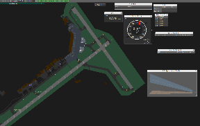{#fig:grp-display-1 width=48%}

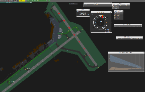{#fig:grp-display-2 width=48%}

[6.1(b)] It also provides for the selection of various mapping layers which you may choose to show, or not. See [[fig:grp-map-selection]].

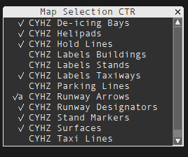{#fig:grp-map-selection width=45%}

[6.1(c)] The list contents are selectable. See [[fig:grp-list-fields]].

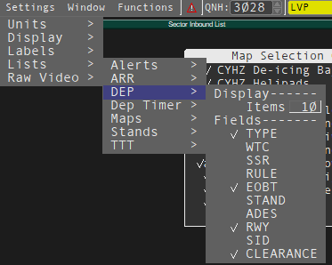{#fig:grp-list-fields width=60%}

[6.1(d)] Full documentation is provided in the plugin folder.

[6.2] # XPGuard

[6.2(a)] XPGuard provides ATC control of stop bars, runway status lights, Follow-me vehicles and Low Visibility Procedures at CYHZ and CYYT. Pilots need to be operating with the corresponding add-ons in their aircraft to see the lights and follow-me vehicles.

[6.2(b)] See https://xpguard.net/ and videos in https://www.youtube.com/@XPGuard-p3 for additional information.

[6.2(c)] Our concept for the operations of these lights is as follows:

- In real life, stop bars are only provided for use during LVOP. We have chosen to apply them for routine operations to help avoid runway incursions.
- In real life, controllers are provided with A-SMGCS and RIMCAS as tools to alert them to potential runway incursions, without the application of physical lights. In our context, we need the lights to be provided with the alerts.
- Pilots can ask for follow-me vehicles or progressive taxi instructions to help guide them along unfamiliar routes. This enables that.
- During LVOP, special taxiway centreline lighting is provided. We use a Follow The Green (FTG), which is not in use in Canada, capability to simulate the use of LVOP lighting by illuminating the path to / from the low vis runway. Note that LVOP lighting is not provided along RWY 16/34 in CYYT due to plugin limitations.

[6.3] # CDM

[6.3(a)] The Collaborative Decision Making (CDM) plugin is available to assist in managing the push back sequence during events.

[6.3(b)] More information on its use will be provided later.

[7] # Glossary

[7.1] # Terms

| Term                                         | Definition                                                                                                                          |
| -------------------------------------------- | ----------------------------------------------------------------------------------------------------------------------------------- |
| Apron                                        | Aircraft parking and servicing area. Normally uncontrolled, but may be controlled if congestion is expected.                        |
| CDF                                          | Central De-Ice Facility                                                                                                             |
| CFL (Cleared Flight Level)                   | The altitude cleared for the aircraft to climb to, updated based on the SID altitude.                                               |
| Clearance Delivery                           | A controller position responsible for issuing IFR clearances, assigning SSR codes, and ensuring flight plan compliance.             |
| Crosswind Limits                             | Maximum crosswind values for safe operations: 25 knots on dry runways, 15 knots on wet runways (as per NAV CANADA guidance material). |
| CYHZ / CYQM / CYFC / CYSJ / CYYT / CYQX      | ICAO codes for Halifax, Moncton, Fredericton, Saint John, St. John’s, and Gander airports respectively.                             |
| Departure Sequencing (Ground Sequencing)     | Strategic sequencing of aircraft on the ground to optimize departure flow and meet restrictions.                                    |
| FIR (Flight Information Region)              | A region of airspace in which flight information and alerting services are provided. CZQM is one such FIR on VATSIM.                |
| Flight Plan Validation                       | The process by which a controller reviews a flight plan for accuracy, route compliance, and assigns SID, CFL, and SSR code.         |
| Ground Controller                            | Responsible for managing taxi operations and may control apron pushbacks during congestion.                                         |
| LAHSO                                        | Land And Hold Short Operations. A procedural method to de-conflict runways through the use of landing restrictions.                 |
| Low Vis Ops                                  | Specific Taxi routes and procedures for use to / from CAT II runways when the RVR is between 600 and 1200 feet.                     |
| METAR / SPECI                                | Official aviation weather reports. VATSIM controllers must use these rather than real-time weather feeds.                           |
| NAV CANADA AeroView                          | Online tool providing weather, RVR, and crosswind analysis—not to be used for controlling on VATSIM. https://spaces.navcanada.ca/workspace/aeroview/ |
| NAV CANADA guidance material                 | NAV CANADA’s published reference material for air traffic control procedures. Referenced here for crosswind limits and for the phraseology in [[5]]. |
| Pushback Clearance                           | Authorization for an aircraft to reverse from a gate position; normally uncontrolled unless apron congestion requires intervention. |
| RVR                                          | Runway Visual Range. Measured and reported ground visibility (Feet).                                                                |
| SID (Standard Instrument Departure)          | A pre-defined route for departing aircraft to transition from the airport to the enroute structure. Assigned by Clearance Delivery. |
| SSR Code (Secondary Surveillance Radar Code) | A transponder code assigned to each IFR flight, used for radar identification.                                                      |
| Top-Down Control                             | When an upper controller (e.g., CTR) provides services for lower positions (e.g., TWR, GND) if they are unstaffed.                  |
| Tower Controller                             | Responsible for runway operations including takeoffs, landings, and local traffic separation.                                       |
| VATSIM                                       | Virtual Air Traffic Simulation Network; a global network simulating real-world ATC and flight operations.                           |
| Visual Traffic                               | Aircraft operating under VFR within the airport control zone, requiring separation from IFR aircraft by the tower.                  |
