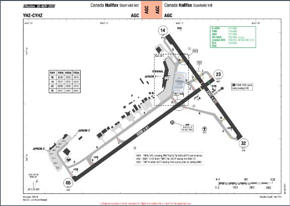
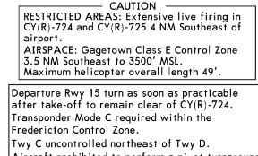
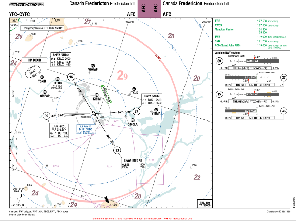
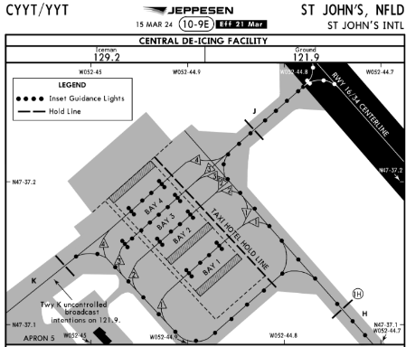
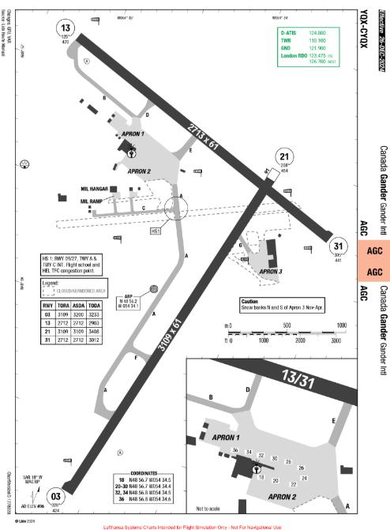

[1] # Control Pages

[1.1] # Document Identification

| Item           | Value                              |
| -------------- | ---------------------------------- |
| Name           | CZQM FIR Tower Operating Practices |
| Identification | CZQM-TWR                           |
| Type           | Operating Practices                |
| Revision       | 1.3                                |
| Effective Date | To be confirmed                    |

[1.2] # Revision Records

| Revision ID | Effective Date   | Description of Change                                                                                                 |
| ----------- | ---------------- | --------------------------------------------------------------------------------------------------------------------- |
| 1.0         | 2025-05-24 0300Z | Initial version                                                                                                       |
| 1.1         | 2025-08-15 0300Z | Modification to 4.1.2.2 compulsory routes to reflect real world changes                                               |
| 1.2         | 2025-12-27 0400Z | Editorial. Change markups. Further mods to 4.1.2.2 mandatory routes. Additional procedures added for several airports |
| 1.3         | To be confirmed  | Reformat document to use CZQM docengine. [[2.2]] reflects new git based tracking.                                     |

[2] # Introduction

[2.1] # Scope and Applicability

[2.1(a)] This document is intended to provide operational guidance to CZQM controllers providing services to virtual pilots from this FIR’s control towers, either directly or indirectly (top-down).

[2.1(b)] FIR policies are contained in the Moncton / Gander FIR General Policy document (CZQM-FGP§2.1).

[2.2] # Amendments

[2.2(a)] Amendments to this document are tracked and versioned using the CZQM-FIR/policies GitHub repository.

[3] # Control Tower Positions – Generic Guidance

[3.1] # Clearance Delivery

[3.1(a)] A clearance delivery controller provides clearances after verifying the validity of a requested flight plan route. This role includes adjusting flight plans where appropriate.

[3.1(b)] When reviewing and validating the filed flight plans, Clearance Delivery shall:

- Assign an SSR code.
- Assign the appropriate SID.
- Update the Cleared Flight Level (CFL) field to reflect the SID altitude. This is 5000 ft or 050 in ATC notation.
- Ensure that the flight plan route is compliant with unit directives.

[3.2] # Ground

[3.2(a)] A ground controller is tasked with providing control instructions to aircraft operating on movement areas, such as taxiways, to and from runways and parking positions.

[3.2(b)] Ground controllers also provide what VATSIM calls Ground Sequencing. A ground sequencing controller is involved in strategic sequencing of departing traffic (on the ground), planning delays and meeting restrictions set on departures. Ground controllers should sequence departures to provide optimally efficient use of the active runway(s).

[3.2(c)] In this FIR, apron surfaces are normally uncontrolled. However, if the ground controller is of the opinion that congestion exists or will soon exist on an apron, the controller is allowed to take control of the apron and issue pushback clearances and other instructions as necessary to mitigate potential disruptions.

[3.3] # Tower

[3.3(a)] A tower controller provides instructions relating to movements on or near runways, including take-off and landing clearances and managing the separation of local visual traffic.

[3.3(b)] As specified in NAV CANADA MANOPS, crosswind limits (considering gusts) are 25 kt for dry runways and 15 knots for wet runways.

[3.3(c)] The NAV CANADA AeroView website provides access to “Live RVR” pages for CYFC, CYHZ, CYQM, CYQX, and CYYT. These pages include current airport information and crosswind analysis that is useful in calculating crosswind components. Controllers are reminded that the VATSIM environment only uses published METAR and SPECI weather products to control the environment. Controllers should not use the live winds shown on these pages as they may not reflect the weather experienced by our customers.

[3.3(d)] Pilots requesting a different runway for operational reasons should be accommodated.

[4] # Unit-Specific Guidance

[4.1] # CYHZ

[4.1(a)] Layout

[4.1(a)(i)] Runways and Taxiways are as per [[fig:cyhz-airport]]. The default runway in use at CYHZ is runway 23. It should be selected unless crosswind or tailwind limits are exceeded. Normally tailwind > 5 kts or crosswind > 15 kts, inclusive of gusts, unless otherwise specified by the pilot.

{#fig:cyhz-airport width=90%}

[4.1(a)(ii)] Taxiway N leading to Runway 14 is not depicted in the default MSFS 2020 scenery. Backtracking may be required.

[4.1(a)(iii)] We understand Taxiway A to terminate in line with the west side of the terminal apron (Apron 1), becoming Apron 1 at that time.

[4.1(b)] Low Vis Procedures (RVR <1200 > 600)

[4.1(b)(i)] Low visibility Taxi Routes for RWY 23 are as depicted in [[fig:cyhz-low-visibility]]. Flight simulator scenery does not support the required lights.

{#fig:cyhz-low-visibility width=70%}

[4.1(c)] Land and Hold Short Operations (LAHSO)

[4.1(c)(i)] Land And Hold Short Operations (LAHSO) are published for Runway 05 to hold short of runway 14/32. During such operations, you may authorize simultaneous landings or a simultaneous landing and takeoff by restricting the aircraft landing on runway 05 to hold short of the other active runway (14 or 32).

[4.1(c)(ii)] Conditions for use of LAHSO include:

- The entire runway surface is DRY (RSC 6/6/6).
- Weather is VMC.
- Crosswind not to exceed 25 knots, including gusts, and no tailwind; or,
- If a tailwind < 10 kts is present, pilot requests the runway where a hold-short restriction will be issued or the controller suggests that runway and the pilot accepts.

[4.1(c)(iii)] Phraseology.

- Before or with the landing clearance, and in time for the pilot to take another action if required, issue a hold-short instruction and traffic information. A pilot who prefers to use the full length of a runway or a different runway is expected to advise the controller in time to allow for other arrangements.
- Get a readback of the hold-short instruction.  
  HOLD SHORT (runway ID), [9500 FEET AVAILABLE TO THE INTERSECTION], (traffic) CLEARED TO LAND (runway ID).
- To the aircraft without the Hold-short Restriction, issue traffic details either before or with a take-off or landing clearance, and in time for the pilot to take another action.  
  (traffic) WILL HOLD SHORT (runway ID), CLEARED (TO LAND / FOR TAKEOFF) (runway ID).

[4.1(d)] Apron Management

[4.1(d)(i)] In the real world, Halifax aprons are uncontrolled. Pilots are expected to exercise judgment to avoid collisions.

[4.1(d)(ii)] During busy events, such as Moncton Mondays, it will be up to the discretion of the Ground Controller whether to manage one or several apron(s). In such a case, pushbacks, pushback directions, etc. will be as directed by Ground.

[4.1(e)] De-icing

[4.1(e)(i)] De-icing at CYHZ is performed at one of the de-icing bays. See [[fig:cyhz-deicing]]. The De-icing bays are located on Apron 1 and are normally uncontrolled, see [[4.1(d)(ii)]] above. Aircraft will call for taxi clearance after having been de-iced.

{#fig:cyhz-deicing width=80%}

[4.1(e)(ii)] It is possible for large cargo aircraft to be de-iced at Stand 301 as well.

[4.1(f)] Routes

[4.1(f)(i)] Pilots often include the Halifax VOR [YHZ] in their flight plan. It should be removed.

[4.1(f)(ii)] This table shows the mandatory routes from CYHZ – CYHZ Clearance Delivery should not seek out exceptions to these from higher positions:

| Destination            | Conditions                                  | Initial Route                              |
| ---------------------- | ------------------------------------------- | ------------------------------------------ |
| CYYZ CYUL [Northwest]  | Jet aircraft                                | KELNO MOWND Q806                           |
| [Northwest]            | Non-Jet aircraft                            | DUSEN TOPPS                                |
| [Northwest] (1)        | Jet aircraft                                | KELNO EMLOB                                |
| KBOS                   |                                             | ACADN DUVIN [EURRO or AJJAY] OOSHN (2)     |
| KBOS                   | Non-Jet aircraft                            | ACADN ALLEX Q822 ENE PEASE STEVO LWRNC (2) |
| [West] (JFK, EWR, BDL) |                                             | ACADN DUVIN                                |
| [West]                 | Those who must remain within 50NM from land | SENVI VIGMA ALLEX (3)                      |
| CYYT [East]            |                                             | IGTAS NOTOP PERLU                          |
| CYYG [Northeast]       | Depart RWY 23                               | KELNO                                      |
| CYYG [Northeast]       | Not Departing 23                            | KATLO                                      |
| CYQM                   |                                             | KELNO CYQM (4)                             |

CYHZ Compulsory outbound Routes – Source: Canada Flight Supplement / Planning / Mandatory IFR Routes.

1. Alternative routing normally for those aircraft going further West than YYZ.
2. To comply with BVA CZQM Letter of Agreement.
3. This route will not normally be approved.
4. Or as previously requested by IFR control.

[4.2] # CYQM

[4.2(a)] Layout

[4.2(a)(i)] See [[fig:cyqm-airport]].

{#fig:cyqm-airport width=100%}

[4.2(b)] Aprons

[4.2(b)(i)] The aprons are uncontrolled.

[4.2(b)(ii)] The De-icing facility is located on Apron 8. Aircraft are expected to de-ice at the pad and then call Ground for Taxi.

[4.3] # CYFC

[4.3(a)] Layout

[4.3(a)(i)] Be aware of the Restricted airspace to the Southeast. See [[fig:cyfc-cautions]], [[fig:cyfc-airspace]], and [[fig:cyfc-airport]].

{#fig:cyfc-cautions width=60%}

{#fig:cyfc-airspace width=90%}

{#fig:cyfc-airport width=100%}

[4.4] # CYYT

[4.4(a)] Layout

[4.4(a)(i)] Microsoft charts are not included for CYYT, and the default scenery is terrible… See [[fig:cyyt-airport]].

{#fig:cyyt-airport width=100%}

[4.4(b)] Low Vis Procedures (RVR <1200 > 600)

[4.4(b)(i)] Low visibility Taxi Routes for RWY 10/28 are as depicted in [[fig:cyyt-low-visibility]]. Flight simulator scenery does not support the required lights…

{#fig:cyyt-low-visibility width=90%}

[4.4(c)] Aprons

[4.4(c)(i)] All aprons are uncontrolled.

[4.4(c)(ii)] De-icing. See [[fig:cyyt-deicing]].

{#fig:cyyt-deicing width=80%}

Aircraft will be taxied to the Central De-icing Facility via TWY H to hold short of the facility. Aircraft shall be instructed to contact Ground when de-ice is complete. Aircraft will then proceed, as per a notional ICEMAN’s instructions, to a suitable Bay to be de-iced. Once the procedure is completed, they will contact Ground for Taxi. Note that aircraft approaching the De-Ice Facility from K are uncontrolled.

[4.5] # CYQX

[4.5(a)] CYQX is a shadow of its former self. Note the backtracks required for several runways. There are several abandoned areas. There is no CDF. See [[fig:cyqx-airport]].

{#fig:cyqx-airport width=80%}

[5] # Glossary

[5.1] # Terms

| Term                                         | Definition                                                                                                                          |
| -------------------------------------------- | ----------------------------------------------------------------------------------------------------------------------------------- |
| Apron                                        | Aircraft parking and servicing area. Normally uncontrolled, but may be controlled if congestion is expected.                        |
| CDF                                          | Central De-Ice Facility                                                                                                             |
| CFL (Cleared Flight Level)                   | The altitude cleared for the aircraft to climb to, updated based on the SID altitude.                                               |
| Clearance Delivery                           | A controller position responsible for issuing IFR clearances, assigning SSR codes, and ensuring flight plan compliance.             |
| Crosswind Limits                             | Maximum crosswind values for safe operations: 25 knots on dry runways, 15 knots on wet runways (as per NAV CANADA MANOPS).          |
| CYHZ / CYQM / CYFC / CYSJ / CYYT / CYQX      | ICAO codes for Halifax, Moncton, Fredericton, Saint John, St. John’s, and Gander airports respectively.                             |
| Departure Sequencing (Ground Sequencing)     | Strategic sequencing of aircraft on the ground to optimize departure flow and meet restrictions.                                    |
| FIR (Flight Information Region)              | A region of airspace in which flight information and alerting services are provided. CZQM is one such FIR on VATSIM.                |
| Flight Plan Validation                       | The process by which a controller reviews a flight plan for accuracy, route compliance, and assigns SID, CFL, and SSR code.         |
| Ground Controller                            | Responsible for managing taxi operations and may control apron pushbacks during congestion.                                         |
| LAHSO                                        | Land And Hold Short Operations. A procedural method to de-conflict runways through the use of landing restrictions.                 |
| Low Vis Ops                                  | Specific Taxi routes and procedures for use to / from CAT II runways when the RVR is between 600 and 1200 feet.                     |
| MANOPS (Manual of Operations)                | NAV CANADA’s official reference for air traffic control procedures. Referenced here for crosswind limits.                           |
| METAR / SPECI                                | Official aviation weather reports. VATSIM controllers must use these rather than real-time weather feeds.                           |
| NAV CANADA AeroView                          | Online tool providing weather, RVR, and crosswind analysis—not to be used for controlling on VATSIM.                                |
| Pushback Clearance                           | Authorization for an aircraft to reverse from a gate position; normally uncontrolled unless apron congestion requires intervention. |
| RVR                                          | Runway Visual Range. Measured and reported ground visibility (Feet).                                                                |
| SID (Standard Instrument Departure)          | A pre-defined route for departing aircraft to transition from the airport to the enroute structure. Assigned by Clearance Delivery. |
| SSR Code (Secondary Surveillance Radar Code) | A transponder code assigned to each IFR flight, used for radar identification.                                                      |
| Top-Down Control                             | When an upper controller (e.g., CTR) provides services for lower positions (e.g., TWR, GND) if they are unstaffed.                  |
| Tower Controller                             | Responsible for runway operations including takeoffs, landings, and local traffic separation.                                       |
| VATSIM                                       | Virtual Air Traffic Simulation Network; a global network simulating real-world ATC and flight operations.                           |
| Visual Traffic                               | Aircraft operating under VFR within the airport control zone, requiring separation from IFR aircraft by the tower.                  |
